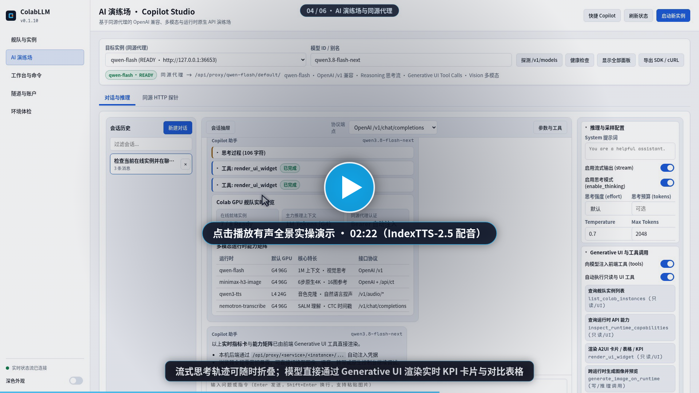

# ColabLLM（Google Colab / Kaggle 云端大模型与工具服务）

在 Google Colab（T4/L4/A100/H100/G4/CPU）与 Kaggle 交互式会话（CPU/GPU/TPU）上运行大模型与工具服务，通过 Cloudflare Tunnel（默认）或 FRP + Caddy 提供公网访问。
遵循 **“一个服务 = 一个 notebook (`src/colabllm/services/<name>.ipynb` 或 `src/colabllm/kaggle_services/<short_name>.ipynb`) + 一个执行脚本 (`.py`)”** 的约定。

## 功能实操视频

[](https://github.com/deluxebear/colabllm/blob/master/docs/assets/colabllm-walkthrough.mp4)

> **有声全景导览（02:22 · IndexTTS-2.5 配音）**：点击上方预览图打开 [GitHub 在线视频播放器](https://github.com/deluxebear/colabllm/blob/master/docs/assets/colabllm-walkthrough.mp4)，查看统一 CLI、Web 舰队管控与 **AI 演练场（Copilot Studio · 同源安全代理 · 多模态与专有 API 控制台）** 完整实操演示（[直接下载 MP4](https://github.com/deluxebear/colabllm/raw/master/docs/assets/colabllm-walkthrough.mp4)）。

## 统一命令入口

用户通过分发包安装，无需克隆源码。从 [GitHub Releases](https://github.com/deluxebear/colabllm/releases) 下载 wheel 后安装（私有仓库需要相应访问权限）：

```bash
uv tool install ./colabllm-1.3.0-py3-none-any.whl
# 如果命令目录尚未加入 PATH
uv tool update-shell
```

版本发布到 PyPI 后，也可以直接安装和升级：

```bash
uv tool install colabllm
uv tool upgrade colabllm
```

之后可以在任意目录使用 `colabllm <运行时名称> <命令> [参数...]`：

```bash
colabllm services                       # 列出全部运行时
colabllm minimax-h3-image up            # 默认 G4（SGLang Diffusion 原生 4K 生图 / 1-16 图编辑）
colabllm minimax-h3-image generate "Rain-soaked Tokyo alley at dusk" --tier 2k -o alley.webp
colabllm unlimited-ocr up                # 默认 A100
colabllm unlimited-ocr ocr ./documents -O ./results
colabllm unlimited-ocr resume JOB_ID --wait
colabllm oxr up                          # 默认 A100（SoMark OXR-1.0 文档解析，/demo 浏览器 UI）
colabllm oxr parse ./document.pdf -O ./parsed
colabllm qwen3-tts up -i 2
colabllm comfyui up
colabllm ollama up --dry-run
colabllm unlimited-ocr --help

# Kaggle 交互式会话运行时（独立子命令命名空间，不依赖 Google Drive）
colabllm kaggle services                        # 列出全部 Kaggle 运行时
colabllm kaggle web-probe up --quick-tunnel     # 纯 CPU 探针（不消耗 GPU/TPU 周配额）
colabllm kaggle -a work web-probe up --domain   # 指定 Kaggle 账户并绑定固定域名 kaggle-web-probe.example.com
colabllm kaggle web-probe restart               # 原地重启远端 Jupyter 内核并复用 /kaggle/working/.ct-cache
colabllm kaggle web-probe status --json
colabllm kaggle web-probe down
colabllm doctor --provider all                  # 同时核验 Colab 与 Kaggle 本机依赖及账户状态

# 项目级配置与本地控制台/网关也使用同一入口
colabllm web
colabllm web -d                         # 后台运行，并支持 --status / --stop
colabllm web --port 8765 --read-only
colabllm gateway -d                     # 常驻 OpenAI/Anthropic 兼容聚合网关（默认 127.0.0.1:8787）
colabllm gateway token create pi-agent  # 签发命名客户端 Token（clgw_...，磁盘仅存 SHA-256）
colabllm gateway --status               # 查询网关与各副本槽位快照（支持 --json / --stop）
colabllm tunnel-config
colabllm frp-config --help
colabllm frp-status
```

所有运行脚本和 notebook 都包含在安装包中。本地相对输入/输出路径按调用时所在目录解析。
本项目的配置和运行状态统一写入 `~/.colabllm/`，不读取仓库旧 `.state/`，不提供旧配置迁移。
可设置 `COLABLLM_HOME=/absolute/path` 使用独立目录。

```text
~/.colabllm/
├── tunnel-config.json                # 全局主域名与 FRP 设置
├── services/<name>/state.json        # Colab 实例凭据、会话、隧道与 runner PID
├── services/<name>/run.log           # Colab 运行日志；执行用 notebook 也在实例目录
├── kaggle/services/<name>/state.json # Kaggle 实例凭据、Kernel 会话、隧道与 runner PID
├── kaggle/services/<name>/run.log    # Kaggle 运行日志；clean.ipynb 与 runtime.env 在实例目录
├── web/                              # 本地 Web 控制台状态与 web.log
├── gateway/                          # 本地聚合网关 tokens.json、state.json 与 gateway.log (0600)
└── frp/<server-id>.json              # FRP 私密凭据
```

`colab`（含 `colab-ext`）、`kaggle`（含 `kaggle-ext`）、`cf` 和 `ssh` 的授权/配置仍由各自工具管理；Google Drive 数据仍保存在远端。
卸载使用 `uv tool uninstall colabllm`，用户配置目录保留。
升级前先停止运行中的服务，升级后重新启动，避免后台 runner 依赖的安装文件被替换。

### 更换电脑（沿用相同域名与 API Key）

域名归属和凭据只保存在本机 `~/.colabllm/`。在另一台电脑上直接执行 `up --domain` 会遇到：

- **FRP 后端无法启动**：新电脑执行 `frp-config` 会生成新的 `project_id`，已有 DNS 记录和 FRP 服务器路由属于旧 `project_id`，`up` 会以 `DNS conflict` 拒绝接管（防止误抢域名）。
- **API Key 改变**：新电脑没有 `state.json`，会生成新的 Token，客户端中配置的旧 Key 全部返回 401。
- **Cloudflare 后端双连接**：隧道与 DNS 按服务名复用、不区分电脑；若两台电脑同时运行同一服务，请求会在两台 VM 间轮流分发（Key 不同时随机 401）。
- **重复计费**：旧电脑的 runner 未停止时，旧 Colab VM 会继续运行，新电脑会再创建一台。

同一服务、同一实例同一时间只应由一台电脑运行。迁移步骤：

```bash
# 1. 旧电脑：停止服务；不要加 --delete-tunnel，以保留域名路由与 DNS 归属
colabllm <name> down

# 2. 复制整个状态目录到新电脑（含私密凭据，保持仅本人可读）
rsync -a --chmod=go-rwx ~/.colabllm/ <新电脑>:~/.colabllm/

# 3. 新电脑：安装 colabllm，并完成外部工具授权
#    colab 登录 + `colab drive consent`；如需 Kaggle 则完成 `kaggle account login`；
#    同一 Cloudflare 账号的 `cf` 登录；FRP 后端还需能 SSH 到服务器
colabllm tunnel-config            # 确认主域名与 FRP 配置已带过来
colabllm doctor --provider all

# 4. 新电脑：启动，域名、API Key 与 FRP 路由保持不变
colabllm <name> up --domain
# Kaggle 运行时同理：
colabllm kaggle web-probe up --domain
```

`~/.colabllm/` 中与迁移相关的文件：`tunnel-config.json`（主域名、FRP `project_id`）、`frp/*.json`（FRP 客户端凭据）、
`services/<name>/state.json` 与 `kaggle/services/<name>/state.json`（API Key / 登录密码、隧道与 DNS 记录）。若确实需要两台电脑同时运行同一服务，
请使用不同实例（如 `-i 2`），它们使用独立的子域名、状态和 Key。

## 运行时使用指南

每个运行时的具体命令、API/UI 工作流、输入输出及恢复语义见下方“各运行时使用文档”表。
共享规则集中在 [运行时通用操作](https://github.com/deluxebear/colabllm/blob/master/docs/runtime-common.md)，可先阅读以理解认证、Drive 路径、超时和多实例。
`docs/<运行时>.md` 是用法说明的维护来源，用户技能内的对应参考由同步工具生成：

```bash
python tools/sync_runtime_docs.py
python tools/sync_runtime_docs.py --check
```

修改用法或新增运行时后需同步；本地测试及 CI 会检查指南完整性、示例参数和技能内容一致。

## 安装 Agent Skill

根目录 [skills/colabllm](https://github.com/deluxebear/colabllm/blob/master/skills/colabllm/SKILL.md) 提供面向使用者的独立技能，覆盖本项目所有运行时。
它包含按任务加载的 OCR、语音、推理、媒体和排错参考，不依赖源码仓库或个人部署配置。

wheel 和源码包均包含完整技能，安装 CLI 后即可导出：

```bash
# 查看主技能说明
colabllm skill

# Codex：将完整 colabllm/ 技能目录导出到个人技能目录
colabllm skill --output "${CODEX_HOME:-$HOME/.codex}/skills"

# 支持 ~/.agents/skills 的 Agent
colabllm skill --output ~/.agents/skills

# 其他 Agent：指定其实际技能目录
colabllm skill --output /path/to/agent/skills
```

`--output` 是技能父目录，实际生成 `<目录>/colabllm/SKILL.md` 和 `references/`。
目标已存在时返回错误，不覆盖用户修改。更新时先导出到新目录，比较后替换；CLI 升级不会自动覆盖已安装的技能。
也可以直接从源码复制整个 `skills/colabllm/` 目录。安装后按 Agent 的方式重新加载技能或开启新会话，
再请求“使用 colabllm 将本地 PDF 转为 Markdown”等任务。

仓库内 `.agents/skills/colab-llm-service/` 是维护者技能；分发给使用者的是 `skills/colabllm/`。

## 开发、构建与发布

```bash
# 开发安装：修改源码立即生效，源码目录需要保留
uv tool install --editable .

# 普通本地安装 / 更新
uv tool install --force .

# 构建 wheel 和源码分发包（dist/）
uv build --no-sources

# 验证 wheel 在隔离环境中的安装与运行
python tools/check_distribution.py dist/colabllm-1.3.0-py3-none-any.whl
```

版本号以 `pyproject.toml` 为唯一来源，CLI 从已安装包元数据读取版本。
采用 `MAJOR.MINOR.PATCH`：修复递增 PATCH、新功能递增 MINOR、不兼容变更递增 MAJOR；
在 `0.x` 开发阶段，不兼容变更递增 MINOR，并在 [CHANGELOG.md](https://github.com/deluxebear/colabllm/blob/master/CHANGELOG.md) 中说明。
当前版本为 `1.3.0`，对应 Git 标签 `v1.3.0`；后续发布示例：

```bash
uv version --bump patch
# 将 CHANGELOG.md 的 Unreleased 内容整理到本次版本的日期条目
python tools/check_release.py --tag v1.3.1
git add pyproject.toml CHANGELOG.md README.md
git commit -m "chore: release 1.3.1"
git tag -a v1.3.1 -m "Release 1.3.1"
git push origin master
git push origin v1.3.1
```

推送 `v*` 标签触发 [release.yml](https://github.com/deluxebear/colabllm/blob/master/.github/workflows/release.yml)：

1. 验证标签、包版本和变更记录一致，复用 Linux/macOS × Python 3.12–3.14 CI。
2. 构建 wheel 和 sdist，验证隔离安装，生成 SHA256SUMS 并保存 Actions artifact。
3. 发布 GitHub Release，附带安装包及校验文件，发布说明取自当前版本的 CHANGELOG 条目。
4. 将同一组已验证的包通过 Trusted Publishing 上传 PyPI。

首次启用 PyPI 需要项目所有者在 [PyPI Publishing](https://pypi.org/manage/account/publishing/)
添加 Pending Publisher：项目 `colabllm`、Owner `deluxebear`、Repository `colabllm`、
Workflow `release.yml`、Environment `pypi`。已有 PyPI 项目则在项目 Publishing 设置添加同样的发布者。
Actions 使用 `pypi` environment 和 OIDC，无需配置长期 PyPI API Token。
参考 [PyPI Trusted Publisher 说明](https://docs.pypi.org/trusted-publishers/creating-a-project-through-oidc/)。

PyPI 上传失败时，GitHub Release 仍可下载；修复身份配置后在 Actions 选择 **Re-run failed jobs**。
也可以针对已有标签手动运行 release workflow；已发布的 GitHub Release 会拒绝被覆盖，应优先只重跑失败任务。
已发布版本不移动标签或替换安装包，修复后发布新版本。
通过本地 wheel 安装的用户可安装新 wheel 更新；通过 PyPI 安装的用户使用 `uv tool upgrade colabllm`。

## CLI 行为约定

- `colabllm <服务> --help` 列出生命周期和服务专用命令；`colabllm help <服务> <命令>` 查看详细帮助。
- `-i/--instance` 可放在服务参数的任意位置，`--` 之后按字面解析；实例 ID 必须为 1–64 位字母、数字、下划线或连字符，且不能以连字符开头。
- `--account`（或环境 `COLABLLM_ACCOUNT` / `COLAB_ACCOUNT`）可指定本次使用的 Colab 账户（档案名或邮箱，`up` 与 `doctor` 同时支持 `-a/--account`）；`up --drive-account` 可额外指定共享网盘凭据账户。`up` 启动后会把解析到的账户与网盘绑定写入该实例 `state.json`，后续 `--auto-restart` 自动重拉、`status` 与 `down` 都会锁定原账户，不受之后终端 `colab account use` 切换活动账户影响。
- 普通结果写入 stdout，进度和告警写入 stderr；`--json` 的 stdout 只包含 JSON。
- `info`、`ps`、`list`、`status` 支持 `--json`，默认隐藏凭据；需要时显式加 `--show-secrets`。
- `--quiet` 抑制诊断进度，错误仍然显示；`--no-color` 或 `NO_COLOR` 关闭诊断颜色。非终端输出自动关闭诊断颜色。
- 常见网络、文件和配置错误默认给出简洁提示；`--debug` 显示异常堆栈。
- 成功退出码为 0；操作失败为非零，参数用法错误为 2；外部 Colab 命令失败时保留其正退出码；Ctrl+C 为 130。
- 就绪标记只接受完整的 `CT_READY` 协议行；日志中的普通文字提及不会被视为就绪。
- `up` 默认等待 `CT_READY`；等待超时返回失败，但后台 runner 保留。`up --detach` 仅启动后台 runner，立即返回；`up --foreground` 在当前终端保持连接。
- `up --auto-restart`（可选 `--idle-check SECONDS`、`--restart-delay SECONDS`、`--max-restarts N`）开启所有运行时通用的掉线自动拉起守护：监听 `colab exec` 退出（默认 `3s` 后核实）及每 `10s` 公网边缘探针 + `--idle-check`（默认 5 分钟）兜底的 `colab status` 远端核实，网络闪断时直接重连原 VM 并在服务可用时立即恢复 `ready` 状态，VM 被 Colab 回收时立即清理残留会话并按原 GPU 规格重新建卡、挂载 Drive 与恢复服务（固定域名与 `api_token` 不变）；执行 `down` 时正常停止。
- 同一实例的启动和停止互斥；状态事务使用文件锁和原子替换。前台/后台 runner 都记录进程启动身份，停止前校验身份并等待退出。
- `down` 先确认远端停止成功，再停止本地连接并清理运行状态；远端停止失败时保留连接和追踪信息，便于重试。
- **`colabllm kaggle` 运行时约定**：命令形态为 `colabllm kaggle [-a ACCOUNT] <short_name> <命令> [参数...]`（服务与实例组合会话名 `<short_name[-inst]>` 长度上限 `48` 字符）；账户解析遵循 `-a/--account` > `COLABLLM_KAGGLE_ACCOUNT` > `KAGGLE_ACCOUNT` > `kaggle-ext` 当前活动账户，并在 `state.json` 锁定实例归属账户；非 CPU 会话启动前预检每周剩余配额 `remaining_hours > 0.15` 并默认实施宿主机 `--max-uptime 6h` 上限，首次到达 `CT_READY` 前异常、中断或超时会自动调用 `kaggle session stop` 防止遗留孤儿计费会话。
- 携带认证信息的 HTTP 请求拒绝跨来源重定向。`--url` 或服务 URL 环境变量切换来源时，需要显式提供 Token，不能自动借用原服务的凭据。来源按协议、主机和有效端口比较。

## 超时与环境诊断

```bash
# 外部命令上限：可放在服务名前后，也可设置 COLABLLM_COMMAND_TIMEOUT
colabllm --command-timeout 60 ollama status

# 默认模式超时只停止等待，后台 runner 保留；前台模式超时会断开本地连接
colabllm ollama up --ready-timeout 600
colabllm ollama up --foreground --ready-timeout 600

# 轮询等待上限：0 保留不限时行为；每次请求也会受剩余时间约束
colabllm unlimited-ocr job JOB_ID --wait --timeout 300
colabllm minimax-h3-image job JOB_ID --wait --timeout 300
colabllm comfyui pull-workflow TEMPLATE --timeout 300 --poll 2
colabllm longcat-avatar job JOB_ID --wait --timeout 300

# 默认只检查本机依赖、Drive 扩展、当前或指定账户授权文件与用户配置
colabllm doctor
colabllm doctor -a gpu2 --online --timeout 10
colabllm doctor --provider kaggle --online --timeout 10
colabllm doctor --json --transport quick --no-drive

# 额外验证 Colab、Cloudflare、SSH 授权，按选中的后端执行限时只读检查
colabllm doctor --online --timeout 10
```

超时退出码为 `124`。长驻的 `colab exec` 保活连接不受通用外部命令上限影响。
未指定 `--command-timeout` 时，共享外部命令默认 300 秒，个别下载或 SSH 操作保留专属默认上限。
`doctor` 不创建 GPU 会话、不挂载 Drive、不修改隧道，也不显示凭据或外部命令的原始输出。
离线检查不会证明授权仍有效；需要时使用 `--online`，该模式禁用浏览器交互并限制每项检查时间。

## Shell 补全

命令、选项和枚举值来自实际解析器；实例 ID 从 `~/.colabllm/services/` 与 `~/.colabllm/kaggle/services/` 的目录名读取，同时离线补全 `colabllm kaggle` 运行时名及 `colab-ext` / `kaggle-ext` 账户名；补全过程不读取凭据、不联网。

```bash
# Bash：在当前 Shell 加载
source <(colabllm completion bash)

# Zsh：先启用补全系统，再加载
# autoload -Uz compinit && compinit
source <(colabllm completion zsh)
```

Fish 中执行 `colabllm completion fish | source`。需要持久启用时，将相应加载命令加入自己的 Shell 初始化文件，
或将脚本保存在 `~/.colabllm/completions/` 后从初始化文件加载。

## 测试

本地 CLI 与控制逻辑使用 Python 标准库，默认测试无需 Torch、NumPy 或 GPU：

```bash
python -m unittest discover -s tests
```

`tests_colab/` 单独保存 Colab 端模型代码的回归测试（如 LongCat attention 和音频分段）。
它们会导入模型运行代码，仅在对应的 Colab 服务环境中运行；attention 测试还需要 CUDA 和上游 LongCat 源码。
在该环境中，将项目源码放入 VM 后执行：

```bash
# LongCat-Video VM 使用 /content/longcat-video/repo；Avatar VM 使用 /content/longcat-avatar/repo
PYTHONPATH=/content/longcat-video/repo python -m unittest discover -s tests_colab
```

GitHub Actions 在 Linux/macOS、Python 3.12/3.13/3.14 上运行本地测试、三种 Shell 补全测试、构建和隔离 wheel 安装验证。工作流不执行模型测试、不启动 Colab、不自动发布包。

本地缺少 Zsh/Fish 时跳过对应 Shell 集成测试；CI 会安装这些 Shell。
本地测试中的真实 FRP 集成测试需额外指定 `COLABSVC_FRP_TEST_BIN`，默认跳过。

## 架构与职责

| 阶段 / 职责 | 执行位置 | 说明 |
| --- | --- | --- |
| 创建/复用远端会话 (`colab new` / `kaggle session create`) | 本地脚本 `services/` 与 `kaggle_services/` | 按选定账户隔离会话：Colab 传递 `COLAB_ACCOUNT`，Kaggle 通过 `--account` 创建私密占位内核 `<username>/kaggle-ext-s-<session>` |
| 免浏览器挂载网盘（仅 Colab：`colab drive mount`） | 本地脚本 `src/colabllm/services/<name>.py` | Colab 按账户或共享 `--drive-account` 挂载到 `/content/drive`；Kaggle 不挂载 Google Drive，改用容器内 `/kaggle/working/.ct-cache` 持久化二进制缓存 |
| Cloudflare 固定域名 | 本地脚本 (`cf` CLI) | 创建/复用 named tunnel、配置 ingress 与 DNS CNAME（Colab 前缀 `colabsvc`，Kaggle 前缀 `kagglesvc` 与 `kaggle-<alias>` 子域名）；未配置主域名时使用动态 URL |
| FRP 固定域名 | 本地脚本 (`ssh` + `cf` CLI) | SSH 安装或复用服务端 `frps`/Caddy，通过 Cloudflare DNS 将域名指向服务器 IP（共享 `frps` 按平台隔离前缀 `colabsvc-frp` / `kagglesvc-frp`） |
| 密钥生成与注入 | 本地脚本 -> `--env` / `0600 runtime.env` | 自动生成账号密码与 Bearer Token 并写入各自 `state.json` (0600)；Kaggle 通过 `--env-file` 静默注入 Kernel 内存，不在云端 Notebook 落盘明文凭据 |
| 安装与启动服务 | 远端 `services/*.ipynb` 与 `kaggle_services/*.ipynb` | 幂等安装，服务仅监听 `127.0.0.1`；Kaggle 将含密钥配置隔离于 `/tmp/ct-runtime` (`0700`)，二进制缓存隔离于 `/kaggle/working/.ct-cache/bin/` |
| 安全认证层 (Caddy) | 远端 Notebook | 对无自带认证的服务（如 Ollama、`web-probe`）前置 Caddy：浏览器走 Basic Auth，API 走 `Authorization: Bearer <token>` |
| 隧道拉起与跨平台保活 (`MuxDaemon`) | 远端 Notebook + 本机单进程 `MuxDaemon` | 远端阻塞监控子进程并触发 `CT_READY`；本机默认通过共享 `MuxDaemon` 原生纯标准库 WebSocket 维持 Colab/Kaggle 保活与看门狗重连（稳态零常驻外部 CLI 子进程） |

## 各运行时使用文档

| 服务名称 | 默认 GPU | 认证方式 | 固定域名示例（主域名配置为 `example.com`） | 详细使用说明 |
| --- | --- | --- | --- | --- |
| **NVIDIA-Nemotron-3.5-Transcribe-30B-A4B** | `G4` | `vLLM` Bearer API Key (`builtin`) | `https://transcribe.example.com` | [docs/nemotron-transcribe.md](https://github.com/deluxebear/colabllm/blob/master/docs/nemotron-transcribe.md) |
| **Qwen3-TTS** | `L4` | Bearer API Key (`builtin`) | `https://qwen3-tts.example.com` | [docs/qwen3-tts.md](https://github.com/deluxebear/colabllm/blob/master/docs/qwen3-tts.md) |
| **IndexTTS-2.5** | `L4` | Bearer API Key (`builtin`) | `https://indextts.example.com` | [docs/indextts.md](https://github.com/deluxebear/colabllm/blob/master/docs/indextts.md) |
| **Fish Audio Drama 3 (SGLang-Omni TTS & 小说朗读)** | `G4` | `SGLang-Omni` Bearer API Key (`builtin`) | `https://drama3.example.com` | [docs/drama3.md](https://github.com/deluxebear/colabllm/blob/master/docs/drama3.md) |
| **TangoFlux (44.1 kHz 立体声音效与文本生音频)** | `T4` | Bearer API Key (`builtin`) | `https://tangoflux.example.com` | [docs/tangoflux.md](https://github.com/deluxebear/colabllm/blob/master/docs/tangoflux.md) |
| **Unlimited-OCR 2（Drive 批量识别 + Demo）** | `A100` | Caddy (Basic Auth + Bearer) | `https://unlimited-ocr.example.com` | [docs/unlimited-ocr.md](https://github.com/deluxebear/colabllm/blob/master/docs/unlimited-ocr.md) |
| **SoMark OXR-1.0（SoMark 兼容文档解析 + Demo）** | `A100` | Caddy (Basic Auth + Bearer + SoMark 表单 `api_key`) | `https://oxr.example.com` | [docs/oxr.md](https://github.com/deluxebear/colabllm/blob/master/docs/oxr.md) |
| **LongCat-Video-Avatar 1.5** | `G4` | Caddy (Basic Auth + Bearer) | `https://longcat-avatar.example.com` | [docs/longcat-avatar.md](https://github.com/deluxebear/colabllm/blob/master/docs/longcat-avatar.md) |
| **LongCat-Video** | `G4` | Caddy (Basic Auth + Bearer) | `https://longcat-video.example.com` | [docs/longcat-video.md](https://github.com/deluxebear/colabllm/blob/master/docs/longcat-video.md) |
| **Openjutsu (MiniMax H3 Video Studio)** | `G4` | Caddy (Basic Auth + Bearer) | `https://openjutsu.example.com` | [docs/openjutsu.md](https://github.com/deluxebear/colabllm/blob/master/docs/openjutsu.md) |
| **FLUX 3 Image Klein (T2I + Multi-Ref I2I + PUP)** | `G4` | `vLLM-Omni` Bearer API Key (`builtin`) | `https://flux-klein.example.com` | [docs/flux-klein.md](https://github.com/deluxebear/colabllm/blob/master/docs/flux-klein.md) |
| **Qwen-Image-2.1 (T2I + 1-4 Ref RGBA I2I)** | `G4` | `vLLM-Omni` Bearer API Key (`builtin`) | `https://qwen-image.example.com` | [docs/qwen-image.md](https://github.com/deluxebear/colabllm/blob/master/docs/qwen-image.md) |
| **MiniMax-H3-Image (6-Step PDD Native 4K T2I + 1-16 Ref I2I)** | `G4` | `SGLang Diffusion` Bearer API Key (`builtin`) | `https://minimax-h3-image.example.com` | [docs/minimax-h3-image.md](https://github.com/deluxebear/colabllm/blob/master/docs/minimax-h3-image.md) |
| **ComfyUI + ComfyUI-Manager** | `L4` | Caddy (Basic Auth + Bearer) | `https://comfyui.example.com` | [docs/comfyui.md](https://github.com/deluxebear/colabllm/blob/master/docs/comfyui.md) |
| **Qwen3.8-Flash-Next (UD-Q4_K_XL-V2 · 1M + Vision)** | `G4` | `llama-server` Bearer API Key | `https://qwen.example.com` | [docs/qwen-flash.md](https://github.com/deluxebear/colabllm/blob/master/docs/qwen-flash.md) |
| **DeepSeek-V4.1-Flash Coder (Auto Max 1M + Vision)** | `G4` | `llama-server` Bearer API Key | `https://deepseek.example.com` | [docs/deepseek-coder.md](https://github.com/deluxebear/colabllm/blob/master/docs/deepseek-coder.md) |
| **DeepSeek-V4-Pro-Qwen3.5-9B (i1-Q4_K_M + MTP · 256K + Vision)** | `L4` | `llama-server` Bearer API Key | `https://deepseek-9b.example.com` | [docs/deepseek-qwen-9b.md](https://github.com/deluxebear/colabllm/blob/master/docs/deepseek-qwen-9b.md) |
| **Ollama（含 Qwen3.8-27B BF16 预设）** | `T4` / `G4` | Caddy (Basic Auth + Bearer + `x-api-key`) | `https://ollama.example.com` | [docs/ollama.md](https://github.com/deluxebear/colabllm/blob/master/docs/ollama.md) |
| **Unsloth Studio** | `L4` | 内置 Web 登录 (`builtin`) | `https://unsloth-studio.example.com` | [docs/unsloth-studio.md](https://github.com/deluxebear/colabllm/blob/master/docs/unsloth-studio.md) |
| **Cloudflare R2 → Google Drive 迁移 (`r2-migrate`)** | `CPU` (`--high-mem`) | Caddy + Web UI (`caddy`) | `https://r2-migrate.example.com` | [docs/r2-migrate.md](https://github.com/deluxebear/colabllm/blob/master/docs/r2-migrate.md) |
| **Kaggle HTTP 连通性与缓存探针 (`colabllm kaggle web-probe`)** | `CPU` (`kaggle`) | Caddy + Web UI (`caddy`) | `https://kaggle-web-probe.example.com` | [docs/kaggle-web-probe.md](https://github.com/deluxebear/colabllm/blob/master/docs/kaggle-web-probe.md) |

### 文本与编程大模型选型说明（Colab G4 硬件边界）

针对 Colab G4 的实测硬件边界（本地 NVMe 可用空间约 **`253 GB`**、显存 **`95.6 GiB`**、主机 DDR5 内存 **`~176 GiB`**），项目内三套主力文本/多模态推理方案按如下分工与选型构建：

- **`deepseek-coder`（编程、Coding Agent 与复杂逻辑推理首选）**：默认部署 `Abiray/DeepSeek-V4.1-Flash-1017-Uncensored-GSQ-RCO-Coder-GGUF`（基于 `ISTA-DASLab` 50% 能力剪枝、保留核心 `192` 编程/推理专家的 `GSQ-RCO IQ2_XXS` 主干 `72.1 GB` + `110.6 GB` `IQ4_NL` Engram + `BF16` 视觉，总计 **`183.7 GB`**）。
  - **为何不换用未剪枝 `huihui-ai/Huihui-DeepSeek-V4.1-Flash-1017-abliterated-GGUF`**：该仓库可直接加载的成品仅有 **`1-bit`** 的 `UD-IQ1_S`（`234 GB`，贴近本地盘红线，且主干 `114 GiB` 超出 G4 显存、须卸载约 `30 GiB` 专家至内存而大幅降速）与 `UD-IQ1_M`（`251 GB`，超出本地盘安全容量），其余 `Q2` / `Coder` 均为需本地二次重写的 `patch` 差分包；而当前 `Abiray` 成品版不仅稳留约 `65 GB` 本地盘空间、**主干 100% 全驻 G4 显存（`n_cpu_moe=0`）+ `103 GiB` Engram 全驻 DDR5 内存跑满 `1,048,576`（1M）上下文**，且 `192` 个 `IQ2_XXS` 编程专家保持字节级无损（与原版 Top-1 一致率 `99.80%`、安全拒答率 `0.0%`）。
- **`qwen-flash`（日常通用对话、超长文档理解与文学创作首选）**：默认部署 `huihui-ai/Huihui-Qwen3.8-Flash-Next-abliterated-v2-GGUF` 成品目录 **`unsloth-UD-Q4_K_XL-V2`**（`imatrix_micro3` 校准 **4-bit** 量化，`103.7 GiB` + `BF16` 视觉；该目录已是去审查重校准成品，无需也不应重复叠加仓库内的 `patch-unsloth` 差分包）。通过 `26.82 GiB` PLE 表常驻 DDR5 内存、`q8_0` 压缩 KV/QSA 索引缓存（`16.05 GiB`）及自动卸载仅 `3/48` 层路由专家（`4.39 GiB`），在 G4 上跑满 **`1,048,576`（1M）** 上下文，实测生成吞吐达 **`67 ~ 88 tok/s`**（`84K` 无缓存输入 Prefill 达 `818 tok/s`）。
- **`ollama --preset huihui-27b`（无损 BF16 稠密模型与多协议兼容首选）**：在 G4 上一键部署 `huihui_ai/Qwen3.8-abliterated:27b-bf16`（约 `56 GB` 满血 BF16 权重 + 原生 `262,144` 上下文 + `f16` KV），原生同时开放 Ollama `/api/*`、OpenAI `/v1/*` 与 Anthropic `/v1/messages` 三套接口。
- **`deepseek-qwen-9b`（L4 / T4 省配额高吞吐强推理与多模态首选）**：默认在 **L4（24 GB）** 上部署 `xtools-at/DeepSeek-V4-Pro-Qwen3.5-9B-UNCENSORED-heretic` 的 imatrix 校准 **`i1-Q4_K_M`（`5.24 GiB`）** + **原生 Multi-Token Prediction（`MTP`）草稿侧车（`--spec-type draft-mtp`）** + `mmproj-f16` 视觉（亦可 `--quant Q8_0` 切换 8-bit）；依托 24 层 Gated DeltaNet + 主干/MTP 共 9 层全注意力的混合结构，**256K（`262,144`）满窗口 `q8_0` KV 仅占 `4.83 GiB`**，在 L4（余量 `~9.3 GiB`）上全层 GPU 常驻跑满原生 256K 上下文 + 深度思考 + 视觉理解（`--gpu T4` 同样自动启用 `i1-Q4_K_M` + MTP）。

### 图像生成与多图编辑选型说明（Colab G4 硬件边界）

- **`minimax-h3-image`（旗舰原生 4K 商业质感生图与 1–16 张多参考图编辑首选）**：基于 **SGLang Diffusion + FlashAttention-4** 部署 `MiniMaxAI/MiniMax-H3-Image`（33.1B DiT + 33.4B Qwen3-VL 编码器 + MiniMaxH3ImageVAE，6 步融合 PDD 蒸馏调度 + 在线 AdaLN 预计算释放 `24.6 GiB` 显存）。默认 `fp8-all` 全组件常驻（峰值显存仅 **`~50.4 GiB`**，G4 实测 GPU 推理 **2K 约 `2.6s`、原生 4K `5472×3072` 约 `15.7s`**，留出 `~45 GiB` 余量应对多参考图编辑），亦可 `--quantization bf16` 切换单卡无损常驻（`~92.2 GiB`）；CLI 默认走网络友好的内部 `/api/ct/*` 协议（本地参考图裸二进制上传 + SHA-256 零字节去重、异步后台任务轮询、`HTTP Range` 断点续传与服务端 WebP/JPEG 实时转码、Google Drive 零流量直读直写），同时兼容标准 OpenAI `/v1/images/*`。
- **`qwen-image`（中英双语精准文字排版与原生 RGBA 透明底素材首选）**：基于 `vLLM-Omni` 部署 `Qwen/Qwen-Image-2.1`（7.1B DiT + Qwen3-VL-8B + 4 通道 RGBA VAE），支持 `--rgba` 原生透明通道直出、1–4 张 `<image1>..<image4>` 序号绑定编辑与 LoRA 适配器。
- **`flux-klein`（轻量多卡阶梯兼容、LoRA 生态与提示词扩写首选）**：基于 `vLLM-Omni` 部署 `black-forest-labs/flux-3-image-klein`（5.6B DiT，支持 G4 / H100 / L4），支持 1–10 张参考图编辑、LoRA 适配器以及可选 `flux-3-image-klein-pup`（Qwen3.5-9B）提示词自动扩写。

## 目录结构

```text
LICENSE                        # MIT 开源许可证
pyproject.toml                 # 包元数据、版本、colabllm 命令入口
src/colabllm/
├── cli.py                     # 统一命令分发
├── control.py                 # 全局域名与 FRP 管理
├── gateway.py                 # 常驻多模型聚合网关命令行入口
├── gateway_runtime/           # 网关能力目录、鉴权、亲和路由与 HTTP/1.1 转发
├── kaggle_cli.py              # Kaggle 命名空间子命令入口 (`colabllm kaggle`)
├── kaggle_services/           # Kaggle <short_name>.py + <short_name>.ipynb；随包安装
├── utility.py                 # 通用工具子命令
├── web.py                     # 本地可视化 Web 控制台入口
├── web_ui/                    # 本地浏览器控制台服务与静态资源
├── lib/                       # 本地共享 runner、状态、HTTP/音频工具、Kaggle 生命周期与 FRP 实现
└── services/                  # Colab <name>.py + <name>.ipynb；随包安装
templates/                     # notebook 生成器 build_notebooks.py 与嵌入 notebook 的独立模块
docs/                          # 各运行时与 FRP/通用操作文档
skills/colabllm/               # 随包分发的用户 Agent Skill（references 由 docs 同步生成）
tools/                         # 文档同步、分发包校验、基准测试等开发工具
tests/                         # 本地测试（Python 标准库）
tests_colab/                   # 仅在 Colab 模型环境运行的回归测试
```

## 本地常驻聚合网关 (`colabllm gateway`)

`colabllm gateway` 与本地 Web 控制台隔离运行，在固定端口（默认 `127.0.0.1:8787`，端口占用时直接退出）将本机就绪的 12 个 OpenAI 兼容文本与多模态运行时聚合成单一入口，向跨机 `pi` 编程代理及 OpenAI / Anthropic SDK 提供标准化调用与可独立吊销凭据（`clgw_...`，支持 `Authorization: Bearer` 与 `x-api-key`）：

```bash
# 1. 启动后台常驻网关（仅推荐在 Tailscale/WireGuard 组网或带 --allow-host 的 HTTPS 反代后使用 --allow-remote）
colabllm gateway --detach --host 0.0.0.0 --allow-remote --allow-host host-a.ts.net --json

# 2. 为不同终端设备签发、轮换或即时吊销命名 Token（服务运行中热生效，不中断现有连接）
colabllm gateway token create laptop-sdk --json
colabllm gateway token list
colabllm gateway token rotate laptop-sdk --json
colabllm gateway token revoke laptop-sdk

# 3. 查询脱敏运行快照与停止网关
colabllm gateway --status --json
colabllm gateway --stop
```

*   **统一模型寻址与前缀音色接口**：客户端通过 `GET /v1/models` 发现并采用 `<upstream_model>@<runtime>[:<instance_id|default>]` 发起请求（保留 `ollama` `@sha256:` 摘要，无 `@<runtime>` 后缀的裸模型返回 `HTTP 400`）；TTS 音色只读查询走前缀路由 `GET /r/{qwen3-tts,indextts,drama3}[:<inst>]/v1/audio/voices`。
*   **`-np 1` 前缀亲和与预响应切换**：网关从激活实例的 `state.json` 读取并发槽位并维护对话/Messages/Responses/Completions 根前缀 LRU 亲和（短宽限等待与全满 `HTTP 429` + `Retry-After` 背压），仅在尚未向客户端发出响应字节前于保有目标模型的健康副本间切换。
*   **默认 Fail-Closed 安全边界与 `524` 超时建议**：跨机请求禁止任何 Google Drive 头/字段、`/api/ct/*` 与音色变更接口、外部 `http(s)://` 媒体 URL 与视频托管/yt-dlp 域名（返 `HTTP 403`，仅放行 `data:` 内联媒体与二进制 multipart 上传）；生图不支持 `response_format="url"`（返 `HTTP 400`）；工具定义 Schema 与结构化工具调用载荷按三协议精确豁免以防误伤代理。遇到 Cloudflare Quick Tunnel 约 100 秒超时断连或本地 prefill 超时时，网关统一返 `HTTP 504`（区分 `cf_edge_524` 与 `prefill_timeout`），长上下文任务建议开启 `stream: true` 或改用 `--transport frp`。详见 [运行时通用操作](https://github.com/deluxebear/colabllm/blob/master/docs/runtime-common.md)。

## 本地环境与前置准备

本机负责创建 Colab / Kaggle 远端会话、配置隧道、挂载网盘（Colab）和维持后台连接；模型在远端运行，**本机无需 GPU、CUDA、PyTorch 或模型权重**。

### 必需与可选依赖

| 本机环境 / 工具 | 何时需要 | 说明 |
| --- | --- | --- |
| Linux 或 macOS | 必需 | Colab / Kaggle CLI 当前支持的平台；本项目后台进程管理也使用 Unix 进程组 |
| Python 3.12+ | 必需 | 执行 `src/colabllm/services/*.py`、`kaggle_services/*.py` 与 `control.py` |
| `uv` | 包安装与升级 | 隔离安装 `colabllm`、Colab CLI 和 Kaggle CLI；Git 仅开发时需要 |
| `colab` CLI | 使用 Colab 运行时必需 | PyPI 包 `google-colab-cli`，用于 Colab 会话、文件操作及执行 Notebook |
| `colab-ext` 扩展 | Colab 网盘及多账户必需 | [colab-ext](https://github.com/deluxebear/colab-ext)，提供 `drive`（兼容别名 `dfs`）、多账户 `account` 与 `-a`、`ext doctor`；需单独安装 |
| `kaggle` CLI | 使用 Kaggle 运行时必需 | PyPI 包 `kaggle`（`uv tool install kaggle`），提供底层 Kaggle API 客户端 |
| `kaggle-ext` 扩展 | 使用 Kaggle 运行时必需 | [kaggle-ext](https://github.com/deluxebear/kaggle-ext)，非侵入式扩展多账户 `kaggle account`、交互式会话 `kaggle session` 与 `kaggle ext doctor`；需单独安装 |
| Node.js、npm、Cloudflare `cf` CLI | 固定域名或 FRP 模式 | 本机调用 Cloudflare API 管理 DNS；Cloudflare named tunnel 也由它配置。Quick Tunnel 不需要它 |
| OpenSSH 客户端 `ssh` | FRP 模式；或 Colab SSH 排错 | 用于连接 FRP 服务器，复用 `~/.ssh/config` 的密钥、端口和跳板配置 |

使用 Colab 服务需准备可用账号及 Google Drive；使用 Kaggle 服务需准备已认证的 Kaggle 账号（每个账号通常有每周 GPU `30h` / TPU `20h` 独立配额）。首次 Google、Drive、Kaggle OAuth 和 Cloudflare 授权通常需要浏览器完成。

### 1. 安装 Colab CLI

先按 [uv 官方说明](https://docs.astral.sh/uv/getting-started/installation/) 安装 `uv`，并准备 Python 3.12+。使用独立工具环境安装：

```bash
uv tool install google-colab-cli
uv tool update-shell
# 重新打开终端，或按 update-shell 的提示加载 PATH
colab version
colab --help
```

安装来源：[google-colab-cli](https://github.com/googlecolab/google-colab-cli)。首次运行 `colab sessions` 时，按 CLI 的提示完成 Google 认证；需要自行提供 OAuth 客户端配置的环境，应按上游说明放在默认的 `~/.colab-cli-oauth-config.json`。本项目后台调用 `colab`，因此应先在同一用户环境中完成授权。

```bash
colab sessions       # 确认可访问 Colab；不创建新 VM
colab usage          # 查看账号计算单元用量/余额
```

### 2. 安装并授权 `colab-ext` 扩展（免浏览器 Drive 挂载 + 原生多账户）

本项目启动时默认通过免浏览器 DriveFS 挂载网盘（底层调用 `colab dfs mount`，`colab-ext` 中 `dfs` 与 `drive` 等价），不依赖 Notebook 内交互式的 `drive.mount()`；同时也全面兼容 `colab-ext` 的原生多账户会话隔离与共享网盘绑定。扩展来自 [deluxebear/colab-ext](https://github.com/deluxebear/colab-ext)，需在安装 Colab CLI 后单独安装：

```bash
curl -fsSL https://raw.githubusercontent.com/deluxebear/colab-ext/main/install.sh | sh
```

也可以克隆扩展仓库后运行 `python3 install.py`。安装器将源码保存到 `~/.colab-ext/`（旧 `~/.colab-dfs-ext/` 会自动迁移），并自动接入提供 `colab` 命令的 Python 环境；详细选项见[扩展中文说明](https://github.com/deluxebear/colab-ext/blob/main/README.zh-CN.md)。安装后检查并进行一次性 Drive 授权：

```bash
colab ext doctor
colab ext version
colab drive --help       # 旧命令 colab dfs 仍完全兼容
colab drive consent      # 浏览器完成一次授权，后续挂载无需再次交互
colab drive show         # 查看当前/共享 Drive 授权摘要，不打印 refresh token
```

Drive 授权与 Colab 会话认证分别进行。安装多账户扩展后，凭据与会话按账户隔离保存在 `~/.config/colab-cli/accounts/<账户名>/`（主注册表为 `~/.config/colab-cli/accounts.json`；未升级扩展前的单账户凭据位于 `~/.config/colab-cli/dfs_credentials.json`）。正常使用时，服务脚本自动按账户和共享 Drive 绑定挂载远端 `/content/drive`，无需手工调用 `mount`；已有空闲会话可用 `colab -a <账户> drive mount -s <会话名>` 验证。

升级 Colab CLI 后，可执行 `colab ext doctor` 检查扩展是否仍在；命令可用时可运行 `colab ext install` 重新接入。若出现 `No such command: drive` 或 `dfs`，且扩展仍在 `~/.colab-ext/`，可重新运行安装器修复：

```bash
python3 "$HOME/.colab-ext/install.py"
colab ext doctor
```

若扩展目录缺失，重新运行上面的安装命令。`up --no-drive` 可跳过自动挂载，但需要网盘音色、任务持久化和输出保存的功能仍依赖 Drive，不适合作为这些功能的替代配置。

#### 多账户与共享 Google Drive 用法（多张 GPU / 配额轮换）

一个拥有计算单元或 Pro 配额的 Google 账号可能与专门存放大模型缓存的 Google Drive 主账号分离，或需要同时使用多个 Google 账号并发运行多个 Colab GPU 实例并共享同一份网盘数据/模型权重。先在 `colab` CLI 中完成账户登记与共享网盘绑定：

```bash
# 1. 在主网盘账号完成登录与一次 Drive 授权
colab account list
colab -a main drive consent

# 2. 添加用于跑 GPU 的副号并登录，然后将其默认 Drive 绑定到 main（只需一次）
colab account add gpu2
colab account set-drive gpu2 main
# 或设置全账户兜底共享网盘：colab account set-drive --default main

# 3. 检查全部账户会话与配额，或用 doctor 定向检查某个账户
colab sessions --all
colab usage --all
colabllm doctor -a gpu2 --online
```

完成上述绑定后即可直接通过 `-a` / `--account` 与 `--drive-account` 在多个账户间无感切换或并发运行：

```bash
# 切换活动账户：之后不传 --account 的新 up 默认使用 gpu2，运行中的旧实例保持锁定原账户
colab account use gpu2
colabllm qwen-flash up --domain

# 或单次显式指定算力账户与共享网盘账户（两者互不影响）
colabllm qwen-flash up -a gpu2 --drive-account main --auto-restart --domain

# 多账户多卡并发，同时共享同一份 MyDrive/colab-llm 模型缓存
colabllm ollama up -i 1 -a main --domain                     # -> https://ollama-1.example.com（使用 main 算力与网盘）
colabllm ollama up -i 2 -a gpu2 --drive-account main --domain  # -> https://ollama-2.example.com（使用 gpu2 算力 + main 网盘）
colabllm ollama ps
```

> 说明：在 `minimax-h3-image` 的 `generate` / `edit` 等生图子命令中短参数 `-a` 已用于 `--aspect`（宽高比）；若需在业务子命令前置指定账户，请统一使用长参数 `--account <账户>`（例如 `colabllm nemotron-transcribe --account gpu2 ls-drive`），而在 `up` 与 `doctor` 子命令中 `-a` 与 `--account` 均可直接使用。

### 3. 安装并授权 Kaggle CLI 与 `kaggle-ext` 扩展（使用 Kaggle 运行时时）

仅使用 Google Colab 运行时可跳过本节；若要通过 `colabllm kaggle ...` 运行 Kaggle 会话并在 `colabllm web` 中纳管 Kaggle 多账户周配额，需在本机安装官方 [`kaggle`](https://pypi.org/project/kaggle/) CLI 与非侵入式扩展 [deluxebear/kaggle-ext](https://github.com/deluxebear/kaggle-ext)：

```bash
# 1. 安装官方 kaggle CLI（uv 隔离环境）
uv tool install kaggle
uv tool update-shell
kaggle --version

# 2. 安装 kaggle-ext 扩展（挂载 kaggle account / kaggle session / kaggle ext）
curl -fsSL https://raw.githubusercontent.com/deluxebear/kaggle-ext/main/install.sh | sh
kaggle ext version
kaggle ext doctor
```

详细选项见 [kaggle-ext 中文说明](https://github.com/deluxebear/kaggle-ext/blob/main/README.zh-CN.md)。扩展源码保存在 `~/.kaggle-ext/`，通过 `kaggle_ext.pth` 无侵入接入 `kaggle` 工具环境（升级 `uv tool upgrade kaggle` 后可执行 `python3 "$HOME/.kaggle-ext/install.py"` 重新挂接）。多账户与 OAuth / Token 凭据保存在 `~/.config/kaggle-ext/accounts/<账户名>/`（索引文件 `~/.config/kaggle-ext/accounts.json`）：

```bash
# 登录主账户（默认 browser OAuth；无桌面环境可用 --no-launch-browser 或 --token KGAT_...）
kaggle account login default
# 若需追加多个 Kaggle 账户以轮换每周 GPU (30h) / TPU (20h) 配额
kaggle account add work
kaggle account list                    # 离线列出本机已配置账户
kaggle account status                  # 并发核验全部账户认证及每周 GPU/TPU 剩余配额
kaggle account use work                # 切换默认活动账户（已运行的 colabllm 实例仍锁定原账户）

# 使用 colabllm doctor 端到端校验 Kaggle 依赖与扩展状态
colabllm doctor --provider kaggle --online --timeout 10
```

本机已验证基线为 `kaggle 2.2.5` 与 `kaggle-ext 0.4.0`。

### 4. 安装 Cloudflare `cf` CLI

使用固定域名时，无论选择 Cloudflare Tunnel 还是 FRP，都需要在**本机**安装并授权 `cf`。这里的 `cf` 是 Cloudflare CLI，不是 Cloud Foundry CLI，也不是远端运行的 `cloudflared`。

准备符合所安装 `cf` 版本要求的 Node.js/npm，然后安装：

```bash
node --version
npm --version
npm install --global cf
cf --version
cf auth login
cf auth whoami
```

安装和认证说明见 [Cloudflare 官方文档](https://developers.cloudflare.com/cf/get-started/)。账号需有目标域名的 Zone/DNS 管理权限；使用 named tunnel 时还需有隧道管理权限。`cf zones list` 可检查域名是否在当前账号中。只使用 Cloudflare 动态 URL 时，可跳过本节。

本机已验证的组合为 `google-colab-cli 0.7.5`、`colab-ext 0.3.0`、`kaggle 2.2.5`、`kaggle-ext 0.4.0`、`cf 1.0.0-beta.26` 和 Node.js `26.13.0`。其中该 `cf` 版本的 Node.js 要求为 `^22.23.0 || ^24.22.0 || ^26.12.0`；升级版本时以 npm 包的 `engines` 声明为准，避免仅按大版本判断兼容性。

### 5. FRP 模式额外要求

本机需要 OpenSSH，以及能够非交互连接服务器的密钥配置：

```bash
ssh -V
ssh -o BatchMode=yes root@frpip 'id -u'
```

`root@frpip` 是示例，替换为实际 SSH 目标；首次连接应先核实服务器主机指纹。服务器需要 Linux、systemd、Python 3，以及 root 或免密 sudo；读取既有 FRP TOML 配置需要服务器 Python 3.11+。服务端需允许公网 TCP 7000、80 和 443。配置命令会安装或复用服务器上的 frps/Caddy，本机不需要预先安装它们，详见 [FRP 操作说明](https://github.com/deluxebear/colabllm/blob/master/docs/frp.md)。

### 启动前自检

在项目根目录、实际用于运行服务的终端中执行：

```bash
python3 --version
# Colab 模式检查
command -v colab && colab version
colab ext doctor
colab drive show
colab account list
# Kaggle 模式检查（如启用）
command -v kaggle && kaggle --version
kaggle ext doctor
kaggle account status
# 统一配置、域名与全平台体检
colabllm tunnel-config
colabllm doctor --provider all
# 固定域名 / FRP 模式还需检查
command -v cf && cf auth whoami
ssh -V
colabllm frp-status
```

认证文件保存在本机用户目录，运行时状态保存在 `~/.colabllm/services/`（Colab）与 `~/.colabllm/kaggle/services/`（Kaggle）。执行脚本的本机需要持续在线且避免休眠：后台 runner 维持远端 WebSocket 保活连接，断开可能导致远端会话超时回收或无法及时释放 Kaggle 计费会话。远端所需模型依赖、`cloudflared`/`frpc` 和认证 Caddy 由 Notebook 安装，不需要在本机重复安装。

## Cloudflare Tunnel 配置

通过 `colabllm tunnel-config` 统一配置；所有现有及新增运行时、所有实例均读取同一份主域名配置，保存在本机 `~/.colabllm/tunnel-config.json`。未启用 FRP 且配置为空时，`up`（包括不带 HOST 的 `up --domain`）使用 Cloudflare Quick Tunnel 的随机 `https://*.trycloudflare.com` URL，无需 `cf` 登录；每次启动 URL 可能变化。代码中的历史 `example.com` 后缀不再自动启用。

```bash
# 查看 / 设置 / 清除全局主域名（项目根目录统一入口）
colabllm tunnel-config
colabllm tunnel-config --base-domain example.com
colabllm tunnel-config --clear

# 只为本次启动指定主域名，不写入配置
colabllm longcat-avatar up --base-domain example.com
# -> https://longcat-avatar.example.com
colabllm qwen-flash up -i 2 --base-domain example.com
# -> https://qwen-2.example.com（保留服务别名与实例后缀）

# 已配置主域名后：up 自动使用固定域名；也可以强制动态 URL
colabllm longcat-avatar up
colabllm longcat-avatar up --quick-tunnel

# 完整域名覆盖自动生成的服务域名
colabllm longcat-avatar up --domain avatar.example.com
```

可设置环境变量 `COLABSVC_BASE_DOMAIN=example.com`。选择顺序：`--quick-tunnel` 强制动态；完整 `--domain HOST` > `--base-domain` > 环境变量 > 全局配置 > 动态 URL。三个启动选项互斥。域名只填 DNS 名称，不包含 `https://`、端口或路径。

Cloudflare 固定域名要求 `cf auth login` 且账户有该域名的 DNS Zone 权限，启动时自动创建/复用 named tunnel、设置 ingress 和 DNS CNAME。配置修改仅影响之后的启动，不会重启运行中的服务；已有服务需自行择机重启。切换动态模式不会删除旧隧道和 DNS，可使用 `down --delete-tunnel` 显式清理。

## FRP 后端（项目全局）

默认使用 Cloudflare Tunnel；全局配置 FRP 后，所有运行时的新启动自动使用 FRP + 服务端 Caddy HTTPS。

```bash
# 配置并通过 SSH 自动安装服务端（替换示例 IP、SSH 目标和域名）
colabllm frp-config --server-ip 203.0.113.10 --ssh root@frpip --base-domain example.com
colabllm frp-status
colabllm indextts up

# 本次覆盖 / 关闭全局 FRP
colabllm indextts up --transport cloudflare
colabllm indextts up --quick-tunnel
colabllm frp-config --disable
```

FRP 服务端默认 TCP 7000，Caddy 使用 80/443；DNS 经本机 `cf` 自动配置为 DNS only。配置、自动安装、认证及清理说明见 [FRP 操作说明](https://github.com/deluxebear/colabllm/blob/master/docs/frp.md)。现有运行时不会自动切换。

## 常用命令

以 `unsloth-studio` 和 `ollama` 为例：

```bash
# 1. 启动服务（未配置主域名时使用随机 *.trycloudflare.com 临时链接）
colabllm unsloth-studio up

# 2. 配置所有服务共享的主域名，再启动固定域名服务
colabllm tunnel-config --base-domain example.com
colabllm ollama up --domain
colabllm qwen-flash up --domain     # 绑定 https://qwen.example.com（G4 GPU，1M 上下文 + 视觉）

# 3. 查看访问 URL、登录密码与 API Token
colabllm ollama info --show-secrets

# 4. 查看实时日志 / 检查状态与公网连通性
colabllm ollama logs -f
colabllm ollama status

# 5. 停止服务并释放 Colab VM（加 --delete-tunnel 同时删除 Cloudflare 隧道和 DNS 记录）
colabllm ollama down
colabllm ollama down --delete-tunnel
```

## Kaggle 运行时使用说明 (`colabllm kaggle`)

Kaggle 运行时统一放在 `colabllm kaggle <short_name> <命令>` 子命令命名空间下，与 Colab 共享同一套全局域名（`tunnel-config` / `frp-config`）、本地 `MuxDaemon` 单进程 WebSocket 保活架构，以及 `colabllm web` / `colabllm doctor` 管理面板。详细设计见 [Kaggle 运行时架构设计](https://github.com/deluxebear/colabllm/blob/master/docs/designs/kaggle-runtime.md)，当前随包提供的 `web-probe` 用法见 [Kaggle 探针指南](https://github.com/deluxebear/colabllm/blob/master/docs/kaggle-web-probe.md)。

### 1. 常用生命周期与内核重启

以随包分发的纯 CPU 连通性与缓存探针 `web-probe`（不消耗 GPU/TPU 周配额）为例：

```bash
# 查看可用 Kaggle 运行时与本地预览执行计划
colabllm kaggle services
colabllm kaggle web-probe up --dry-run --quick-tunnel -i chk

# 启动并暴露到公网（默认 Cloudflare 固定域名，自动生成 kaggle-web-probe.example.com；也支持 --quick-tunnel 或 --transport frp）
colabllm kaggle web-probe up --quick-tunnel
colabllm kaggle -a work web-probe up -i 2 --domain --auto-restart    # 指定 Kaggle 账户 work + 实例 2 + 守护重连
colabllm kaggle web-probe up --auto-restart --max-restarts 0        # 仅断线重附，不自动重建新容器

# 在不清除 /kaggle/working/.ct-cache 二进制缓存的前提下安全重启远端 Jupyter 内核
colabllm kaggle web-probe restart

# 查询状态、公网/凭据详情、实时日志与所有实例
colabllm kaggle web-probe status --json
colabllm kaggle web-probe info --json --show-secrets
colabllm kaggle web-probe logs -f
colabllm kaggle web-probe ps

# 停止并释放远端 Kaggle 交互式会话（自动清除 runtime.env；--delete-tunnel 同步清理 DNS/FRP 路由）
colabllm kaggle web-probe down
colabllm kaggle web-probe down --delete-tunnel
colabllm kaggle web-probe down --all
```

### 2. Kaggle 与 Colab 运行时的关键差异

| 维度 | Google Colab (`colabllm <name>`) | Kaggle (`colabllm kaggle <short_name>`) |
| --- | --- | --- |
| **命令与全局标识** | `colabllm <name> <subcmd>`；Web/网关全局键 `<name>` | `colabllm kaggle <short_name> <subcmd>`；Web/网关全局键 `kaggle-<short_name>` |
| **状态目录与会话长度** | `~/.colabllm/services/<session>/`（实例后缀最多 64 字符） | `~/.colabllm/kaggle/services/<session>/`（`<short_name[-inst]>` 总长 `<= 48` 字符） |
| **固定域名与隧道隔离** | 隧道 `colab-<session>`；DNS 注释 `colabsvc`；域名 `<alias>.example.com` | 隧道 `kaggle-<session>`；DNS 注释 `kagglesvc`；自动前缀 `kaggle-<alias>.example.com`（与 Colab 共享主域名与 FRP 无冲突） |
| **存储与凭据安全** | 自动免浏览器挂载 `/content/drive` | **不挂载 Google Drive**；容器内严格划分 `/kaggle/working/.ct-cache`（持久化二进制 + SHA-256 清单，支持 `restart` 缓存命中）与 `/tmp/ct-runtime`（`0700`/`0600` 易失密钥区），通过本机 `0600` `runtime.env` 经 WebSocket 注入 Kernel 内存，云端占位 Notebook 零明文留存 |
| **配额门禁与防孤儿保护** | `colab exec` 断连后 VM 由平台自动回收；默认按 Colab 账户 CCU 运行 | Kaggle 交互式会话在宿主机断连后仍继续消耗每周配额，因此宿主机对非 CPU 会话前置要求周配额 `remaining_hours > 0.15`、统一启用 `--max-uptime 6h` 上限，且首次 `CT_READY` 前失败/`SIGINT`/`SIGTERM` 自动执行 `kaggle session stop`；`--auto-restart` 按 `live_state`（`running` / `unreachable` / `reclaimed`）四分支恢复 |
| **控制台与网关接入** | 全部服务纳入 `colabllm web`；兼容模型接入 `colabllm gateway` | `colabllm web` 纳管 Kaggle 实例、周配额面板、`restart` 内核重启与 AI 演练场 `kaggle-web-probe` 探针面板（按需禁用无意义的 Drive 导入控件）；纯诊断服务 `web-probe` 保持 `gateway_enabled=False` |

## 多实例（多会话）并发支持（所有运行时通用）

所有运行时脚本（`nemotron-transcribe.py`、`comfyui.py`、`qwen-flash.py`、`ollama.py`、`unsloth-studio.py`、`templates/service.py` 以及 Kaggle 运行时 `kaggle_services/*.py`）均原生支持通过 **`-i <ID>` / `--instance <ID>`**（或环境变量 `CT_INSTANCE=<ID>`）创建和管理多个独立的远端会话与隧道（Kaggle 组合会话名 `<short_name>-<ID>` 须 `<= 48` 字符）：

| 实例参数 | Colab 会话名 (`-s`) | 状态目录 (`~/.colabllm/services/`) | 隧道名 (`--domain`) | 默认域名 (`--domain`) | 网盘共享目录 (`CT_DATA_DIR`) |
| --- | --- | --- | --- | --- | --- |
| 默认（不传 `-i`） | `<name>` | `~/.colabllm/services/<name>/` | `colab-<name>` | `<host>.example.com` | `/content/drive/MyDrive/colab-llm/<name>` |
| `-i 1` | `<name>-1` | `~/.colabllm/services/<name>-1/` | `colab-<name>-1` | `<host>-1.example.com` | `/content/drive/MyDrive/colab-llm/<name>`（共享缓存与数据；可用 `-a`/`--drive-account` 跨号共享同一网盘） |
| `-i 2` | `<name>-2` | `~/.colabllm/services/<name>-2/` | `colab-<name>-2` | `<host>-2.example.com` | `/content/drive/MyDrive/colab-llm/<name>`（共享缓存与数据；可用 `-a`/`--drive-account` 跨号共享同一网盘） |

```bash
# 启动任意运行时的多个并发实例（各自拥有独立的 Colab GPU VM、Cloudflare 隧道与域名；可绑定不同账户）
colabllm comfyui up -i 1 --domain               # -> https://comfyui-1.example.com
colabllm comfyui up -i 2 -a gpu2 --domain       # -> https://comfyui-2.example.com（使用 gpu2 账户算力 + 其绑定或指定的 Drive）
colabllm qwen-flash up -i 2 --domain            # -> https://qwen-2.example.com
colabllm ollama up -i 2 --domain                # -> https://ollama-2.example.com
colabllm unsloth-studio up -i 2 --domain        # -> https://unsloth-studio-2.example.com
colabllm nemotron-transcribe up -i 2 --domain   # -> https://transcribe-2.example.com
colabllm kaggle web-probe up -i 2 -a work --domain # -> https://kaggle-web-probe-2.example.com（使用 work 账户）

# 列出某个服务的所有实例状态、URL 与 API Token
colabllm <name> ps
colabllm kaggle <short_name> ps

# 查看指定实例的详情 / 日志 / 状态
colabllm <name> info --show-secrets -i 2
colabllm <name> logs -i 2 -f
colabllm <name> status -i 2

# 停止指定实例，或使用 --all 一键停止该服务的所有实例
colabllm <name> down -i 2
colabllm <name> down --all
colabllm kaggle <short_name> down --all
```

## 新增一个大模型服务

1. 复制模板：
   ```bash
   cp templates/service.py src/colabllm/services/<name>.py
   cp templates/service.ipynb src/colabllm/services/<name>.ipynb
   chmod +x src/colabllm/services/<name>.py
   ```
2. 修改 `src/colabllm/services/<name>.py` 中的 `Service(...)` 配置（端口、`auth="caddy"` 或 `"builtin"`、GPU 类型）。
3. 修改 `src/colabllm/services/<name>.ipynb` 的 **Cell 1（安装）** 和 **Cell 2（启动服务，绑定 `127.0.0.1`）**。
4. 先运行 `colabllm <name> up --dry-run` 检查执行计划，再正式运行 `up`。
5. 同一变更中更新 `docs/<name>.md`，运行 `python tools/sync_runtime_docs.py` 生成对应的技能参考文档，并更新 `skills/colabllm/SKILL.md` 的运行时索引，覆盖启动、调用、输入输出、认证和任务恢复。新增、删除运行时或修改命令行为都需要同步维护用户技能。
6. 核对技能示例与实际 CLI 参数一致，构建分发包，并用 `tools/check_distribution.py` 验证安装、运行时发现和完整技能导出；新增文件类型时同步调整打包规则。运行时及其用户技能均可从安装包使用后，才算完成新增流程。
7. 若新增 Kaggle 运行时，配对脚本与 Notebook 置于 `src/colabllm/kaggle_services/<short_name>.{py,ipynb}`，文档置于 `docs/kaggle-<short_name>.md`，并遵循 `runtime_core.KAGGLE_NAMESPACE` 与双区存储规范（详见[Kaggle 运行时架构设计](https://github.com/deluxebear/colabllm/blob/master/docs/designs/kaggle-runtime.md)）。

详细规范与排错指南见 [`.agents/skills/colab-llm-service/SKILL.md`](https://github.com/deluxebear/colabllm/blob/master/.agents/skills/colab-llm-service/SKILL.md)。

## 修改 notebook

`src/colabllm/services/*.ipynb` 与 `templates/service.ipynb` 由 `templates/build_notebooks.py` 生成，请勿直接手改。
中间件、缓存、隧道等逻辑以独立模块保存在 `templates/`（如 `colab_asgi_common.py`、`colab_cache.py`、`tunnel_client.py`），
可在本地单元测试；修改后运行 `python3 templates/build_notebooks.py` 重新生成，测试会校验生成结果与提交内容一致。

## License

本项目基于 [MIT License](https://github.com/deluxebear/colabllm/blob/master/LICENSE) 开源。
各运行时下载的第三方模型、镜像与软件遵循其各自的许可证与使用条款，请在使用前自行确认。
