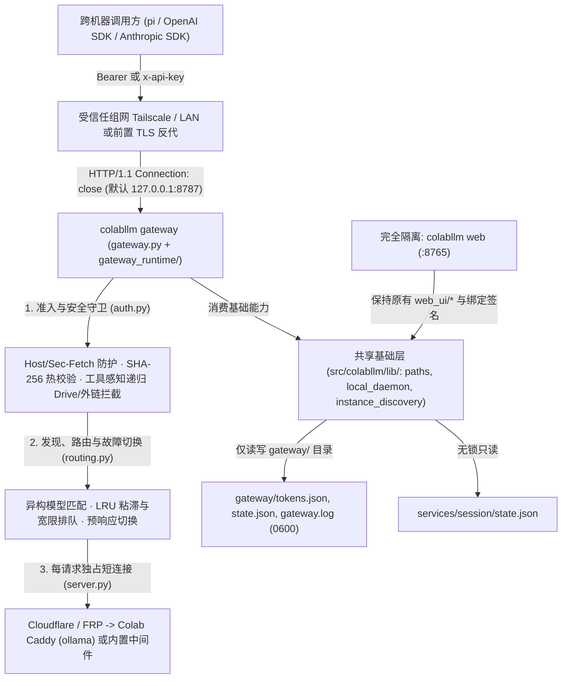

# ColabLLM OpenAI 兼容聚合网关 (`colabllm gateway`)

*   **Author:** eric xiong
*   **Status:** Approved
*   **Date:** 2026-11-17

--------------------------------------------------------------------------------

## Overview

`colabllm gateway` 是一个独立于本地 Web 控制台（`colabllm web`）运行的常驻数据面 HTTP/1.1 网关守护进程。它基于 Python 标准库构建，默认严格绑定回环地址且端口冲突时直接退出，用于将本机已启动的多个 Google Colab GPU 运行时聚合成单一固定入口与基于哈希的可吊销客户端凭据体系，供跨机器运行的 `pi` 编程代理（通过 OpenAI `/v1/chat/completions` 与无状态 `/v1/responses` 调用工具链的外部终端代理）以及 OpenAI / Anthropic SDK 客户端调用。

网关覆盖当前仓库全部 12 个支持 OpenAI 兼容协议的运行时，按实际服务架构与鉴权形态归类如下：

*   **`llama-server`（文本与视觉推理，`builtin` Bearer 鉴权）**：`qwen-flash`、`deepseek-coder`、`deepseek-qwen-9b`
*   **`ollama`（多模型推理、嵌入与音频转写/合成，`Caddy` 前置反代）**：`ollama`
*   **`vLLM-Omni` / `vLLM`（图像、TTS 与音频理解，`builtin` Bearer 鉴权与 ASGI 中间件）**：`flux-klein`、`qwen-image`、`qwen3-tts`、`indextts`、`nemotron-transcribe`
*   **`SGLang-Omni` / `SGLang Diffusion`（语音与图像生成，`builtin` Bearer 鉴权与 ASGI 中间件）**：`drama3`、`minimax-h3-image`
*   **原生 ASGI 音频服务（基于 `uvicorn` 运行，`builtin` Bearer 鉴权）**：`tangoflux`

其余 7 个工作流或专有界面服务（`comfyui`、`openjutsu`、`longcat-video`、`longcat-avatar`、`unlimited-ocr`、`r2-migrate`、`unsloth-studio`）保持禁用。网关仅在独立包目录 `src/colabllm/gateway_runtime/` 中维护静态声明的服务策略目录（随 [pyproject.toml](../../pyproject.toml) 静态包枚举一起分发并在打包检查脚本中校验），结合对 `<COLABLLM_HOME>/services/<session>/state.json` 的无锁只读扫描自动接纳活跃副本，完全保持既有的 Web 控制台目录与远端笔记本模板独立运行。未来在仓库中新增隶属上述已支持协议族的 OpenAI 兼容服务时，仅需在网关服务目录登记一条策略规则并重启本地网关进程，在常规协议字段范围内无需修改网关分发主逻辑或远端笔记本。

--------------------------------------------------------------------------------

## The Problem

在现有 `colabllm` 架构中，用户通过 `<COLABLLM_HOME>`（默认 `~/.colabllm`，由 [paths.py](../../src/colabllm/lib/paths.py) 解析）管理每个 Colab 会话目录 `services/<session>/state.json`（未传 `-i` 的默认副本目录名为 `<service>`，传 `-i <id>` 启动的副本目录名为 `<service>-<id>`），并手动把各运行时的公网隧道 URL 与凭据逐一填入跨机客户端。这一模式在跨机多模型、多副本和多模态使用场景下面临四类障碍：

1. **动态隧道地址漂移与多副本分散凭据**
   *   未绑定固定域名的运行时使用 Cloudflare 临时隧道。冷重启重建远端实例时 `trycloudflare.com` 公网地址会重新生成；触发 `--auto-restart` 若远端会话仍然存活（`reattached_ready`）会保留既有 URL 与 `api_token`，若远端失效重拉则会生成新的临时地址；而新增 `-i <id>` 副本或使用 `--new-credentials` 则会刷新 `api_token`。跨机运行的 `pi` 与 SDK 客户端不得不手工同步变更后的端点与密钥。

2. **`colabllm web` 控制面耦合与端口漂移**
   *   现有浏览器控制台（[web.py](../../src/colabllm/web.py) 与 [server.py](../../src/colabllm/web_ui/server.py)）按 `/api/proxy/<service>/<instance>/<path>` 路径寻址而非按标准请求体 `"model"` 字段路由，鉴权围绕进程级启动令牌 `bootstrap_token`、浏览器 Cookie 与 CSRF 头构建，且未显式传入 `--strict-port` 时会在端口被占时顺延尝试 `8765..8789`。更重要的是，同一端口承载了实例启停（`/api/instances/<svc>/{up,down}`）、已注册业务子命令执行（`/api/tasks/run`）与实例密钥读取（`/api/instances/<svc>/secret`）等控制面接口，直接跨机器开放会扩大宿主机与账号操作面。

3. **跨机器多模态调用的 Google Drive 与远程 URL 拉取风险**
   *   远端 Colab 服务在 `ollama` 上通过 `Caddy` 对外转发，在其余多模态与推理服务上则直接由 [colab_asgi_common.py](../../templates/colab_asgi_common.py) 与各 `templates/*_middleware.py` 提供 `builtin` 鉴权及增强能力。标准 `/v1/*` 请求体与请求头即可触发 Google Drive 读写与本地权重或参考音频/图像加载（包括 `X-Save-Drive`、`X-Drive-Only`、`save_to_drive`、`save_drive_dir`、`save_drive_path`、`lora`/`lora_path`、`drive_image*`、`drive://`/`gdrive://`/`file://`/`/content/drive/`/`MyDrive/` 与无前缀相对路径，以及 `nemotron-transcribe` 对特定视频站点链接的下载解析）；此外部分图像与语音中间件还会在 Colab VM 内拉取未加充分 SSRF 防护的外部 `http(s)://` 媒体 URL（例如 [minimax_h3_image_middleware.py](../../templates/minimax_h3_image_middleware.py) 仅拦截了少量回环和元数据字面主机名，未覆盖完整内网网段、DNS 重绑定与重定向），而 [tangoflux_server.py](../../templates/tangoflux_server.py) 等纯生成服务不拉取外链但仍支持 Drive 输出字段。在不改动远端笔记本的约束下，必须在本地网关边界实施 fail-closed 拦截。

4. **单槽位（`-np 1`）长上下文 KV 缓存失效与隧道超时盲区**
   *   `qwen-flash`、`deepseek-coder`、`deepseek-qwen-9b` 与处于 `coding` / `agent` / `low-vram` 预设下的 `ollama` 均默认单并发推理槽位（`-np 1`）。跨副本无状态轮询会导致同一 `pi` 长对话在副本间切换并重算数分钟首包（prefill）；各 `ollama` 副本加载的模型清单互不共享；同时 Cloudflare 临时隧道约 100 秒未收到上游响应字节即会以边缘 `524` 断连，现有控制台难以区分启动中等待、长 prefill 耗时与上游故障。

--------------------------------------------------------------------------------

## Goals

*   **G1 — 控制面隔离的固定端口常驻网关**：提供独立守护进程命令 `colabllm gateway`（默认监听 `127.0.0.1:8787`，端口冲突直接报错退出；支持绑定指定回环、网卡地址或通过显式 `--allow-remote` 与 `--allow-host` 配合 Tailscale / WireGuard / 局域网及前置 HTTPS 反代跨机访问），使用持久化 SHA-256 摘要存储的命名客户端 Token（支持多客户端独立吊销与不停机轮换，兼容 `Authorization: Bearer` 与 `x-api-key` 请求头），端口内不暴露实例启停、子命令任务执行或上游 `api_token` 读取接口。
*   **G2 — 统一多模态 `/v1/*` 透传与目录驱动可扩展性**：
    *   根路径覆盖 `/v1/models`、`/v1/models/{id}`、`/v1/chat/completions`、`/v1/responses`、`/v1/completions`、`/v1/embeddings`、`/v1/messages`（及带后缀前缀）、`/v1/images/generations`、`/v1/images/edits`（支持 JSON 与无像素重编码的有界内存 `multipart/form-data` 重建）、`/v1/audio/speech`、`/v1/audio/speech/batch`、`/v1/audio/generations`、`/v1/audio/transcriptions`、`/v1/audio/translations`；同时为不带 `"model"` 字段的 TTS 音色查询保留只读路径前缀别名 `GET /r/<runtime>[:<inst>]/v1/audio/voices`。
    *   通过独立的网关能力目录声明允许开放的路由与安全字段规则，并在静态仓库卫生检查中校验仓库内每个服务对均已在目录注册；未登记服务或关闭网关暴露的工作流服务在运行期一律返回 `HTTP 501`。
*   **G3 — 无歧义路由、有状态 KV 亲和与预响应故障切换**：
    *   结合进程存活性与就绪标记过滤活跃副本，以 `<upstream_model>@<runtime>[:<instance_id|default>]` 无歧义索引路由（右侧匹配已知运行时或禁用标识才拆分，保护 `ollama` `@sha256:` 摘要），支持快速元信息通道不被推理阻塞。
    *   对长上下文对话模型维护有状态 LRU 粘滞亲和与短暂粘滞宽限，在 `-np 1` 饱和时提供有界排队背压（超时返回 `HTTP 429` 与 `Retry-After`）；将自动故障切换严格限制在仅包含目标模型、未锁定具体实例且尚未向客户端发送任何响应状态与字节的预响应阶段，并支持上游 `state.json` 凭据内容真实变化后的单次 `401` 重试。
*   **G4 — 默认无条件 Fail-Closed Google Drive 与外部媒体防护**：
    *   在不修改远端笔记本模板的前提下，网关边界默认无条件拦截（返回 `HTTP 403`，不静默剥离字段）已登记的 Drive 读写请求头、深度递归及多态容器（含表单 JSON 文本）中的写盘/本地权重与参考图键、各类 Drive/本地路径格式、外部视频托管域名、控制面 `/api/ct/*` 与音色写接口，以及首期全量外部 `http(s)://` 媒体引用（仅放行 `data:` 内联媒体与二进制上传，同时豁免 OpenAI Chat / Responses / Anthropic Messages 中的工具定义与结构化工具调用载荷以避免误伤代理）；生图接口不支持的 `response_format="url"` 参数统一按无效请求参数返回 `HTTP 400`。
*   **G5 — 请求追踪、结构化日志与超时诊断**：
    *   全链路透传或分配 `X-Request-Id`，将无正文与无明文密钥的 JSONL 请求及拦截审计事件写入轮转日志，暴露免鉴权 `GET /healthz` 与鉴权 `GET /gateway/status`；区分 `STARTING` 启动中副本（返回可操作 `HTTP 503`），区分建连、prefill 与流间超时及 Cloudflare `524` 边缘断连，向客户端输出带可操作建议的标准错误体。

--------------------------------------------------------------------------------

## Non-Goals

*   **不暴露控制台生命周期与密钥接口**：`colabllm gateway` 不提供 `up`/`down` 实例启停、`/api/tasks/run` 子命令执行、`tunnel-config` 修改或上游 `api_token` 明文查询接口。
*   **不修改远端 Colab 笔记本与运行时镜像**：不通过编辑 [build_notebooks.py](../../templates/build_notebooks.py)、[colab_asgi_common.py](../../templates/colab_asgi_common.py) 或各模板中间件向云端部署新鉴权或校验代码。
*   **不向 `services/` 目录写入任何状态**：对 `<COLABLLM_HOME>/services/*/state.json` 保持无锁只读；网关自身全部持久与运行文件仅写入 `<COLABLLM_HOME>/gateway/`。
*   **不改动现有 Web 控制台 UI 注册表与状态缓存**：本阶段保持 `src/colabllm/web_ui/*` 目录零改动，待各引擎接口经真实 Colab 实测后再按需单独同步浏览器控制台展示能力。
*   **不做协议翻译与网关侧会话历史托管**：不在网关内把 `/v1/responses` 转换为 `/v1/chat/completions`，也不维护 `previous_response_id` 内存会话缓存；对无状态引擎拒收 `previous_response_id`。
*   **不提供通用 `/r/<runtime>/v1/*` 全量镜像、`/r/<runtime>/api/*` 管理反代与浏览器 CORS 代理**：跨机代理与音色写入管理、非 OpenAI 作业控制仍归属本地 CLI 与 `colabllm web`。
*   **不内置 ACME/TLS 证书签发，也不在首期放行外部媒体 URL**：公网加密传输依赖 Tailscale / WireGuard 或前置反代终结 TLS；首期跨机媒体统一使用二进制表单或 `data:` URI。

--------------------------------------------------------------------------------

## Open Questions

*   **None** — 裸模型名与 `@unknown` 返回码边界、`/r/<runtime>` 收敛为只读音色前缀、首期外链全禁与无状态 `/v1/responses` 的 `previous_response_id` 拒收策略均已在下文架构与详细规范中锁定；针对 3 个 `llama-server` 服务在真实 Colab 上的 `/v1/responses` 端到端行为，将作为独立实机验证门禁（不影响网关无状态透传机制本身）决定后续是否更新 `web_ui` 控制台能力开关。

--------------------------------------------------------------------------------

## Critical User Journeys (CUJs)

### CUJ 1: 跨机器 `pi` 编程代理单入口多轮推理与预响应故障切换

*   **Given**: 用户在主机 A 上启动 `colabllm qwen-flash up`、`colabllm deepseek-coder up -i 1`、`colabllm deepseek-coder up -i 2`，并在主机 A 以 `colabllm gateway --detach --host 0.0.0.0 --allow-remote --allow-host host-a.ts.net` 启动网关，为主机 B 的 `pi` 创建一枚命名 Token。
*   **When**: 主机 B 上的 `pi` 仅配置主机 A 的固定网关 URL 与该 Token，通过 `GET /v1/models` 发现 `qwen3.8-flash-next@qwen-flash` 与 `deepseek-v4.1-flash-coder@deepseek-coder` 后发起多轮携带 `tools` 工具定义与调用结果的 `POST /v1/chat/completions`（或无状态 `POST /v1/responses`）长上下文流式请求；期间 `deepseek-coder` 副本 1 隧道断开并被 `--auto-restart` 触发重连。
*   **Then**: 带合法工具定义（包括 `url`/`image` 等参数名）的多轮请求不被安全守卫误杀，优先粘滞命中同一热副本复用 KV 缓存；若某次短暂繁忙溢出到具备该模型的空闲副本 2 后完成响应，后续轮次粘滞目标更新为副本 2 避免缓存回跳；副本 1 在预响应阶段出现连接失败或 `502`/`503`/`530` 时自动切往副本 2 重放，客户端也可随时在主机 A 本地以 `--status --json` 查询实时健康状态。

### CUJ 2: 跨机器多模态图像编辑、音色查询与 Drive / 外链拦截

*   **Given**: 主机 A 运行着 `flux-klein` 与 `qwen3-tts`（或 `indextts`），未修改任何 Colab 笔记本镜像。
*   **When**: 主机 B 客户端先通过 `GET /v1/models` 发现生图模型并调用 `POST /v1/images/edits`（`multipart/form-data` 上传多张同名 `image[]` 二进制 PNG、`data:` 内联参考图及带 `@flux-klein` 的 `"model"`），以及通过 `GET /r/indextts/v1/audio/voices` 查询可用音色；随后另一请求尝试提交 `save_to_drive`、`drive://inputs/secret.png`、裸文件名 `"secret.png"`、外部 `https://` 参考图 URL、`lora` 表单 JSON 字符串或 `POST /r/qwen3-tts/v1/audio/voices`，以及以 `response_format="url"` 调用生图接口。
*   **Then**: 第一笔多图二进制与 `data:` 编辑请求在不重编码像素的前提下重放并成功返回结果，前缀音色查询成功；`response_format="url"` 返回标准 `HTTP 400` 提示改用 `b64_json`；后续全部试图触发 Google Drive、本地路径、外部未授权 URL、视频站点拉取或音色写入的请求均在本地网关边界返回带有明确原因与 `X-Request-Id` 的 `HTTP 403`，不向远端发送任何上游请求并记入 JSONL 审计日志。

### CUJ 3: 通过目录登记接入未来 OpenAI 兼容运行时

*   **Given**: 开发者在仓库源码中按现有 `colabllm` 规范新增了一个未来的 `llama-server` 对话服务或 `vLLM-Omni` 多模态服务。
*   **When**: 若开发者漏在网关服务目录登记该服务，仓库卫生校验在测试期即报错拦阻；按所属协议与允许路径在网关目录补齐一条规则并重启本地 `colabllm gateway` 后，将该服务启动至 `READY` 状态（在标准字段结构范围内无需修改网关分发核心与远端笔记本）。
*   **Then**: 网关从 `<COLABLLM_HOME>/services/*/state.json` 动态发现该就绪实例并通过 `<model>@<new_service>` 在 `/v1/models` 列出；其声明的对话与多模态路由立即开放并自动继承网关的递归 Drive/外部媒体拦截保护；未登记或误发起的禁用服务请求直接被 `HTTP 501` 拒绝。

### CUJ 4: 命名客户端 Token 热吊销与长上下文超时诊断

*   **Given**: 管理员为两台远端机器分别签发命名 Token `workstation-pi` 与 `laptop-sdk`，某台 `qwen-flash` 实例处于启动加载中（`STARTING`）或正处理 200K 上下文推理。
*   **When**: 管理员执行 `colabllm gateway token revoke workstation-pi`，已吊销客户端继续携带旧凭据请求；同时另一设备请求尚在 `STARTING` 的运行时，或通过临时 Cloudflare 隧道发起超过 100 秒无首包输出的非流式请求触发边缘 `524`。
*   **Then**: 无需重启网关进程，`workstation-pi` 的请求立即收到 `HTTP 401`，而 `laptop-sdk` 及在场活跃流连接不受影响；针对 `STARTING` 运行时返回附带状态排查指令的 `HTTP 503`；针对 Cloudflare 边缘 `524` 或本地 prefill 超时统一返回标准 `HTTP 504`（保留细化错误码及开启流式输出或改用 `--transport frp` 的操作建议）。

--------------------------------------------------------------------------------

## Technical Plan (Architecture)

### 组件拓扑与前置状态契约

网关采用与 `colabllm web`（[web.py](../../src/colabllm/web.py) + `web_ui/`）完全平行的独立入口 `src/colabllm/gateway.py` 与子包 `src/colabllm/gateway_runtime/`（避免包名与脚本名冲突），仅将通用的私有文件原子写盘、通用本地进程/端口绑定锁和无缓存实例状态扫描下沉至 `src/colabllm/lib/`，保持 `web_ui/*`、`colabsvc.Service` 与 `mux.py` 现有结构零扰动。构建分发方面，需要在 [pyproject.toml](../../pyproject.toml) 中显式枚举新增子包并通过 [check_distribution.py](../../tools/check_distribution.py) 验证 `uv` 隔离安装与空状态只读行为。



既有运行时状态目录（[colabsvc.py](../../src/colabllm/lib/colabsvc.py) 所管理的 `<COLABLLM_HOME>/services/<session>/state.json`）在网关侧严格只读：

| 字段 / 概念 | 含义与判定规则 |
| --- | --- |
| **`<COLABLLM_HOME>`** | 仓库本地数据根目录，由 [paths.py](../../src/colabllm/lib/paths.py) 解析 `COLABLLM_HOME` 环境变量或回退 `~/.colabllm`。 |
| **会话目录与 `:default`** | 位于 `<COLABLLM_HOME>/services/<session>/`。未指定 `-i` 时 `<session>` 即服务名 `<runtime>`（在组合模型语法中简称为 `<runtime>:default`）；指定 `-i <id>` 时为 `<runtime>-<id>`（简称为 `<runtime>:<id>`）。目录拆解逻辑由共享目录发现模块提供。 |
| **`READY` vs `STARTING`** | 存在活跃保活进程且就绪标记 `ready` 为真时判定为 **`READY`**（可承接推理）；保活进程存活但 `ready` 尚不为真时判定为 **`STARTING`**（返回 `HTTP 503` 与对应状态排查命令）；进程已退出则忽略，损坏 JSON 文件按跳过处理。 |
| **上游连接与鉴权键** | `url`（公网隧道地址）；`api_token`（注入上游 Bearer 凭据）；仅当 `api_token` 缺失且存在 `auth_user`/`auth_pass` 时回退 `Basic` 凭据（用于前置 `Caddy` 的 `ollama` 等启用基础鉴权的会话，其余 `builtin` 服务仅使用 Bearer）；`transport`（`"cloudflare"` 或 `"frp"`）。 |
| **并发与兼容环境键（`env`）** | `env` 字典包含 `llama-server` 的并行 env 键、`ollama` 序列化的 JSON 字符串字段 `CT_OLLAMA_SERVER_ENV`（内含 `OLLAMA_NUM_PARALLEL`）以及兼容协议族开关 `CT_OLLAMA_COMPAT`（按 [ollama_runtime.py](../../src/colabllm/lib/ollama_runtime.py) 支持 `all`、`ollama`、`openai`、`anthropic` 或逗号组合）。 |

### 独立网关能力目录与静态扩展门禁

*   **隔离目录边界与既有系统零冲突**：此前尝试将规则同时塞入 `web_ui` 控制台目录会导致跨层字段分裂并破坏现有控制台的启发式档案单测；因此网关服务能力目录独立定位于 `src/colabllm/gateway_runtime/catalog.py`。`web_ui/`（包括 [api_catalog.py](../../src/colabllm/web_ui/api_catalog.py)、[introspect.py](../../src/colabllm/web_ui/introspect.py) 和 [state_store.py](../../src/colabllm/web_ui/state_store.py)）完整保留控制台界面预设、首次按需导入机制与日志缓存策略；`colabsvc.Service`、[mux.py](../../src/colabllm/lib/mux.py) 与全部 19 个服务脚本零改动。
*   **19 个既有服务的精确路由与安全规则**：
    *   7 个非 OpenAI 工作流与专有界面服务（`comfyui`、`openjutsu`、`longcat-video`、`longcat-avatar`、`unlimited-ocr`、`r2-migrate`、`unsloth-studio`）在网关目录标记禁用，不加入 `/v1/models` 探测；调用其前缀或模型后缀时返回 `HTTP 501`。
    *   3 个 `llama-server` 服务（基于仓库锁定的 `llama.cpp v1.0.0` 基准）：开放 `GET /v1/models`、`GET /v1/models/`、`POST /v1/chat/completions`、`POST /v1/completions`、`POST /v1/messages` 及无状态透传 `POST /v1/responses`（在网关侧主动拒收带 `previous_response_id` 的请求并返回 `HTTP 400`）；`web_ui` 对这三项服务暂维持 `"responses_api": False` 展示直到真实 Colab 手工验证通过。
    *   `ollama`：读取运行期 `CT_OLLAMA_COMPAT` 动态开放协议路由：仅设 `"ollama"`（不含 `"openai"` 与 `"anthropic"`）的副本因远端 `Caddy` 禁止全部 `/v1/*` 访问，直接在网关 `/v1/models` 清单与路由池中排除（当仅存此类副本时返回带明确兼容性开启提示的 `HTTP 503`）；含 `"openai"` 时开放对话、补全、无状态及可控副本的 `/v1/responses`、嵌入及音频合成/转写/翻译（按音频转写端点对上传文件字段校验）；含 `"anthropic"`（包括仅配 `"anthropic"` 模式）时开放 `/v1/models`、`/v1/models/` 与 `/v1/messages`（含带后缀路径）。
    *   8 个多模态服务与音频生成服务：按各自中间件真实支持的接口精准登记——其中 `nemotron-transcribe` 仅开放 `/v1/models` 与 `/v1/chat/completions`（无 Whisper 转写端点，强制屏蔽常见视频托管域名与 `save_drive_dir` 等全部 Drive 键）；`indextts` 与 `qwen3-tts`、`drama3` 均经前缀专用只读路由开放 `GET /r/<runtime>[:<inst>]/v1/audio/voices`；生图服务仅在 `/v1/images/*` 检查顶层/规范化的 `"url"` 参考字段而不误伤对话结构；`tangoflux` 支持音效/音频生成并同步拦截批量内层 Drive 键。
*   **静态扩展门禁**：通过仓库静态卫生校验套件强制断言每个成对 `.py` + `.ipynb` 服务文件均已在网关目录中显式登记（启用服务同时校验路由规则非空），未知未登记前缀与 `@unknown` 后缀一律返回 `HTTP 501`。

### CLI 接口、哈希凭据与 `--status` 闭环准入

*   **CLI 分发与补全一致性**：在 [cli.py](../../src/colabllm/cli.py) 中新增与 `web` 控制台并列的独立全局命令分发分支指向 `src/colabllm/gateway.py`（兼容前置 `--account` 等全局标志下传），并同步接入 [completion.py](../../src/colabllm/lib/completion.py) 离线补全树（保持补全逻辑永不读取任何 `state.json`）。守护进程入口同时兼容启动/控制选项与 `token {create,list,rotate,revoke}` 子命令，禁止将守护生命周期控制旗标与 `token` 子命令混用。
*   **单向哈希存储与双请求头鉴权**：Token 采用可拆分的 `clgw_<key_id>_<secret>` 格式，`gateway/tokens.json`（`0600` 文件与锁文件保护并发写）仅记录完整 Token 的 SHA-256 摘要，服务侧按文件元数据指纹热加载新删改凭据且不中断已有活跃连接，遇非预期文件内容版本号（`version != 1`）直接 fail-closed 报错。入站同时兼容 `Authorization: Bearer` 与 `x-api-key`，双头并存但值不同时返回 `HTTP 401`。`--detach` 模式在派生产生后台进程前先行确保 `default` 初始 Token 落盘并在标准输出（或 `--json` 输出字段）打印一次，严禁写入日志。
*   **边界防护与局部状态可达性**：
    *   `GET /healthz` 在通过入站域名头检查后免客户端 Token 返回 `{"status": "ok"}`。
    *   `GET /gateway/status` 既允许合法客户端 Bearer Token 查询，也接收专有内部只读状态头（来自受保护 `gateway/state.json` 内的进程级 `status_token`）：该内部头仅限本机回环或已绑定网卡对端访问 `GET /gateway/status`，在仅限本机查询时免除公网 `--allow-host` 白名单限制（从而修复 `--host ::1`、Tailscale 专属 IP 或严格 `--allow-host` 下 `--status` 不可达的问题），并严禁将 `status_token` 用于任何 `/v1/*` 或 `/r/*` 接口。
    *   `Sec-Fetch-Site` 若存在则仅允许 `same-origin` 或 `none`，拦截跨站与同站第三方页请求；本地回环监听默认放行本地回环主机名，`--host 0.0.0.0`/`::` 且 `--allow-remote` 未传 `--allow-host` 时在 `stderr` 打印公网暴露警告并跳过 `Host` 白名单，一旦显式配置 `--allow-host`（支持精确域名与安全子域名后缀通配）即全量强制匹配 `Host`。请求转往上游前剥离入站鉴权、`Cookie`、`Host` 与编码协商头。

### 模型发现、路由亲和与预响应故障切换

*   **模型探测、组合语法与确定性流水线**：
    *   网关对有效 `READY` 实例按需并发探测模型清单（短单次超时 + 并发合并 + TTL 缓存，推理成功被动续期，实例变更或熔断立即作废）。每个活跃就绪副本探测到的标准模型 ID 直接以 `<upstream_model>@<runtime>` 聚合暴露在 `GET /v1/models`（跨副本按 `(runtime, upstream_model)` 去重，不引入非标准自定义字段）；`GET /v1/models/{id}` 直接基于网关本地探测表应答，兼容 URL 编码与单模型多别名直查（覆盖上游未提供单模型查询接口的服务）。
    *   客户端使用 `<upstream_model>@<runtime>[:<instance_id|default>]` 寻址：若无 `@` 或 `@` 右侧为 `sha256:...` 摘要则返回 `HTTP 400` 与可用候选提示；若 `@` 右侧既非启用运行时又属于禁用或未登记服务，返回 `HTTP 501`。`GET /r/<runtime>[:<inst>]/v1/audio/voices` 仅服务无体参数音色查询，多副本不带 `:inst` 时要求单副本就绪或报错引导；直接访问根 `GET /v1/audio/voices` 返回 `HTTP 404`。
    *   对支持多轮状态的 `ollama /v1/responses`，若请求携带 `previous_response_id`，仅当当前仅有一个合法可用 `ollama` 副本时允许自动落点，否则要求显式 `:instance_id|default`（缺省返回 `HTTP 400`）；无状态引擎携带 `previous_response_id` 统一返回 `HTTP 400`。
*   **对称 `"model"` 改写约束**：请求侧按实际结构剥离后缀还原上游模型名（JSON 根 `"model"`、`drama3` `items[*].model` 及 `multipart` 唯一 `"model"` 分片）；仅当上游返回类型为 JSON 或 SSE 事件流且原载荷已存在相应 `"model"` 字段（顶层、`response.model` 或 `message.model`）时对称回写为客户端请求 ID，绝不篡改无 `"model"` 字段或二进制媒体响应。
*   **粘滞亲和、异构池筛选与预响应故障切换**：
    *   `/healthz`、`/gateway/status` 与 `/v1/models` 走快速元信息通道不受全局推理配额挤压；副本并发槽位从 `state["env"]` 解析并校验正整数后回退目录默认值。
    *   按请求协议提取稳定根前缀作为亲和键（Chat、Anthropic Messages 提取系统提示、`messages[0]` 与工具定义，Responses 提取指令与首条输入，Completions 提取提示前段），写入上限 `1024` 项的有状态 LRU 映射表。命中热粘滞副本但暂满时等待短宽限（默认 `1s`，受总排队超时封顶）以避免双会话互踩缓存；若仍忙则优先溢出到含该模型、空闲且负载低的副本，并在成功后更新粘滞映射；全部含该模型副本均饱和并排队超时后返回带 `Retry-After` 的 `HTTP 429`。
    *   **预响应故障切换状态机**：

```text
[含目标模型的就绪候选池 -> 选定副本] --(TCP/TLS 连接失败, 断流异常, 或预响应 401/502/503/530)-->
   ├─ 尚未向客户端发送任何响应状态行或字节，上游返回 401，且重新读取 state.json 后的上游鉴权值与失败值确实不同
   │     └─ 立即使用新凭据重试当前同一副本 1 次（固定 :instance_id 同样适用）
   ├─ 未锁定具体 :instance_id，且尚未向客户端发送状态行或任何字节（连接错误 / 502 / 503 / 530）
   │     └─ 记入当前副本短期熔断冷却期，从同样保有该 upstream_model 的下一健康副本池重放请求
   └─ 已锁定 :instance_id（非上述凭据变化 401），或已发出流式首字节，或上游已返回其他明确业务状态
         └─ 不做自动切换；预响应阶段直接透传，流式首字节之后追加标准化流终止错误事件并结束连接
```

*   当目标运行时尚无 `READY` 副本但存在 `STARTING` 实例时，返回 `HTTP 503` 及对应 `colabllm <runtime> status` 诊断命令建议。

### 传输边界、有界 Multipart 处理与 Fail-Closed 安全守卫

*   **入站与出站传输契约**：
    *   入站服务明确按 HTTP/1.1 运行以支持请求体读取前的延迟 `100 Continue` 握手机制：先校验 `Host`、`Sec-Fetch-Site`、Client Token、路径允许性与内容长度，全部通过后再应答继续发送正文；同时携带 `Content-Length` 与 `Transfer-Encoding` 或长度非法的走私请求直接拒为 `HTTP 400`。
    *   摒弃脆弱的磁盘落盘假象与跨工具不兼容拼接，采用统一有界内存处理（单请求硬上限 `96 MiB`，multipart 单文本字段上限 `1 MiB`）：通过标准库 MIME 解析读取多部分列表，严格允许同名多值文件或数组参数（如多个 `image[]`）及不带文件名但声明媒体类型的二进制分片原字节无损透传，同时拒绝重复传入多个标量 `model` 字段（`HTTP 400`），仅在剥离模型后缀时以加密随机边界重建载荷。
    *   出站使用每请求独占短连接（不设长连接池），携带固定 `Accept-Encoding: identity` 防止远端压缩缓冲 SSE 流，禁止自动跟随 `3xx` 重定向（任何 `3xx` 响应直接丢弃位置头并返回 `HTTP 502`），按建连、首包等待与流间读取三阶段切换套接字超时并在完成后即时释放上游连接与并发槽位。因 HTTP/1.1 短连接客户端发送请求后合法半关闭写端（`TCP FIN`）在套接字可读检查上等价于对端 EOF，网关不使用预响应读端探针抢杀客户端连接，避免误断长 prefill 推理。
*   **四级 Fail-Closed 安全守卫**：网关在向任何上游建立连接之前强制执行以下检验（工具声明 Schema 与结构化工具调用实参豁免见第 4 项），任一敏感规则命中直接返回 `HTTP 403`（不静默剥离字段）：
    1.  **控制/变更路由与请求头阻断**：无条件拒绝 `X-Save-Drive` 与 `X-Drive-Only` 请求头；拒绝 `/api/ct/*`、`/r/*/api/*` 与 `POST/DELETE` 音色变更路由；生图接口检测到 `response_format="url"` 按参数无效返回 `HTTP 400` 引导改用 `b64_json`。
    2.  **归一化递归与表单 JSON 二次检验**：统一递归解包请求 JSON 中的 `extra_body`、`extra_params`、`items[*]`、`references[*]`，并对 multipart 文本分片中的结构体名称（如 `lora`、`extra_body`、`extra_params`）及 `response_format` 执行 JSON 解析后递归校验与键名归一化（忽略大小写及数组后缀 `[]`）。拦截全部已登记 `drive_forbidden_fields`（覆盖 `save_to_drive`、`save_drive_dir`、`save_drive_path`、`drive_only`、`lora`、`lora_path`、`drive_image`、`drive_images`，包括对象与列表嵌套写法）。
    3.  **上下文精准媒体字段检验**：按接口契约校验媒体参考字段（对话接口校验 `image_url`、`audio_url`、`images` 与 Anthropic 内容块的 `source.url`；语音接口校验 `ref_audio`、`emo_audio`、`audio_path`、`audio`；音频转写校验 `file`；**仅在生图端点 `/v1/images/*` 检验 `image`、`images`、`image_url` 与裸 `"url"` 键**，不在 `/v1/chat/completions` 全局扫描任意 `"url"` 键）。
    4.  **外部媒体与工具调用载荷豁免**：首期无条件禁止所有 `http://`、`https://`、`drive://`、`gdrive://`、`file://`、`upload://`、`ytdl://`、`yt-dlp://`、`/content/`、`MyDrive/`、无前缀相对路径及与音频转写中间件共用的视频托管站点特征域名（大小写不敏感匹配整串 URL 含查询参数），跨机媒体输入一律要求 `data:(image|audio)/...` 内联编码或二进制表单分片。同时完整豁免 OpenAI Chat（工具参数定义与工具调用/工具结果文本）、OpenAI Responses（工具参数与函数调用负载）与 Anthropic Messages（工具 `input_schema`、`tool_use.input` 及工具结果非显式媒体块）内的合法代码/工具参数结构，防止误伤编程代理。

### 错误契约、结构化日志与诊断状态

*   **标准化错误体**：全部网关生成响应均附 `X-Request-Id` 响应头；`/v1/messages` 系列返回 Anthropic 错误信封，其余接口返回 OpenAI 标准错误信封。不论本地 `prefill_timeout` 还是上游 Cloudflare 边缘返回 `524`，均向调用方统一以标准 `HTTP 504` 返回并在错误码字段明确区分 `prefill_timeout` 与 `cf_edge_524`（附流式输出或 `--transport frp` 建议）。
*   **只读轮转审计日志与脱敏状态**：向 `<COLABLLM_HOME>/gateway/gateway.log`（`0600` 权限轮转 JSONL）记录时间、追踪 ID、Token 标识、直连对端地址（仅取原始套接字对端 IP，不采信未经验证代理注入头）、请求方法与路径、选定副本、状态码、耗时、首包耗时与错误分类，绝不输出请求正文或密钥；`GET /gateway/status` 返回剥离 URL 查询参数与片段凭据后的副本快照与实时并发计数。

--------------------------------------------------------------------------------

## Alternatives Considered

### Alternative A: 复用 `colabllm web` 同端口暴露代理或直接挂载 `/v1/*`

*   **Pros**: 无需额外维护独立守护进程与第二个本地端口；可直接参考 [server.py](../../src/colabllm/web_ui/server.py) 已有的代理转发逻辑。
*   **Cons**: `colabllm web` 在同一端口暴露实例启停（`/api/instances/<svc>/{up,down}`）、已注册子命令执行（`/api/tasks/run`）与实例凭据读取（`/api/instances/<svc>/secret`），且鉴权依赖进程级 `bootstrap_token`、浏览器 Cookie 与 CSRF 校验头；未传 `--strict-port` 时还会在 `8765..8789` 自动顺延端口。
*   **Reason for Rejection**: 为纯推理调用方开放控制面端口会放大宿主机与 Colab 账号操作面，且浏览器会话鉴权与可变端口不适用于跨机 `pi` 与标准 SDK 客户端。

### Alternative B: 仅提供静态客户端配置导出命令配合外部 LiteLLM，不做常驻网关进程

*   **Pros**: 仅需简短导出命令生成客户端配置文件，零本地常驻进程开销，连接池与虚拟密钥交由外部进程处理。
*   **Cons**: 每次冷重建更换临时隧道域名、`--new-credentials` 刷新 `api_token` 或扩缩容副本时，客户端必须手动重新导出并重启重载；外部静态列表无法感知本机 `state.json` 上下线，也无法实施 `-np 1` 动态会话粘滞与预响应副本切换。
*   **Reason for Rejection**: 静态导出无法透明屏蔽隧道 URL 漂移、新副本凭据分化以及 `-np 1` 长上下文前缀缓存亲和调度问题。

### Alternative C: 首期仅支持纯 LLM（`llama-server` + `ollama`），剔除多模态运行时

*   **Pros**: 纯 JSON/SSE 对话代理无需处理 `multipart/form-data` 二进制表单及图像/音频中间件复杂输入字段校验，代码体积与实现复杂度最小。
*   **Cons**: 跨机运行的代理与 SDK 若要调用 `flux-klein`、`qwen-image`、`minimax-h3-image`、`qwen3-tts`、`indextts`、`drama3`、`tangoflux` 与 `nemotron-transcribe`，仍需为每台在线 Colab 单独维护隧道地址与不同密钥，形成两套割裂配置。
*   **Reason for Rejection**: 统一入口与单一跨机可吊销凭据体系需完整覆盖当前已部署的全量 12 个 OpenAI 兼容文本与多模态运行时，避免双配置割裂运维体验。

### Alternative D: 修改远端 Colab 笔记本公共模块（`templates/colab_asgi_common.py`）校验网关能力头

*   **Pros**: 网关侧无需维护任何多模态服务媒体与写盘字段清单，由云端统一拦截即可防止一切参数变体与重定向绕过。
*   **Cons**: 必须改动 [colab_asgi_common.py](../../templates/colab_asgi_common.py)、各模板中间件并重新构建生成全部 19 份 `.ipynb` 笔记本，同时已在运行的 Colab 会话在手动重启重建前全部不生效。
*   **Reason for Rejection**: 本阶段约束远端笔记本模板与镜像保持不变，通过本地独立能力目录驱动网关边界拦截，即可在不中断、不重启任何在跑 Colab 实例的前提下完成部署。

### Alternative E: 在 19 个 `src/colabllm/services/*.py` 或共享 `web_ui` 中合并维护网关政策

*   **Pros**: 看似把所有控制台开关、服务启动逻辑与网关路由放在同一结构内集中声明。
*   **Cons**: 一方面 [mux.py](../../src/colabllm/lib/mux.py) 使用 `dataclasses` 与 `Service(**svc_data)` 做跨进程启动 RPC，向 `Service` 加字段会破坏与在跑守护进程及序列化字典的兼容性；另一方面强行合并 [api_catalog.py](../../src/colabllm/web_ui/api_catalog.py) 与 [introspect.py](../../src/colabllm/web_ui/introspect.py) 的首次 `runpy` 缓存和 docstring 启发式测试，会把尚未实测的控制台开关与仅属网关的多模态拦截规则混为一谈。
*   **Reason for Rejection**: 将网关能力策略独立收敛进 `src/colabllm/gateway_runtime/catalog.py` 并配静态打包/卫生测试检查，既保持 `colabsvc.py`、`mux.py`、19 个服务脚本与 `web_ui/*` 零改动，又允许后续同类新服务仅增补一条目录登记即可接入。

### Alternative F: 在网关本地实现 `/v1/responses` 到 `/v1/chat/completions` 的双向协议翻译

*   **Pros**: 即使上游引擎不具备原生 `/v1/responses` 接口，也能对客户端暴露统一协议。
*   **Cons**: 仓库内 `ollama` 已公开启用 `responses_api`，而 `llama-server` 锁定的上游基准版本（参见 [qwen_flash_runtime.py](../../src/colabllm/lib/qwen_flash_runtime.py)）亦包含无状态 `/v1/responses` 实现；网关在 SSE 与工具调用事件间做格式翻译易产生兼容性失真，且依然无法为无状态引擎合成跨轮 `previous_response_id` 上下文。
*   **Reason for Rejection**: 采用 `/v1/responses` 原生透传与 `previous_response_id` 边界检查即可满足调用方需求；针对 `colabllm web` 的 `api_catalog` 界面标识则在真实 Colab 实机验证后另行同步，不在未实测时修改控制台默认配置。

### Alternative G: 使用 `/` 或 `:` 作为组合模型名主分隔符

*   **Pros**: 在单一英文短模型名场景下直观接近 Hugging Face 路径或容器镜像标签习惯。
*   **Cons**: `ollama` 标签自带 `:`（如 `qwen3:8b`），Hugging Face GGUF 标识兼具 `/` 与 `:`（如 `hf.co/org/repo:Q4_K_M`），且 `pi` 等客户端以首个 `/` 作为 `<provider>/<model>` 切分点，极易造成模型解析冲突。
*   **Reason for Rejection**: 运行时名称及实例标识中不包含 `@`，仅当 `@` 右侧匹配非 `sha256:` 后缀的运行时时按末位 `@` 拆分的策略同时兼容 `/`、`:` 与 `@sha256:` 模型摘要。

### Alternative H: 保留本地代抓外链、长连接池、磁盘临时落盘缓冲或预响应半关闭探针

*   **Pros**: 允许外链直传或代抓可支持公网图片链接；持久连接池与异步断连探针理论上可节省少量握手或在流开始前感知异常关闭。
*   **Cons**: 远端直接抓 `https://` 在不改中间件重定向逻辑下存在内网探测残余风险，而由本地网关代抓转码会暴露网关宿主 IP 并放大载荷体积；在零第三方依赖约束与分钟级推理场景下，连接池会引发陈旧断开误熔断，磁盘落盘与全内存重构叠加反而形成磁盘与多倍内存双开销，而预响应可读探测会把符合 HTTP/1.1 的合法写端半关闭客户端误判断开并杀掉长推理。
*   **Reason for Rejection**: 遵循零第三方依赖前提，首期收口为“全面禁用外部媒体 URL + `96 MiB` 有界内存表单重建 + 每请求独占短连接 + 分阶段套接字超时释放”，大幅压缩竞态与脆弱边界。

--------------------------------------------------------------------------------

## Non-Functional Requirements

*   **Security & Privacy**:
    *   目录与凭据权限：`<COLABLLM_HOME>/gateway/` 目录与下属 `tokens.json`、`tokens.lock`、`state.json`、`instance.lock`、`gateway.log` 统一采用私有目录权限（`0700`）与私有原子文件写入（`0600`），磁盘不保存明文客户端 Token Secret。
    *   边界与防泄露机制：入站先行验证 `Sec-Fetch-Site` 与适用范围的 `Host`；`tokens.json` 严格校验 `"version": 1`，按 `key_id` 索引并以恒定时间比对完整 Token SHA-256；内部 `status_token` 限缩为本地只读状态接口专用；禁用 `3xx` 重定向跟踪以保护上游凭据；日志仅记录直连对端地址与操作分类而不记正文或密钥。
*   **Performance, Memory & Latency**:
    *   有界内存封装：单请求正文硬上限收敛在 Cloudflare Tunnel 百兆约束之下的 `96 MiB`（`multipart` 单文本字段上限 `1 MiB`）。取消不实落盘缓冲后，表单解析与后缀改写重建在内存中按请求上限有界运行（高峰期单请求会保有原包体与重建包体约 2–3 倍内存工作集，受全局并发上限约束），并保证不对二进制图像与音频像素重新编解码。
    *   发现延迟控制：使用并发合并探测与有界单次探测超时刷新可用模型列表，在部分副本隧道半开无响应时阻塞受单次探测超时封顶，不拖垮整体 `/v1/models` 响应。
*   **Rollout, Coexistence & Rollback**:
    *   零锁冲突共存：对 `<COLABLLM_HOME>/services/*/state.json` 严格保持无锁只读，与所有运行中保活进程、`mux` 守护进程及 `colabllm web` 互不干扰，也无需重启现有在线 Colab 实例。
    *   停用与回滚：`colabllm gateway --stop` 仅终止自身守护进程并清理 `gateway/state.json`，保留或按需移除 `<COLABLLM_HOME>/gateway/`，不触碰任何云端 GPU 会话或本地服务配置。

--------------------------------------------------------------------------------

## Risks & Limits

| 风险 / 限制项 | 影响范围与触发条件 | 缓解措施 |
| --- | --- | --- |
| **预响应等待阶段对客户端静默退出的感知滞后** | 标准库同步阻塞模型叠加 HTTP/1.1 客户端合法写端半关闭（`TCP FIN`）特性，使网关在未收到上游首字节前的纯等待期无法区分“正常半关闭等响应”与“用户已关闭终端”。 | 在收到上游首字节后写流异常时即时切断上游释放 `-np 1` 槽位；等待首字节期间依赖有界 `prefill_timeout` 兜底回收。 |
| **`llama-server /v1/responses` 实机兼容性尚待验证** | 该路径按 `llama.cpp v1.0.0` 上游实现设计为无状态透传，尚未经真实 Colab 实例联调实测，且控制台能力目录仍标记关闭。 | 在网关对无状态引擎显式禁用 `previous_response_id`（返回 `HTTP 400`）；后续实测确认前保持 `web_ui` 默认开关不动，失败时客户端可直接回退使用 `/v1/chat/completions`。 |
| **单宿主机单点与易失性内存状态** | 本地网关进程重启后，内存中的 `-np 1` LRU 亲和映射与副本熔断冷却计数会清零，可能带来短暂首轮冷 prefill。 | Token 与活跃服务状态均有各自持久化来源；进程重启后通过有界并发超时重新探测就绪实例，并随后续请求重新积累 LRU 亲和。 |
| **远端中间件新增 Drive 字段导致的契约漂移** | 若未来更新远端中间件模板引入了全新命名的本地读取键而忘记更新网关能力目录，可能遗漏拦截。 | 通过代码审校配合仓库静态卫生校验强制检查服务目录登记完整性，并在入站守卫保留通用媒体路径方案前缀与域名兜底拦截。 |
| **标准库多线程模型与全局上游并发共享** | 并发处理受限于进程线程池上限与远端单一 GPU 实例槽位，多台远端设备会共享同一份全局并发与副本配额。 | 强制短连接 `Connection: close` 防止长闲置占线，配合全局并发信号量与 `-np 1` 有界等待保护网关及远端队列稳定。 |
| **Cloudflare 临时隧道约 100s 首包 `524` 上限** | 超过 100K 上下文且禁用流式输出的慢 prefill 请求会在收到首字节前被 Cloudflare 边缘强行切断。 | 错误分类与诊断提示统一在 `HTTP 504` 中区分 `cf_edge_524`，提示长上下文场景开启 `stream: true` 或改用 `--transport frp`。 |

--------------------------------------------------------------------------------

## Additional Resources

*   [concepts_brief.md](../../concepts_brief.md) — 网关需求分析与架构方案简报
*   [README.md](../../README.md) — `colabllm` 整体包架构、全局命令与凭据规范
*   [docs/runtime-common.md](../runtime-common.md) — 公共 CLI、`COLABLLM_HOME`、隧道选择与运维说明
*   [docs/qwen-flash.md](../qwen-flash.md)、[docs/deepseek-coder.md](../deepseek-coder.md)、[docs/ollama.md](../ollama.md)、[docs/flux-klein.md](../flux-klein.md)、[docs/qwen3-tts.md](../qwen3-tts.md)、[docs/indextts.md](../indextts.md)、[docs/nemotron-transcribe.md](../nemotron-transcribe.md)、[docs/tangoflux.md](../tangoflux.md) — 各代表性运行时协议、参数与接口文档

--------------------------------------------------------------------------------

## Future Improvements

*   **本地代抓外链转 `data:` URI 模式**：若后续有不可避免的公网图片链接调用需求，可新增独立选项由本地网关绑定全局公网 IP、禁用 `3xx` 重定向并限流下载后内联转为 `data:` URI 转发给远端（需权衡网关宿主 IP 暴露、出口带宽消耗及 Base64 膨胀与 `96 MiB` 上限挤压）。
*   **客户端配置生成器**：在网关旁增加辅助命令 `colabllm gateway clients-config --format pi`，读取 `/gateway/status` 中的实时模型列表与上下文参数，生成可直接用于 `pi` 的 `models.json` 片段。
*   **Prometheus 指标端点**：为长周期跨机运行场景补充只读 `/metrics` 文本指标端点，导出分副本吞吐、TTFB 分位数、`-np 1` 排队拒绝率与被动熔断计数。

--------------------------------------------------------------------------------

## Detailed Implementation Plan

### Inter-Module Contracts & Exact Schemas

#### 1. `RuntimeGatewaySpec` & `GATEWAY_RUNTIME_SPECS` (`src/colabllm/gateway_runtime/catalog.py`)

仅服务于网关的数据面策略声明，独立维护，不进入 `colabsvc.Service`、`mux.py` 及 `web_ui/*`：

```python
@dataclass(frozen=True)
class RuntimeGatewaySpec:
    gateway_enabled: bool = False
    mode: Literal["chat_only", "multimodal"] = "chat_only"
    allowed_v1_routes: tuple[tuple[str, str], ...] = ()          # Exact root paths: (("GET", "/v1/models"), ...)
    allowed_v1_prefixes: tuple[tuple[str, str], ...] = ()        # Trailing slash prefixes: (("GET", "/v1/models/"), ...)
    prefixed_only_routes: tuple[tuple[str, str], ...] = ()       # Only via /r/<runtime>[:<inst>], blocked on root /v1/*
    media_fields: tuple[str, ...] = ()                           # Canonical media keys checked recursively in allowed scopes
    check_bare_url_on_images_api: bool = False                   # Check bare "url" leaf key strictly on /v1/images/*
    check_file_on_asr_api: bool = False                          # Check "file" field/part strictly on /v1/audio/{transcriptions,translations}
    drive_forbidden_fields: tuple[str, ...] = ()                 # Keys strictly rejected (HTTP 403) anywhere outside tool exemptions
    default_slot_capacity: int = 1
    slot_capacity_env: str | None = None                         # Exact st["env"] key or "CT_OLLAMA_SERVER_ENV:OLLAMA_NUM_PARALLEL"
    rewrite_batch_items_model: bool = False                      # drama3 items[*].model rewriting
    forbid_ytdlp_urls: bool = False                              # Unconditional YTDLP_DOMAIN_MARKERS block
    reject_url_response_format: bool = False                     # Reject response_format="url" with HTTP 400 on /v1/images/*
    stateless_responses_only: bool = False                       # Reject previous_response_id with HTTP 400
```

*   **槽位容量解析与回退规则 (`routing.py`)**：
    *   按 `slot_capacity_env` 读取运行态 `state["env"]`；当为 `"CT_OLLAMA_SERVER_ENV:OLLAMA_NUM_PARALLEL"` 时，先将该字符串按 JSON 对象解析，再读取其中的 `"OLLAMA_NUM_PARALLEL"`。
    *   将读取值转为整数并要求 `value > 0`；若键缺失、JSON 解析失败、类型非整型或 `value <= 0`，一律静默回退至 `spec.default_slot_capacity`（`1`）。
*   **全部 19 个服务目录策略规范**（禁止在 `allowed_v1_routes` 与 `prefixed_only_routes` 间混放）：
    1. **`qwen-flash`、`deepseek-coder`、`deepseek-qwen-9b`**（3 个 `llama-server` 服务）：
       * `gateway_enabled=True`, `mode="chat_only"`, `default_slot_capacity=1`, `stateless_responses_only=True`。
       * `slot_capacity_env` 分别为 `"CT_QWEN_PARALLEL"`、`"CT_DS_PARALLEL"`、`"CT_DS9B_PARALLEL"`。
       * `allowed_v1_routes`: `("GET", "/v1/models")`, `("POST", "/v1/chat/completions")`, `("POST", "/v1/responses")`, `("POST", "/v1/completions")`, `("POST", "/v1/messages")`。
       * `allowed_v1_prefixes`: `("GET", "/v1/models/")`。
       * `media_fields`: `("image_url", "audio_url", "source.url")`；`drive_forbidden_fields`: `("save_to_drive", "save_drive_path", "drive_only", "lora", "lora_path")`。
    2. **`ollama`**：
       * `gateway_enabled=True`, `mode="multimodal"`, `default_slot_capacity=1`, `slot_capacity_env="CT_OLLAMA_SERVER_ENV:OLLAMA_NUM_PARALLEL"`, `check_file_on_asr_api=True`。
       * 基于运行时 `st["env"].get("CT_OLLAMA_COMPAT", "all")` 调用 `ollama_runtime.parse_compat_apis()` 裁剪兼容副本：
         * 若结果同时不含 `"openai"` 与 `"anthropic"`（仅 `"ollama"` 原生模式），该副本不参与 `/v1/models` 聚合、不探测 `/api/tags`，并从 `/v1/*` 候选池中排除；
         * 含 `"openai"` 时开放 `("GET", "/v1/models")`, `("POST", "/v1/chat/completions")`, `("POST", "/v1/completions")`, `("POST", "/v1/responses")`, `("POST", "/v1/embeddings")`, `("POST", "/v1/audio/speech")`, `("POST", "/v1/audio/transcriptions")`, `("POST", "/v1/audio/translations")`，前缀表开放 `("GET", "/v1/models/")`；
         * 含 `"anthropic"`（含仅配 `"anthropic"`）时开放 `("GET", "/v1/models")`, `("POST", "/v1/messages")` 与前缀 `("GET", "/v1/models/")`, `("POST", "/v1/messages/")`。
       * `media_fields`: `("image_url", "audio_url", "images", "source.url")`；`drive_forbidden_fields`: `("save_to_drive", "save_drive_path", "drive_only", "lora", "lora_path")`。
    3. **`flux-klein`** 与 **`qwen-image`**：
       * `gateway_enabled=True`, `mode="multimodal"`, `default_slot_capacity=1`, `check_bare_url_on_images_api=True`, `reject_url_response_format=True`。
       * `allowed_v1_routes`: `("GET", "/v1/models")`, `("POST", "/v1/chat/completions")`, `("POST", "/v1/images/generations")`, `("POST", "/v1/images/edits")`。
       * `allowed_v1_prefixes`: `("GET", "/v1/models/")`。
       * `media_fields`: `("image", "images", "image_url", "source.url")`（`/v1/images/*` 额外叠加裸键 `"url"`）；`drive_forbidden_fields`: `("save_to_drive", "save_drive_path", "drive_only", "lora", "lora_path", "drive_image", "drive_images")`。
    4. **`minimax-h3-image`**：
       * `gateway_enabled=True`, `mode="multimodal"`, `default_slot_capacity=1`, `check_bare_url_on_images_api=True`, `reject_url_response_format=True`。
       * `allowed_v1_routes`: `("GET", "/v1/models")`, `("POST", "/v1/images/generations")`, `("POST", "/v1/images/edits")`。
       * `allowed_v1_prefixes`: `("GET", "/v1/models/")`。
       * `media_fields`: `("image", "images", "image_url")`（`/v1/images/*` 额外叠加 `"url"`）；`drive_forbidden_fields`: `("save_to_drive", "save_drive_path", "drive_only", "drive_image", "drive_images")`。
    5. **`qwen3-tts`**：
       * `gateway_enabled=True`, `mode="multimodal"`, `default_slot_capacity=1`。
       * `allowed_v1_routes`: `("GET", "/v1/models")`, `("POST", "/v1/audio/speech")`；`allowed_v1_prefixes`: `("GET", "/v1/models/")`。
       * `prefixed_only_routes`: `("GET", "/v1/audio/voices")`。
       * `media_fields`: `("ref_audio", "audio")`；`drive_forbidden_fields`: `("save_to_drive", "save_drive_path", "drive_only")`。
    6. **`indextts`**：
       * `gateway_enabled=True`, `mode="multimodal"`, `default_slot_capacity=1`。
       * `allowed_v1_routes`: `("GET", "/v1/models")`, `("POST", "/v1/audio/speech")`；`allowed_v1_prefixes`: `("GET", "/v1/models/")`。
       * `prefixed_only_routes`: `("GET", "/v1/audio/voices")`。
       * `media_fields`: `("ref_audio", "emo_audio")`（覆盖顶层及 `extra_params` 内层）；`drive_forbidden_fields`: `("save_to_drive", "save_drive_path", "drive_only")`。
    7. **`drama3`**：
       * `gateway_enabled=True`, `mode="multimodal"`, `default_slot_capacity=1`, `rewrite_batch_items_model=True`。
       * `allowed_v1_routes`: `("GET", "/v1/models")`, `("POST", "/v1/audio/speech")`, `("POST", "/v1/audio/speech/batch")`；`allowed_v1_prefixes`: `("GET", "/v1/models/")`。
       * `prefixed_only_routes`: `("GET", "/v1/audio/voices")`。
       * `media_fields`: `("ref_audio", "audio_path", "audio")`（覆盖顶层与 `items[*]` 及 `references[*]`）；`drive_forbidden_fields`: `("save_to_drive", "save_drive_path", "drive_only")`。
    8. **`tangoflux`**：
       * `gateway_enabled=True`, `mode="multimodal"`, `default_slot_capacity=1`。
       * `allowed_v1_routes`: `("GET", "/v1/models")`, `("POST", "/v1/audio/generations")`, `("POST", "/v1/audio/speech")`；`allowed_v1_prefixes`: `("GET", "/v1/models/")`。
       * `media_fields`: `()`；`drive_forbidden_fields`: `("save_to_drive", "save_drive_path", "drive_only")`（对顶层及 `items[*]` 做前置纵深检查防御）。
    9. **`nemotron-transcribe`**：
       * `gateway_enabled=True`, `mode="multimodal"`, `default_slot_capacity=1`, `forbid_ytdlp_urls=True`。
       * `allowed_v1_routes`: `("GET", "/v1/models")`, `("POST", "/v1/chat/completions")`；`allowed_v1_prefixes`: `("GET", "/v1/models/")`（不开放不存在的 Whisper 转写端点）。
       * `media_fields`: `("audio_url", "image_url")`；`drive_forbidden_fields`: `("save_to_drive", "save_drive_dir", "save_drive_path", "drive_only")`。
    10. **其余 7 个非 OpenAI 服务**：`comfyui`、`openjutsu`、`longcat-video`、`longcat-avatar`、`unlimited-ocr`、`r2-migrate`、`unsloth-studio` 全设 `gateway_enabled=False` 其余取默认值。

#### 2. 确定性请求流水线与错误状态码决策矩阵

对所有入站 HTTP/1.1 请求严格按以下 7 步顺序求值，前序命中即短路返回（响应头必含 `X-Request-Id`）：

1.  **传输框架检验 (`server.py`)**：若同时出现 `Content-Length` 与 `Transfer-Encoding`，或 `Content-Length` 非法/为负，返回 **`HTTP 400`**（`invalid_request_error` / `bad_request`）；若声明长度超过 `max_body_bytes`（`96 MiB`），在发送 `100 Continue` 前返回 **`HTTP 413`**（`invalid_request_error` / `payload_too_large`）。
2.  **入站边界校验（`auth.py`，先于鉴权防侧信道）**：
    *   `Sec-Fetch-Site` 若存在且归一化值不在 `("same-origin", "none")`（含 `same-site` 与 `cross-site`），返回 **`HTTP 403`**（`permission_error` / `policy_blocked`）。
    *   `Host` 校验（端口截去后归一化，保留 `[ipv6]` 方括号）：
        *   若为 `GET /gateway/status` 且携带了受限本地头 `X-ColabLLM-Status-Token`，并满足 `client_address[0]` 属于回环 IP 或等于 `config.host`：仅要求 `Host` 可解析且指向回环或 `config.host`，免除公网 `--allow-host` 白名单拦截；
        *   其余请求按以下唯一规则校验 `Host`：当配置了非空 `config.allow_hosts` 时（无论本机回环配合反代还是远程绑定），要求 `Host` 严格匹配其一（精确域名/IP 或多级合法子域前缀通配 `*.domain.tld`，CLI 启动时拒绝 `*`、`*.com` 等单标签/缺基域通配）；未配置 `allow_hosts` 时，仅绑定回环接口放行 `{"127.0.0.1", "localhost", "::1", "[::1]"}`，绑定指定非回环单 IP 加放行该绑定 IP，绑定 `0.0.0.0`/`::` 且启用 `--allow-remote` 时跳过 `Host` 白名单并在启动 stderr 打印告警。不匹配返 **`HTTP 403`**。
3.  **凭据与快捷健康接口 (`auth.py` + `server.py`)**：
    *   `GET /healthz` 仅需通过第 1–2 步，免 Token 直接返回 `HTTP 200 {"status": "ok"}`。
    *   `GET /gateway/status` 接收匹配状态文件内 `status_token`（恒定时间比对，且源 IP 属于回环或绑定 IP）或有效未吊销客户端 Bearer / `x-api-key` Token。`status_token` 访问任何其他路径均返 **`HTTP 401`**。
    *   其余全部路径必须校验客户端 Token：`tokens.json` 若存在但 `"version" != 1`，直接 fail-closed 拒启或返 **`HTTP 500`/`401`**；若 `Authorization: Bearer` 与 `x-api-key` 同时提供且值不同、缺失、格式非 `clgw_<key_id>_<secret>`、未知或已设置 `revoked_at`，返回 **`HTTP 401`**（`authentication_error` / `invalid_api_key`）。
4.  **路径分类与受禁管理面阻断 (`server.py` + `routing.py`)**：
    *   匹配 `/api/ct/*`、`/r/<svc>[:<inst>]/api/*`，或匹配 `(POST|DELETE)` 访问 `/v1/audio/voices*` 与 `/r/<svc>[:<inst>]/v1/audio/voices*` -> 固定 **`HTTP 403`**（`permission_error` / `policy_blocked`）。
    *   `GET /r/<svc>[:<inst>]/v1/audio/voices`：`<svc>` 未登记于目录或 `gateway_enabled=False` -> **`HTTP 501`**（`service_unregistered`）；路由不在该服务 `prefixed_only_routes` -> **`HTTP 403`**（`route_forbidden`）；命中有效 TTS 服务后按唯一活跃副本或 `:inst` 校验 `STARTING` (`503`) / 未找到 (`404`)。
    *   `GET /v1/models` -> 返回所有活跃兼容副本聚合清单；`GET /v1/models/{id}` -> URL 解码（处理 `%40`/`%2F`）后解析末尾 `@` 后缀，缺失或 `@sha256:` -> **`HTTP 400`**，未启用/未登记服务 -> **`HTTP 501`**，本地探测缓存未查得该模型 -> **`HTTP 404`**（从网关本地探测表直答，确保上游无单模型端点的服务正常响应）。
    *   `GET /v1/audio/voices`（无 `/r/<svc>` 前缀）及其他一切未列入开放表的 `/r/*`、非 `/v1/*` 或全站未知 `/v1/*` 路径 -> **`HTTP 404`**（`not_found_error` / `not_found`）。
5.  **Expect 协商、正文有限读取与解析 (`server.py` + `auth.py`)**：仅当第 1–4 步全部通过且目标属于开放的根 `POST /v1/*` 路径时，若请求携带 `Expect: 100-continue` 再向客户端回发 `100 Continue` 响应行；随后读取至多 `max_body_bytes`（超限返回 `HTTP 413`），解析 JSON 或 `multipart/form-data`（无效边界、损坏 JSON、非 UTF-8 文本、单个非文件文本分片超过 `max_text_field_bytes` `1 MiB` 均返回 `HTTP 400`/`413`；multipart 存在多份 `"model"` 标量文本字段返回 `HTTP 400`）。
6.  **目标模型解析 (`routing.py`)**：提取 `"model"` 字段：
    *   缺失或为空 -> **`HTTP 400`**；
    *   不含 `@`，或末尾 `@` 右侧以 `"sha256:"` 开头（保护 `ollama` 模型摘要） -> 视为缺后缀裸模型名，返回 **`HTTP 400`** 并附可用模型提示；
    *   解析 `<upstream_model>@<svc>[:<inst>]`：若 `<svc>` 不在 `GATEWAY_RUNTIME_SPECS` 或其 `gateway_enabled is False` -> **`HTTP 501`**（`service_unregistered`）。
7.  **运行时级路由匹配与四级安全/参数检验 (`auth.py` + `routing.py`)**：
    *   校验 `(method, normalized_v1_path)` 是否属于 `<svc>` 的 `allowed_v1_routes` / `allowed_v1_prefixes`（针对 `ollama` 按活跃副本兼容模式过滤；若全为仅原生 `ollama` 模式副本则返回 `HTTP 503`）：不被该运行时开放的合法路由返回 **`HTTP 404`**；
    *   执行安全守卫递归检查（Drive 字段/请求头/路径、`yt-dlp` 域名、媒体方案与 multipart JSON 二次解包，豁免合法三协议工具结构） -> 命中返回 **`HTTP 403`**（`permission_error` / `policy_blocked`）；
    *   校验生图 `response_format="url"`（`reject_url_response_format=True`）及无状态引擎的 `previous_response_id` / 多副本 `ollama` 未指明 `:inst` 的 `previous_response_id` -> 返回 **`HTTP 400`**（`invalid_request_error` / `bad_request`）；
    *   执行并发准入、粘滞排队（全满排队超时 **`HTTP 429`** + `Retry-After`，或全站全局并发满载 **`HTTP 503`**，`STARTING` 无就绪副本 **`HTTP 503`**）及预响应转发（全部含该模型健康副本预响应失败或上游 `3xx` **`HTTP 502`**；网关 `prefill_timeout` 与上游 `524` 均对外返回 **`HTTP 504`**，错码区分 `prefill_timeout` 与 `cf_edge_524`）。

*   **双协议错误体格式**：`POST /v1/messages`（含前缀路径）输出 Anthropic JSON `{"type": "error", "error": {"type": "<anth_type>", "message": "..."}}`；其余接口输出 OpenAI JSON `{"error": {"message": "...", "type": "<oai_type>", "param": null, "code": "<oai_code>"}}`。

#### 3. CLI 全量参数、`GatewayConfig`、`tokens.json`、`state.json` 与 `RequestContext`

*   **CLI 参数与解析规范 (`src/colabllm/gateway.py`)**：
    *   `build_parser()` 在根解析器同步声明与 [web.py](../../src/colabllm/web.py) 一致的 5 个前置公共选项：`--account`、`--command-timeout`、`--debug`、`--quiet`、`--no-color`，并注册 `gateway` 子解析器承接全部守护与运行控制选项：
        *   `--host` (`str`, 默认 `"127.0.0.1"`)；`-p` / `--port` (`int`, `1..65535`, 默认 `8787`)
        *   `--allow-remote` (`action="store_true"`)；`--allow-host` (`action="append"`, 默认 `[]`, 重复传入多个安全域名或 IP)
        *   `--connect-timeout` (`cli_support.positive_seconds`, 默认 `8.0`)；`--prefill-timeout` (`cli_support.positive_seconds`, 默认 `1800.0`)；`--stream-idle-timeout` (`cli_support.positive_seconds`, 默认 `120.0`)
        *   `--slot-wait-timeout` (`cli_support.nonnegative_seconds`, 默认 `5.0`)；`--affinity-grace-timeout` (`cli_support.nonnegative_seconds`, 默认 `1.0`, 实效取 `min(affinity_grace_timeout, slot_wait_timeout)`)
        *   `--max-concurrent` (`int > 0`, 默认 `32`)；`-a` / `--account` (`str | None`, 接收透传不使用)
        *   生命周期互斥控制组：`-d` / `--detach`、`--status`、`--stop`；附加 `--json` 输出。
    *   独立 `build_token_parser()` 解析 `token {create,list,rotate,revoke}` 子命令；`main()` 在参数分派前检查第一个非选项位置参数：若为 `"token"`，禁止同时携带 `--host`/`--port`/`--detach`/`--status`/`--stop` 等守护控制参数（冲突直接报错退出码 `2`）并交由 `build_token_parser()` 处理；若无 `"token"`，按守护命令执行并在 `colabllm gateway` 无附加参数时默认前台启动（`strict_port=True`）。
    *   `completion.py` 针对 `'gateway'` 在候选列表合并 `token` 子命令名及守护标志，在进入 `'gateway token ...'` 时切换 `build_token_parser()` 生成精确子命令与 `--json` 选项候选。
*   **`tokens.json` 磁盘结构与子命令行为（`<COLABLLM_HOME>/gateway/tokens.json`, `0600` + `tokens.lock` `fcntl.flock`）**：
    *   磁盘格式：`{"version": 1, "tokens": {"<key_id>": {"key_id": "<hex12>", "name": "<name>", "sha256": "<hex64>", "created_at": "<iso8601-utc>", "revoked_at": null | "<iso8601-utc>"}}}`；`tokens.json` 按 `clgw_<key_id>_<secret>` 生成完整凭据（`key_id = secrets.token_hex(6)`，`secret = secrets.token_urlsafe(24)`）并仅持久化整串 SHA-256。
    *   `<name>` 合法正则：`^[A-Za-z0-9._-]{1,64}$`（非法返回错误并退出码 `2`）。
    *   `token create <name> [--json]`：存在未吊销（`revoked_at is None`）同名记录时返回退出码 `2`；所有同名旧记录均已吊销时允许创建新 `<key_id>`；`--json` 输出 `{"key_id", "name", "token", "created_at"}`。
    *   `token rotate <name> [--json]`：若不存在活跃同名记录返回退出码 `2`；在同一文件锁内为原记录写入 `revoked_at = now` 并新增活跃 `<new_key_id>`；`--json` 输出 `{"key_id", "previous_key_id", "name", "token", "created_at"}`。
    *   `token revoke <name> [--json]`：若不存在活跃同名记录返回退出码 `2`；写入 `revoked_at = now`；`--json` 输出 `{"key_id", "name", "revoked_at"}`。
    *   `token list [--json]`：只读扫描（文件不存在直接返回空表不新建目录/文件）；`--json` 输出 `{"tokens": [{"key_id", "name", "created_at", "revoked_at"}]}`，**绝不输出明文 `token` 或 `sha256` 哈希**。
*   **`gateway/state.json`、`--detach`、`--status` 与 `--stop`**：
    *   `state.json` (`0600`) 字段完全遵循跨平台进程接口：`{"pid": int, "identity": str, "mode": "foreground" | "background", "host": str, "port": int, "base_url": str, "allow_remote": bool, "allow_hosts": list[str], "status_token": str, "started_at": str}`（`identity` 由 [processes.py](../../src/colabllm/lib/processes.py) `process_identity(pid)` 生成，兼容 Linux ticks 与 macOS 日期标识）。
    *   `--detach [--json]`：若已存在存活进程则报端口/运行冲突退出（退出码 `1`）；在后台 `fork` 前检查并在缺失 `tokens.json` 时创建 `default` Token，JSON 输出 `{"started": true, "pid", "host", "port", "base_url", "log_file", "initial_token"}`（首次创建外 `initial_token` 为 `null`）。
    *   `--status [--json]`：读 `state.json` 并调用 `processes.owned_process(pid, identity)` 验证存活性；未运行返回 `{"running": false}` 且不创建任何目录/文件；存活时根据 `state["host"]` 解析回环探测地址（`0.0.0.0 -> 127.0.0.1`、`:: -> ::1`、IPv6 按 `[host]` 拼接、具体网卡 IP 直连），附加 `X-ColabLLM-Status-Token: <status_token>` 访问 `GET /gateway/status` 返回实时脱敏快照（剥离实例 URL 内 `?query` 与 `#fragment`）。
    *   `--stop [--json]`：调用 `local_daemon.stop_daemon()` 停止进程并移除 `state.json`，JSON 输出 `{"stopped": true, "pid": int}` 或 `{"stopped": false}`。
*   **`GatewayConfig` (`src/colabllm/gateway_runtime/server.py`)**：
    *   `host: str = "127.0.0.1"`, `port: int = 8787`, `allow_remote: bool = False`, `allow_hosts: tuple[str, ...] = ()`
    *   `connect_timeout: float = 8.0`, `prefill_timeout: float = 1800.0`, `stream_idle_timeout: float = 120.0`, `slot_wait_timeout: float = 5.0`, `affinity_grace_timeout: float = 1.0`
    *   `max_concurrent: int = 32`, `max_body_bytes: int = 96 * 1024 * 1024`, `max_text_field_bytes: int = 1024 * 1024`
    *   `cooldown_seconds: float = 15.0`, `probe_timeout: float = 3.0`, `probe_ttl_seconds: float = 30.0`, `max_affinity_entries: int = 1024`
    *   `state_root: Path | None = None`, `services_dir: Path | None = None`
*   **`RequestContext` (`gateway_runtime/` 数据流对象)**：
    *   `request_id: str`, `client_ip: str`, `token_id: str | None`, `token_name: str | None`, `method: str`, `raw_path: str`, `normalized_v1_path: str`, `pinned_runtime: str | None`, `pinned_instance: str | None`, `upstream_model: str | None`, `requested_model: str | None`, `parsed_body: Any | None`, `is_multipart: bool`, `raw_body: bytes`, `stream: bool`, `content_type: str | None`, `api_family: Literal["openai", "anthropic"]`

#### 4. HTTP/1.1 关键边界、亲和键公式与轮转日志规范

*   **`protocol_version = "HTTP/1.1"` 与 `Expect: 100-continue` (`server.py`)**：请求处理器显式声明类属性 `protocol_version = "HTTP/1.1"`，覆写 `handle_expect_100(self) -> bool` 返回 `True` 以阻止解析阶段提前应答，完成步骤 1–4 并校验声明体长不超过 `96 MiB` 后再写入 `100 Continue` 响应行。
*   **有限内存 Multipart 解析与重建 (`auth.py`)**：完整读取有限请求体（支持去块 `chunked` 解码）后使用标准库 MIME 解析提取按提交顺序排列的有序字段/文件分片列表，保留无文件名但声明媒体类型的二进制分片原始字节与多值同名列表；针对表单键先剥离尾部数组后缀 `[]` 并转小写执行 `drive_forbidden_fields` 与上下文媒体键校验，对其余结构体 JSON 文本值（如 `lora`、`extra_body`）与 `response_format` 解析检查；检测到重复标量 `"model"` 返回 `HTTP 400`；如需还原 `"model"` 后缀，调用 `auth.rebuild_multipart_body(fields, file_parts)` 使用 16 字节随机十六进制边界重组有序请求体（故障切换重放直接复用内存 `bytes` 重发）。
*   **工具调用结构豁免规则 (`auth.py`)**：递归扫描 JSON 体时遇以下路径子树跳过媒体/Drive Leaf Key 报警以保护 Agent 调用：OpenAI Chat `tools[*].function.parameters`、`messages[*].tool_calls[*].function`；OpenAI Responses `tools[*].parameters`、类型为 `function_call` 的输入条目；Anthropic Messages `tools[*].input_schema`、类型为 `tool_use` 的块及 `tool_result` 非显式多媒体图像/音频内容字段。
*   **分阶段出站超时与流中断规范 (`server.py`)**：创建每请求专用短连接时设超时为 `connect_timeout`；发送请求后、等待响应头前将底层套接字超时设为 `prefill_timeout`；确认流式响应头部后立即设为 `stream_idle_timeout`。若下游在写出流期间断连（`BrokenPipeError`/`ConnectionResetError`），即刻关闭独占上游连接并释放槽位；若流式输出中途触发 `stream_idle_timeout` 或上游中途复位，记录 `stream_aborted`/`stream_idle_timeout` 后向 SSE 流追加一条标准格式错误事件与 `[DONE]` 终止符后关闭套接字。
*   **协议感知亲和键提取公式 (`routing.py`)**：按目标路径提取稳定前缀并计算 SHA-256：
    *   Chat：`(messages 内全部 system/developer 消息, messages 内首条 user 消息, tools 定义)`；
    *   Anthropic Messages：`(顶层 system 字段 [字符串或列表], messages[0], tools 定义)`；
    *   Responses：`(顶层 instructions 字段, input 首项或前 512 字符截断, tools 定义)`；
    *   Completions：`prompt` 前 512 字符。
*   **`gateway.log` 轮转配置与 JSONL 结构 (`server.py`)**：使用标准库 `RotatingFileHandler`，单个文件上限 `10 MiB`（`10 * 1024 * 1024`），保留 `backupCount = 3`，传入自定义原子/私有权限 `opener` 确保主文件及全部轮转备份创建即带 `0o600` 权限。每条 JSONL 记录严格固定为：`{"ts", "request_id", "client_address", "method", "path", "token_id", "token_name", "runtime", "instance", "requested_model", "upstream_model", "status", "duration_ms", "ttfb_ms", "error_class"}`（不含明文凭据与报文体）。

---

### Implementation Phases & Checkpoints

严格按以下 4 个可独立验收的增量阶段实施，每个 Phase 仅允许修改或创建列出的文件白名单：

#### Phase 1 — Shared `lib/` Foundation & Zero Regression

1. [src/colabllm/lib/paths.py](../../src/colabllm/lib/paths.py) (Modify) & [src/colabllm/lib/frp_backend.py](../../src/colabllm/lib/frp_backend.py) (Modify): 将 `write_private(path, data)` 下沉至 `paths.py`（配合 `private_dir` + `os.chmod(0o600)` + 临时文件 `os.replace`，序列化统一使用 `ensure_ascii=False` 保持 UTF-8 可读），并在 `frp_backend.py` 中从 `paths` 重新导入导出保持向后兼容。
2. `src/colabllm/lib/local_daemon.py` (Create): 从 [web.py](../../src/colabllm/web.py) 抽离纯净通用守护进程与端口绑定基础工具：`normalize_host`、`_normalize_host`（兼容别名）、`is_loopback_host`、`display_host`、`_validate_bind_args`、`acquire_instance_lock(lock_file: Path)`、`bind_http_server(host, port, *, server_factory, strict_port: bool = False, port_span: int = 25)`、`daemon_status(state_file: Path)` 与 `stop_daemon(state_file: Path, *, timeout: float = 5.0)`（使用 `processes.process_identity`、`owned_process` 与 `stop_owned_process`）；**完全不把耦合 `web_ui` 导航特例的 HTTP 请求头校验逻辑混入此层**。
3. `src/colabllm/lib/instance_discovery.py` (Create): 实现无缓存轻量发现工具：`discover_service_pairs(services_dir: Path | None = None)`（严格检查 `.py` 与 `.ipynb` 成对）、`match_service_name(session_name: str, service_names)`、`list_instance_dir_names(services_dir: Path, service_names)`（纯目录名与实例标识正则扫描，**绝不打开或读取任何 `state.json`**）与 `list_raw_instances(services_dir: Path, service_names, *, alive_fn=runner_alive, on_corrupt="skip")`（供支持坏文件跳过的调用方使用，不建内部冗余缓存）。
4. [src/colabllm/lib/colabsvc.py](../../src/colabllm/lib/colabsvc.py) (Modify) & [src/colabllm/lib/completion.py](../../src/colabllm/lib/completion.py) (Modify): `colabsvc.list_service_instances()` 将自身 `STATE_ROOT / "services"` 与 `runner_alive` 传入 `list_raw_instances(..., on_corrupt="skip")`；`completion.instance_ids()` 委托 `list_instance_dir_names` 保证补全全程不碰 `state.json`；`Service` dataclass、[mux.py](../../src/colabllm/lib/mux.py) 与全部 19 个服务脚本保持不变。
5. [src/colabllm/web.py](../../src/colabllm/web.py) (Modify): 调用 `local_daemon` 替代重复锁/绑定/进程启停实现，同时严格保留既有模块顶层 `create_bound_server(host, port, *, strict_port=False, read_only=False, default_account=None, allow_remote=False)`、`_should_auto_open` 与 `strict_port=args.strict_port` 语义。**`src/colabllm/web_ui/*` 全目录与 [test_web_ui.py](../../tests/test_web_ui.py) 在本阶段保持完全不改动。**

*   **Phase 1 Checkpoint**: `python3 -m unittest tests/test_web_ui.py tests/test_lifecycle_safety.py tests/test_http_safety.py tests/test_cli_regressions.py tests/test_completion.py -v`（除缺少可选系统外部工具时的已有条件跳过外全部通过，零回归破坏）。

#### Phase 2 — Gateway Data-Plane Core (`gateway_runtime/`)

6. `src/colabllm/gateway_runtime/__init__.py` (Create): 导出 `GatewayConfig`、`GatewayHTTPServer`。
7. `src/colabllm/gateway_runtime/catalog.py` (Create): 实现 `RuntimeGatewaySpec`、`GATEWAY_RUNTIME_SPECS`（完整声明全部 19 个服务规则）、`parse_slot_capacity(spec, env)`、`ollama_compat_allows(...)` 与 `get_runtime_spec()`。
8. `src/colabllm/gateway_runtime/auth.py` (Create): 实现 `TokenStore`（`clgw_<hex12>_<secret>`、`tokens.json` `"version": 1` 校验、`tokens.lock` `fcntl.flock` 写锁、`<name>` 正则验证、热指纹加载与吊销/轮换分支）、`validate_inbound_access()`（`Host`、`Sec-Fetch-Site`、`status_token` 本机豁免与 `/v1/*` 禁用、双凭据冲突 `401`）与 `inspect_and_prepare_request()`（有序有界 `96 MiB` 内存读取与 MIME 解析、多值保留与无文件名媒体支持、`rebuild_multipart_body()`、`lora`/JSON 文本域二次解包、三协议工具豁免、`response_format="url" -> 400`、导入 `nemotron_audio.YTDLP_DOMAIN_MARKERS` 的无条件 `403` 与全外链禁止）。
9. `src/colabllm/gateway_runtime/routing.py` (Create): 实现并发合并 TTL 探测器（仅查 `ollama` 启用了 OpenAI/Anthropic 兼容族的实例）、`parse_model_target()` 与前缀音色路由分发、含目标模型异构候选池过滤、多副本/无状态 `previous_response_id` 边界检验、全局信号量 + 有状态 1024 项 LRU 粘滞亲和与 `affinity_grace_timeout` 宽限排队（超时 `429 + Retry-After`）、`15s` 冷却期熔断、凭据实质变更检测的 `401` 单次重试及 `STARTING` 诊断。
10. `src/colabllm/gateway_runtime/server.py` (Create): 实现 `GatewayHTTPServer(ThreadingHTTPServer)`、`protocol_version = "HTTP/1.1"`、`handle_expect_100()` 延迟放行、双长度头拒收、每请求独占短连接 `HTTPSConnection` 配合三阶段 `settimeout`切换、`3xx -> 502` 截断、JSON/SSE 顶层与嵌套 `"model"` 对称改写、流中断优雅收尾、`X-Request-Id` 双格式错误响应（`504` 区分 `prefill_timeout` 与 `cf_edge_524`）、`10 MiB x 3` `0600` 自定义 opener `RotatingFileHandler` JSONL `gateway.log`、`GET /healthz` 与脱敏 `GET /gateway/status`。

*   **Phase 2 Checkpoint**: `python3 -c "import sys; sys.path[:0]=['src','src/colabllm/lib']; from colabllm.gateway_runtime import GatewayConfig, GatewayHTTPServer; print(GatewayConfig.__name__, GatewayHTTPServer.__name__)"`

#### Phase 3 — CLI Entrypoint, Shell Completion & Unit/Integration Tests

11. `src/colabllm/gateway.py` (Create): 效仿 `web.py` 注入 `src/colabllm/lib` 与 `src` 并定义 `build_parser()`（根层注册 `--account`/`--command-timeout`/`--debug`/`--quiet`/`--no-color` 与 `gateway` 启动选项，使用 `cli_support.positive_seconds`/`nonnegative_seconds` 校验超时并在启动期校核 `--allow-host` 通配格式）与 `build_token_parser()`（`token create/list/rotate/revoke` 及其 `--json` / 退出码 `2` 分支），实现 `--detach` fork 前首 Token 初始化、`strict_port=True` 启动、`--stop` 与根据 `state["host"]` 智能解析本机可达探测地址及 `X-ColabLLM-Status-Token` 的 `--status [--json]`。
12. [src/colabllm/cli.py](../../src/colabllm/cli.py) (Modify) & [src/colabllm/lib/completion.py](../../src/colabllm/lib/completion.py) (Modify): 在 `cli.py` 新增 `GATEWAY_COMMANDS = ('gateway',)` 与独立分发分支（同步更新帮助列表），在 `completion.py` 为 `'gateway'` 同时补齐主参数、`'token'` 与 `token {create,list,rotate,revoke}` 子命令离线补全。
13. `tests/test_gateway.py` (Create), [tests/test_completion.py](../../tests/test_completion.py) (Modify) & [tests/test_repo_hygiene.py](../../tests/test_repo_hygiene.py) (Modify):
    *   `tests/test_gateway.py`：基于标准库 `unittest` 与 `http.client` 驱动本地网关与回环模拟上游，在临时 `COLABLLM_HOME` 下完整覆盖文末场景矩阵；
    *   `tests/test_completion.py`：补充 `gateway` 与 `gateway token` 子命令补全测试并保持零 `state.json` 读取验证；
    *   `tests/test_repo_hygiene.py`：新增静态断言校验 `src/colabllm/services/` 下每个 `(.py, .ipynb)` 服务对均已在 `gateway_runtime/catalog.py` `GATEWAY_RUNTIME_SPECS` 中登记且启用服务的允许列表非空，同步维持个人部署信息零泄漏与 README 绝对链接检查。

*   **Phase 3 Checkpoint**: `python3 -m unittest tests/test_gateway.py tests/test_completion.py tests/test_repo_hygiene.py tests/test_cli_regressions.py -v`

#### Phase 4 — Packaging, Distribution Verification & Documentation

14. [pyproject.toml](../../pyproject.toml) (Modify) & [tools/check_distribution.py](../../tools/check_distribution.py) (Modify):
    *   在 `pyproject.toml` `[tool.setuptools].packages` 添加 `"colabllm.gateway_runtime"`（[MANIFEST.in](../../MANIFEST.in) 第 5 行已递归包含 `src/colabllm` `.py` 与 `.ipynb`，无需修改）；
    *   在 `check_distribution.py` 中**同时更新 `_inspect_wheel` 与 `_inspect_sdist`** 断言 `gateway.py`、`gateway_runtime/{__init__,catalog,auth,routing,server}.py` 与 `lib/{local_daemon,instance_discovery}.py` 已打入压缩包、零遗留运行状态/密钥文件，并在沙箱测试中验证 `colabllm _complete -- g`、`colabllm gateway --help`、`colabllm gateway token --help` 及 `colabllm gateway --status --json` 返回 `{"running": false}` 且不新建 `<COLABLLM_HOME>/gateway` 目录。
15. [README.md](../../README.md), [docs/runtime-common.md](../runtime-common.md), [skills/colabllm/SKILL.md](../../skills/colabllm/SKILL.md), [skills/colabllm/references/operations.md](../../skills/colabllm/references/operations.md) & [skills/colabllm/references/runtime-common.md](../../skills/colabllm/references/runtime-common.md) (Auto-synced via `python3 tools/sync_runtime_docs.py`) (Modify): 更新 `colabllm gateway` 命令说明、Token 签发/吊销与轮换、Tailscale/TLS 部署、`<upstream_model>@<runtime>` 模型规则、外链禁令与 Quick Tunnel `524` 对策；其中 `skills/colabllm/references/runtime-common.md` 通过修改 `docs/runtime-common.md` 后运行同步脚本自动生成，确保全部文档符合 `test_repo_hygiene.py` 脱敏及 `README.md` 绝对链接规范。

*   **Phase 4 Checkpoint**: `rm -rf dist && uv build --no-sources && python3 tools/check_distribution.py dist/colabllm-*.whl && python3 tools/check_distribution.py dist/colabllm-*.tar.gz && python3 tools/sync_runtime_docs.py --check`

--------------------------------------------------------------------------------

### Verification Plan

*   **Compilation / Build & Distribution**:
    *   清空历史产物目录并构筑源码与二进制包：`rm -rf dist && uv build --no-sources`。
    *   分别传入单一精准产物路径验证完整打包、隔离 CLI 与空状态目录只读性：`python3 tools/check_distribution.py dist/colabllm-*.whl` 与 `python3 tools/check_distribution.py dist/colabllm-*.tar.gz`（每次仅匹配单个构建产物）。
*   **Unit Tests**:
    *   运行核心新增、安全与卫生用例确保零跳过通过：`python3 -m unittest tests/test_gateway.py tests/test_repo_hygiene.py tests/test_cli_regressions.py tests/test_http_safety.py tests/test_lifecycle_safety.py -v`。
    *   运行全量标准库发现套件：`python3 -m unittest discover -s tests -v`（注：`tests/test_completion.py` 与 `tests/test_web_ui.py` 仅在系统缺少可选外部工具 `zsh`、`fish` 或 `node` 时按既有逻辑条件跳过，其余用例均须全部通过）。
*   **Static Analysis & Docs Sync**:
    *   运行 `python3 -m unittest tests/test_repo_hygiene.py -v` 验证目录 1:1 注册契约、无个人部署信息泄漏与 `README.md` 绝对链接规范。
    *   运行 `python3 tools/sync_runtime_docs.py --check` 验证 `docs/runtime-common.md` 与 `docs/<runtime>.md` 同 `skills/colabllm/references/` 内容一致。
*   **Core Behavioral Scenario Matrix (`tests/test_gateway.py`, 标准库 `unittest` + `http.client` 驱动本地进程与回环桩)**:
    1.  **凭据、CLI 分支与准入边界**：`--detach --json` fork 前首 Token 生成与后续 null；`Bearer`/`x-api-key` 校验与双头冲突 `401`；`token create/rotate/revoke/list` 重名/缺名退出码 `2` 及列表不泄密检验、`version != 1` fail-closed；`stat()` 热重载；未配 `--allow-host` 的 `0.0.0.0` 启动告警、本机与远端显式 `--allow-host` 多级通配匹配与非法通配启动拒收、`Sec-Fetch-Site` 拦截（含 `same-site`）；`GET /healthz` `200`；绑定 IPv6 `::1` 或指定网卡 + 启用 `--allow-host` 下 `--status --json` 通过 `X-ColabLLM-Status-Token` 正常可达、`url` 查询凭据脱敏以及 `status_token` 访问 `/v1/*` 遭 `401` 拒绝。
    2.  **目录、路由优先级与 `400`/`403`/`404`/`501`/`503` 矩阵**：`@` 右侧安全拆分（保护 `@sha256:` -> 缺后缀返回 `400`）；`model@unregistered` 与 `model@comfyui` 返回 `501`；`/api/ct/*` 与 `/r/*/api/*` 与 `POST/DELETE voices` 返回 `403`；根 `GET /v1/audio/voices`、`/r/qwen-flash/v1/chat/completions` 与启停正常服务的未开放端点返回 `404`；`GET /r/{qwen3-tts,indextts,drama3}/v1/audio/voices` 正常开放；`GET /v1/models/{id}` 经 `%40` 解码直答（含上游无单模型端点的 `tangoflux`/`minimax`）；`ollama` 兼容族精准筛选（排除仅 `ollama` 原生副本、支持仅 `anthropic` `/v1/models` 与 `/v1/messages/`、`CT_OLLAMA_SERVER_ENV` JSON 解析与非正整数回退 `1`）；无状态 `llama-server` 与缺 `:inst` 的多副本 `ollama` `previous_response_id -> 400`；`STARTING` 实例返 `503`。
    3.  **传输、有界多图与四级 Fail-Closed 安全守卫**：`protocol_version = "HTTP/1.1"` 下 `Expect: 100-continue` 延迟放行、双长度头 `400`、上游 `3xx -> 502`、`> 96 MiB` 或单文本域 `> 1 MiB` 返 `413`；多值 `image[]` + 无 `filename` 媒体分片与 `@flux-klein` 重建保留无损字节；重复 `model` 字段返 `400`；生图 `response_format="url"`（JSON 与 multipart 文本分片）统一返回 `HTTP 400`；Drive 头与 `drive_forbidden_fields`（含 `nemotron` `save_drive_dir`、multipart `lora` JSON 字符串与 `tangoflux` `items[*]`）、全协议外部 `http(s)://`/`yt-dlp`/`drive://`/相对路径拒绝返 `HTTP 403`，**而 OpenAI Chat / Responses / Anthropic Messages 下的 `tools` 定义与结构化工具参数含 `url`/`image`/`audio` 键完全放行不误伤**。
    4.  **亲和、熔断与流状态保护**：`-np 1` 热副本短宽限等待与异构模型候选筛选（仅在包含 `upstream_model` 的副本间溢出并更新 LRU）；全满 `--slot-wait-timeout` 返 `429 + Retry-After`；Chat/Messages/Responses/Completions 根前缀亲和；`state.json` 凭据内容变更触发 `401` 单次重试 vs 内容未变直接透传 `401`；预响应切换基于内存 `bytes` 重放；HTTP/1.1 请求端半关闭 `TCP FIN` 不误断长 prefill；SSE 响应首字节后禁切换、嵌套 `response.model`/`message.model` 对称回写且不碰二进制音频，流中断追加规范 SSE 错误帧，超时对网关外部统一返 `HTTP 504`（区分 `prefill_timeout` 与 `cf_edge_524`）并正确输出 `0600` `RotatingFileHandler` `gateway.log`。
*   **Live Colab & Client Smoke Gate (Optional Post-Merge Verification)**:
    *   待真实 Colab 上线后执行手工联调：使用真实 `pi` 编程代理或 OpenAI/Anthropic SDK 连接 `colabllm gateway`，端到端验证 `llama-server` 的 `/v1/chat/completions` 与无状态 `/v1/responses`、图像编辑及音色合成，作为后续评估是否在 [api_catalog.py](../../src/colabllm/web_ui/api_catalog.py) 启用控制台 `responses_api` 开关的实测依据。

--------------------------------------------------------------------------------

<!-- Provenance: Drafted and iteratively converged across Round 1 (CR-01..CR-24) and Round 2 (R2-CR-01..R2-CR-15) via Elephant-Goldfish Model (EGM). -->

*Drafted and Approved with EGM (Elephant-Goldfish Model)*
