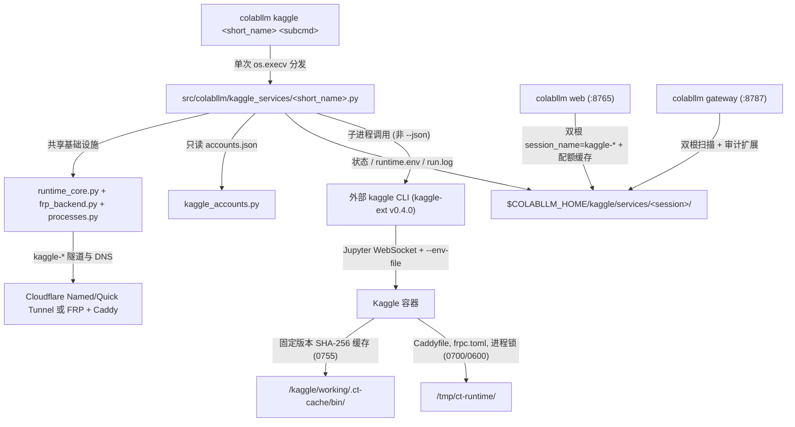

# ColabLLM Kaggle 运行时与多平台控制台/网关纳管 (`colabllm kaggle`)

*   **Author:** eric xiong
*   **Status:** Draft
*   **Date:** 2026-11-17

--------------------------------------------------------------------------------

## Overview

本设计文档定义如何在现有 `colabllm` 仓库（Python >=3.12、纯标准库零第三方依赖）中新增独立于现有 Google Colab 服务目录（`./src/colabllm/services/`）的 Kaggle 运行时体系，使 `colabllm` 能够通过 **`colabllm kaggle <short_name> <subcmd>`** 启动、监控与暴露运行在 Kaggle 交互式会话中的服务，并将 Kaggle 运行时实例与各账户每周 GPU/TPU 配额接入宿主机 `colabllm web` 控制台与 `colabllm gateway` 网关。

在跨仓库职责边界上，`colabllm` 保持零第三方依赖与凭据隔离：不导入 `kagglesdk`，也不直接读取 `~/.config/kaggle-ext/accounts/` 下的 OAuth、API Token（`KGAT_*`）或 Jupyter 代理凭据，而是通过子进程调用本机由 `kaggle-ext`（已验证基线 `v0.4.0`）扩展后的 `kaggle` CLI：
*   `kaggle account list --json` 与 `kaggle account status --json`
*   `kaggle session create|list|status|exec|logs|restart|stop`
*   `kaggle ext doctor --json`

公网隧道令牌与鉴权凭据（`CT_*` 密钥子集）仅通过宿主机 `0600` 权限的 `--env-file` 在 WebSocket 执行阶段注入远端 Kernel 内存，不写入云端占位 Notebook（`<username>/kaggle-ext-s-<session>`）版本历史记录。

作为第一阶段交付里程碑，本方案先实现一个公开的纯 CPU 连通性诊断 Web 服务 `web-probe`（配置 `gateway_enabled=False`，不提供 `/v1/*` OpenAI 推理或回显接口），用以验证两条路径：
1.  **真实 Kaggle 容器控制面端到端验证**：覆盖会话创建、流式 WebSocket 执行、`kaggle session logs -f` 只读监控重连、`/kaggle/working/.ct-cache` 内核重启复用与 `/tmp/ct-runtime`（`0700`/`0600`）运行时秘密配置隔离、Caddy 基础认证、Cloudflare/FRP 隧道，以及 `colabllm web` 双平台实例列表与配额展示。
2.  **本地 mock 与隔离单元测试验证**：覆盖 `colabllm gateway` 双状态根副本扫描、模拟 `gateway_enabled=True` 副本路由、审计字段写入以及 `HTTP 501`/`403` 防护拦截。

--------------------------------------------------------------------------------

## The Problem

1.  **单平台算力受限与多账号 Kaggle 配额未纳入编排**
    Colab CCU（Colab Compute Units，按小时消耗的计算单元余额）额度受单平台配额与风控波动影响。操作者宿主机已通过 `kaggle-ext` 管理多个拥有每周免费 GPU（`2×T4 16GB`）、TPU（`v5e-8`）及 CPU 会话配额的 Kaggle 账号，但缺少统一的公网隧道、前置认证、看门狗保活、状态视图以及控制台与网关接入层。

2.  **Kaggle 交互式会话的配额消耗模型、存储约束与命名规则不同于 Colab**
    *   **断连后持续消耗配额**：Colab VM 在 `colab exec` WebSocket 断开后会被平台自动回收，而 Kaggle 通过 `CreateKernelSession` 启动的交互式会话在宿主机 WebSocket 断开后仍会在云端继续运行（直至约 40–60 分钟空闲回收超时或平台单次运行上限），持续消耗每周 GPU/TPU 配额并占用并发槽位。直接套用 Colab 中 `max_restarts=0`（在 Colab 中表示不限制自动重启次数）或启动中途中断未取消远端会话，会遗留持续占用配额的孤儿容器。
    *   **无 Google Drive 挂载与双区隔离需求**：Kaggle 没有免浏览器 Drive 挂载层，`/kaggle/working` 仅在同一存活会话的内核重启（`restart`）之间保留（容器停止或重建后变空），且现有模板将工作目录（含明文 `Caddyfile`、`frpc.toml`、`frp-ca.crt`）放在单一路径；若直接放置于 `/kaggle/working`，密钥会在会话内持久化工作区残留。
    *   **会话名长度、`exec` 缓冲与 `status` 三态差异**：`kaggle-ext` 限定 `kaggle_session` 总长不超过 48 字符，而 Colab 实例后缀允许最多 64 字符；`kaggle session exec --json` 会等待执行结束才返回输出，流式输出必须使用非 `--json` 模式；`kaggle session status --json` 在未存活时统一退出码 `1`，必须读取 `live_state` 字段区分 `"reclaimed"`（容器已回收）与 `"unreachable"`（网络或代理超时），避免网络抖动误杀健康容器。
    *   **Jupyter 内核串行阻塞约束**：Jupyter 内核按顺序串行执行请求；当末尾看门狗阻塞单元处于运行态时，直接重新发起 `kaggle session exec` 会排队等待而无法执行启动脚本。容器健康时的流式重附必须依赖独立 `session_id` 的只读日志订阅接口（`kaggle session logs -f`）。

3.  **现有代码库与单一 Colab 目录和耦合模块绑定过深**
    *   [cli.py](../../src/colabllm/cli.py)、[instance_discovery.py](../../src/colabllm/lib/instance_discovery.py)、[state_store.py](../../src/colabllm/web_ui/state_store.py)、[runner_bridge.py](../../src/colabllm/web_ui/runner_bridge.py) 与 [routing.py](../../src/colabllm/gateway_runtime/routing.py) 均假设全局只有单一 `$COLABLLM_HOME/services/` 状态目录、单一 Colab 账户环境及 CCU 配额结构，无法识别 Kaggle 实例与周配额字段（`used_hours`/`remaining_hours`/`total_hours`）。
    *   [colabsvc.py](../../src/colabllm/lib/colabsvc.py)、[build_notebooks.py](../../templates/build_notebooks.py) 与 [tunnel_client.py](../../templates/tunnel_client.py) 把通用的原子状态锁、Cloudflare/FRP 隧道编排、域名校验、Caddy 配置与 Colab 专属的 `colab dfs mount`、`MuxDaemon`（[mux.py](../../src/colabllm/lib/mux.py) 的单进程多路复用后台守护）以及容器 `/content/*` 路径写在一起。直接复制该控制面代码会引发安全修复与 DNS 逻辑双份漂移。

4.  **直接用大模型联调新平台的试错成本过高**
    在尚未验证跨仓环境文件转义（例如多行 `CT_FRP_CA_CERT` 写入 `--env-file`）、容器内核重启端口回收、`auto-restart` 配额预检与控制台集成前，直接启动双卡 T4 模型会浪费每周 GPU 配额；因此第一阶段先以纯 CPU 标准库诊断 Web 服务完成控制面、隧道与双区隔离验证，同时将其排除在模型对话列表与网关推理接口之外。

--------------------------------------------------------------------------------

## Goals

*   **G1 — 统一命令命名空间与双射隔离**：建立 `colabllm kaggle <short_name> <subcmd>` 命令分发与单次 `os.execv` 路由、`kaggle-<short_name>` 跨平台双射键名及 `$COLABLLM_HOME/kaggle/services/<session>/state.json` 状态目录；独立命名 Cloudflare 隧道、DNS 归属注释与 FRP 路由前缀；严格隔离 Kaggle 账户解析优先级，并在变更网络资源前执行 48 字符会话名正则校验。
*   **G2 — 零第三方依赖、零云端明文落盘的双区存储与流式编排**：通过子进程调用 `kaggle-ext` 注入单行双引号转义的 `0600` `--env-file`（并在运行期间保留供重启复用、仅在中止清理或 `down` 后删除）；将容器内 `/kaggle/working/.ct-cache/`（带固定版本与 SHA-256 校验的二进制与编译缓存）与 `/tmp/ct-runtime/`（`0700` 目录、`0600` 密钥配置文件与日志）按权限分离。
*   **G3 — 周配额预检、四分支看门狗与全模式防孤儿保护**：非 CPU 会话启动前检查 `remaining_hours > 0.15`（保留 9 分钟启动与停止安全余量）；根据 `live_state` 与公网探活执行只读 `logs -f` 重附、服务不健康重启、网络异常退避等待与有界重建（`--max-restarts 3`），对全部非 CPU 会话统一实施宿主机侧 `--max-uptime 6h` 上限；无论前台、`--detach` 还是默认后台 `up`，在首次到达 `CT_READY` 前异常、超时或收到信号均自动执行 `kaggle session stop`。
*   **G4 — `colabllm web` 与 `colabllm gateway` 多平台集成**：在 `colabllm web` 中基于全局 `session_name`（`kaggle-<dir_name>`）区分平台、独立展示 Kaggle 周配额与双平台状态，提供 `/api/proxy/kaggle-web-probe/<inst>/health` 同源健康代理校验、公网 Caddy 页面跳转与 `0600` 轮转 `web.log`；在 `colabllm gateway` 修复全量 `specs` 透传，支持双状态根扫描、`HTTP 501` 拦截及带 `provider`/`account` 的审计日志。
*   **G5 — 抽离无状态基础设施并完成多阶段验证**：在不重写 Colab `supervise_instance_async` 与 `exec_runner` 主循环的前提下，将通用状态锁、域名/隧道/FRP 委托、HTTP 探活与 `0600` 日志轮转抽离至 `runtime_core.py`，参数化容器模板统一实现 `(pid, start_time)` 进程清理，并通过单元测试、同步校验、打包检查与真实 CPU 会话验证。

--------------------------------------------------------------------------------

## Non-Goals

*   **不提供独立顶级命令 `kagglellm`**：不向 [pyproject.toml](../../pyproject.toml) `[project.scripts]` 添加第二个入口。
*   **不在第一阶段 `web-probe` 伪造 OpenAI `/v1/*` 接口**：保持 `gateway_enabled=False` 且不加入聊天服务白名单；`GET /gateway/status` 在生产中只列举 `gateway_enabled=True` 副本（第一阶段通过模拟 `gateway_enabled=True` Kaggle 状态验证网关快照与转发路径）。
*   **不在 `colabllm` 内导入 `kagglesdk` 或替代 `kaggle-ext`**：不直接读取 `~/.config/kaggle-ext/accounts/` 下的任何凭据或状态文件。
*   **不在第一阶段迁移 GPU/TPU 大模型服务或预置 Dataset**：`qwen`、`indextts` 等双卡 T4 运行时与 `--dataset` 挂载留待后续阶段实现。
*   **不修改 Colab 运行时主逻辑或引入 `hidden=True` 特判链**：不改造现有 19 份 Colab 服务脚本逻辑或引入 Drive 挂载；`web-probe` 对齐既有纯 CPU 工具服务（如 `r2-migrate`）作为可见诊断服务分发，不引入跨模块 `hidden` 状态开关。
*   **不引入跨 CLI/Web UI 的 `--kaggle-account` 冗余参数**：`doctor` 复用现有 `-a/--account`，Web UI 通过 Kaggle 表单选择器与 `accounts.json` 选中目标账户，不新增 `default_kaggle_account` 全局开关。
*   **不引入容器内 `CT_MAX_UPTIME` 定时自退出或 `RuntimeDriver` 重构**：由宿主机看门狗配合 Kaggle 平台空闲限制守住时长上限；不重写 Colab 异步调度循环。

--------------------------------------------------------------------------------

## Open Questions

*   **None** — 第一阶段诊断服务可见定位（公开纯 CPU 诊断运行时 `web-probe`，附 `docs/kaggle-web-probe.md` 并保持 `gateway_enabled=False`）、`GET /gateway/status` 仅展示 `gateway_enabled=True` 副本，以及 CLI 短名 `<short_name>` 与全局键名 `kaggle-<short_name>` 的双射约定均已锁定。

--------------------------------------------------------------------------------

## Critical User Journeys (CUJs)

### CUJ 1: 启动纯 CPU 诊断服务 `web-probe` 并验证会话内缓存复用与双区清理

*   **Given**: 宿主机已安装 `colabllm` 与 `kaggle-ext`（已完成 `kaggle account login` 与 `tunnel-config`），目标账户无历史残留状态，环境变量 `$COLABLLM_HOME`（默认 `~/.colabllm`）指向宿主机状态根目录。
*   **When**:
    1.  用户执行 `colabllm kaggle web-probe up`（默认使用 `--transport cloudflare`；亦可通过 `--quick-tunnel` 覆盖为临时 TryCloudflare URL 或通过 `--transport frp --domain <fqdn>` 指定 FRP 域名）。
    2.  在容器保持运行期间，用户执行 `colabllm kaggle web-probe restart` 触发同容器内核级重启（保留 `/kaggle/working`，清空 Jupyter 内存变量），并通过 `colabllm kaggle web-probe info --json --show-secrets` 读取访问凭据校验公网接口。
    3.  用户执行 `colabllm kaggle web-probe down --delete-tunnel` 停止会话后，再运行 `colabllm kaggle web-probe up` 申请新容器。
*   **Then**:
    1.  首次 `up` 调用 `kaggle session create` 创建私密占位内核（`<username>/kaggle-ext-s-web-probe`）并原子写入 `$COLABLLM_HOME/kaggle/services/web-probe/state.json`，随后以非 `--json` 流式模式运行 `kaggle session exec` 注入 `0600` `runtime.env`（含多行 `CT_FRP_CA_CERT` 单行转义），打印 `CT_PUBLIC_URL` 与 `CT_READY`。容器内 Caddy 在 `public_port=18080` 对外提供基础认证反代，转发至容器内监听 `127.0.0.1:18090` 的纯标准库 HTTP 服务；二进制写入 `/kaggle/working/.ct-cache/bin/`，含密钥配置仅存于 `0700` `/tmp/ct-runtime/`。
    2.  `restart` 先安全结束宿主机旧流式 `exec` 监听进程，重启云端内核并复用 `/kaggle/working/.ct-cache/bin/` 既有二进制（输出 `CT_CACHE_EVENT status=hit`），同时通过 `{CT_WORK_DIR}/{name}.proc.json` `(pid, start_time)` 清理旧容器内业务、Caddy 与隧道进程，不发生 `EADDRINUSE`；未携带凭据访问公网地址返回 `HTTP 401`，携带正确基础认证访问 `/`（HTML 状态页）与 `/health`（JSON）均返回 `HTTP 200`。
    3.  `down` 取消远端会话并移除临时 `runtime.env` 与单次会话状态字段，保留持久鉴权字段供复用（带 `--delete-tunnel` 时同步清理 DNS/FRP 路由）；再次 `up` 在空容器上回退重新下载与校验并重建运行时。

### CUJ 2: GPU/TPU 配额预检拦截、网络抖动保护、有界保活与启动中止清理

*   **Given**: 宿主机配置了两个 Kaggle 账户（`acct_empty` 的 GPU 剩余配额为 `0.05h`；`acct_ok` 剩余配额为 `20.0h`，高于 `0.15h` 阈值），同时具备本地隔离单元测试模拟桩覆盖远端容器回收与到达 `--max-uptime` 上限的路径。
*   **When**:
    1.  用户执行 `colabllm kaggle -a acct_empty web-probe up --dry-run --accelerator NvidiaTeslaT4` 做规格透传检查；随后测试真实非 CPU 运行时请求（或配额不足账户发起非 CPU 会话申请），并在另一次带 `-a acct_ok` 且尚未到达 `CT_READY` 时触发 `SIGINT`（或在 Web UI 取消 `--detach` 任务发送 `SIGTERM`）。
    2.  在启用 `--auto-restart` 的非 CPU 会话（单测/集成桩环境）中，先后触发宿主机网络中断（`live_state == "unreachable"`）、容器仍然存活（`live_state == "running"`）、容器已被回收（`live_state == "reclaimed"`）以及到达 `--max-uptime`（默认 `6h`）。
*   **Then**:
    1.  `web-probe up --dry-run --accelerator NvidiaTeslaT4` 在离线检查路径名后输出执行计划，不调用 `kaggle` 子进程且不写入 `$COLABLLM_HOME`；无 `--dry-run` 时，非 CPU 需求若配额 `remaining_hours <= 0.15` 或处于纯 CPU 探针限制下即在创建任何 DNS、隧道或云端会话前被直接拦截报错。
    2.  创建会话后、到达 `CT_READY` 前发生失败或收到 `SIGINT`/`SIGTERM`（涵盖前台、默认后台与 `--detach` 模式）时，清理逻辑利用已落盘的 `state.json` 自动调用 `kaggle -a acct_ok session stop` 并清理本次会话运行态与 `runtime.env`；若远端取消因网络失败，则保留 `state.json` 并输出含 `kernel_session_id` 的 `ORPHAN_SUSPECTED` 告警。
    3.  看门狗在 `"unreachable"` 下仅按指数退避重试探测，不调用 `stop` 或重建；在 `"running"` 且公网探活返回 `HTTP 200` 时通过 `kaggle session logs -f` 只读流重附（不触发串行内核阻塞，也不增加重启计数）；在 `"reclaimed"` 下复查配额后于 `--max-restarts 3` 范围内重建，并在单次 `up` 达到 `--max-uptime` 后主动执行 `stop` 释放配额。

### CUJ 3: `colabllm web` 双平台实例监控与独立周配额查看

*   **Given**: 宿主机存在活跃的 Colab 服务实例与 Kaggle `web-probe` 实例，且已配置多个 Kaggle 账户。
*   **When**: 用户启动 `colabllm web`，打开浏览器控制台查看实例列表、Kaggle 账户配额栏、日志流抽屉与启动弹窗；通过同源代理请求 `/api/proxy/kaggle-web-probe/<inst>/health`，并点击“打开 Web UI”访问公网 Caddy URL。
*   **Then**: 控制台通过 `provider` 与全局 `session_name = "kaggle-<dir_name>"` 区分实例来源，在独立卡片渲染各 Kaggle 账户每周 GPU/TPU 已用与剩余小时数（保持原有 Colab CCU 接口结构不变）；从表单启动 Kaggle 服务时仅生成 Kaggle 专属参数并禁止注入 Colab 专属参数（`--gpu`、`--drive-account`、`--no-drive`、`--exec-backend`、`--no-mux`）及 Colab `default_account` 自动填充，支持显式传递 `--max-restarts 0`；日志抽屉流式展示按行脱敏后的 `run.log`；`/api/proxy/kaggle-web-probe/<inst>/health` 经基础认证返回脱敏保护后的 JSON 状态（并记录脱敏 JSONL 至 `web.log`），公网 Caddy 地址正常打开诊断 HTML 页面。

### CUJ 4: `colabllm gateway` 双状态根扫描、`HTTP 501` 拦截与路由审计

*   **Given**: `colabllm gateway` 在 `127.0.0.1:8787` 启动，运行环境存在 Kaggle `web-probe` 实例（`gateway_enabled=False`）以及单元测试构造的模拟 `gateway_enabled=True` Kaggle 副本。
*   **When**: 客户端请求 `GET /gateway/status` 与 `GET /v1/models`，向 `POST /v1/chat/completions` 发送 `model="mock@kaggle-web-probe"`（或 `/r/kaggle-web-probe/v1/chat/completions`），或在网关允许的媒体字段中传入 `/kaggle/...` 路径，以及向模拟启用的 Kaggle 模型发送推理请求。
*   **Then**: 网关同时扫描 `$COLABLLM_HOME/services/` 与 `$COLABLLM_HOME/kaggle/services/`；生产态 `web-probe` 不进入 `/v1/models` 与 `/gateway/status`，客户端调用时网关在入口返回 `HTTP 501`（`service_unregistered`）并向 `gateway.log` 写入包含 `"provider": "kaggle"` 与 `"account"` 的结构化审计记录；请求媒体字段携带 `/kaggle/` 路径时被安全守卫拦截返回 `HTTP 403`；模拟 `gateway_enabled=True` 的 Kaggle 副本在 `/gateway/status` 中显式标记 `provider` 与 `account`，且能正确完成 `@<runtime>[:<inst>]` 语法路由与上游转发。

--------------------------------------------------------------------------------

## Technical Plan (Architecture)

### 1. 组件拓扑与共享基础设施边界

架构采取“**无状态基础原语下沉 `runtime_core.py` + 平台隔离目录/账户/看门狗**”的分层方案：保留现有 `./src/colabllm/services/`、`colabsvc.py` 异步/多路复用主循环、[colab_ws.py](../../src/colabllm/lib/colab_ws.py) 与 [mux.py](../../src/colabllm/lib/mux.py) 不变（仅对迁出符号保持兼容重导出）；将可跨平台复用的状态锁、域名与隧道/FRP 编排、HTTP 探活、私有 `0600` 轮转日志与单行 env 转义收口进 `runtime_core.py`；Kaggle 侧通过 `kagglesvc.py` 维护直白独立的三态子进程看门狗。



模块抽象边界划分：
*   **共享无状态基座（`runtime_core.py`）**：承载跨平台 `ProviderNamespace`（封装隧道前缀、DNS/FRP 归属前缀与保留端口集合）、支持动态覆盖 `state_root` 的原子锁状态管理、统一自 `colabsvc` 与 `state_store` 收口而来的 `tunnel-config` 与域名/实例参数解析、带双向平台前缀校验的 Cloudflare/FRP 路由管理、[gateway_runtime/server.py](../../src/colabllm/gateway_runtime/server.py) 同源的 `RotatingFileHandler` `0o600` 轮转日志器（确保轮转备份同样 `0o600`）、简洁 HTTP 探活 `probe(url, path)`、按行缓冲的密钥脱敏过滤、单行转义 `env` 文件生成、退避计算以及就绪日志轮询框架。
*   **协议解析与容器模板复用**：在 [protocol.py](../../src/colabllm/lib/protocol.py) 内通过标记参数化扩展 `NotebookProtocol`，避免复制流式 UTF-8 与缓冲防溢出逻辑；在 [build_notebooks.py](../../templates/build_notebooks.py) 与 [tunnel_client.py](../../templates/tunnel_client.py) 中参数化工作目录、缓存目录、二进制目录，把基于 `/proc/{pid}/stat` `start_time` 标记的进程停止函数提取至公共单元，覆盖容器内 `service`、`caddy`（涵盖全部既有模板中的 Caddy 单元）与隧道进程，替换所有 `pkill -f` 模糊杀进程调用。

### 2. CLI 单次分发、双射命名规则与 `prefer_saved` 多账户隔离

*   **单次 `os.execv` 分发与延迟参数校验**：
    *   [cli.py](../../src/colabllm/cli.py) 注册顶级保留字 `"kaggle"`。执行 `colabllm kaggle <short_name> <subcmd>` 时，直接在进程内解析 `<short_name>` 并**单次 `os.execv`** 转入目标服务模块，省去中间脚本二次解释器启动开销；仅 `colabllm kaggle services`、`help` 或 `--help` 交由辅助命令处理器处理。
    *   全局前置 `-a / --account` 参数校验在全部入口（[cli.py](../../src/colabllm/cli.py)、[utility.py](../../src/colabllm/utility.py)、[web.py](../../src/colabllm/web.py)、[gateway.py](../../src/colabllm/gateway.py)）拆分为两阶段：解析参数时只做防目录穿越语法预检，确认目标平台后，再分别调用 Colab 或 Kaggle 专属账户校验规则。
    *   静态卫生检查禁止在 Colab `services/` 使用 `kaggle` 或 `kaggle-*`，禁止在 `kaggle_services/` 使用 `kaggle-*` 前缀，保障短名与 `kaggle-<short_name>` 的全局可逆双射。

*   **跨平台双射命名与资源隔离对照表**：

| 维度 | Colab 既有规范 | Kaggle 新增规范 | 冲突防护约束 |
| --- | --- | --- | --- |
| CLI 命令形态 | `colabllm <short_name> <subcmd>` | `colabllm kaggle <short_name> <subcmd>` | 禁止独立 `kagglellm`；`services/` 禁用 `kaggle` 与 `kaggle-*` |
| 控制台 / 网关服务键名 | `<short_name>` | `kaggle-<short_name>`（携带 `short_name` 与 `provider="kaggle"`） | 无冒号或斜杠，复用 Web 两段路径与网关 `@<runtime>[:<inst>]` |
| 控制台实例全局标识 | `<dir_name>` | `session_name = "kaggle-" + <dir_name>`（`storage_session = <dir_name>`） | 前端节点缓存、任务协调与代理查找无跨平台覆盖 |
| 宿主机状态目录 | `$COLABLLM_HOME/services/<session>/` | `$COLABLLM_HOME/kaggle/services/<session>/` | `state.json` 记录 `schema_version=1` 与 `provider="kaggle"` |
| 远端会话名 | Colab `sessions.json` key（后缀 `<= 64` 字符） | `kaggle_session` = `<short_name>` 或 `<short_name>-<inst>` | 上线前以正则 `^[A-Za-z0-9][A-Za-z0-9-]{0,47}$` 拒绝超长名称 |
| Cloudflare 隧道 / DNS | 隧道 `colab-<session>`；DNS `colabsvc <session>` | 隧道 `kaggle-<session>`；DNS `kagglesvc <session>` | 通过双向归属前缀互不认领或误删（从头脑风暴阶段早期命名收口为 `kagglesvc`） |
| FRP 服务标识 | 服务 `<session>`；DNS `colabsvc-frp <proj> <session>` | 服务 `kaggle-<session>`；DNS `kagglesvc-frp <proj> <session>` | 隔离共享 `frps` 与 `--base-domain` 路由及双向后端切换校验 |
| 默认公网域名前缀（CF/FRP 通用） | `<alias>`（由服务名或别名决定） | 若默认主机名尚未含 `kaggle-` 前缀则自动前缀 `kaggle-<alias>` | 双隧道传输方式统一生效，且不产生 `kaggle-kaggle-*` 重复前缀 |

*   **多账户双向解析、`completion` 与 `doctor`**：
    *   `kaggle_accounts.py` 对齐 [colab_accounts.py](../../src/colabllm/lib/colab_accounts.py) 的 `prefer_saved` 开关机制：`up`（`prefer_saved=False`）按 `-a` -> `COLABLLM_KAGGLE_ACCOUNT` -> `KAGGLE_ACCOUNT` -> `accounts.json["active"]` 解析；存量生命周期命令 `status`/`down`/`restart`/`logs`/`info`/`--auto-restart`（`prefer_saved=True`）将 `state.json["account"]` 置于环境变量之前，避免当前 Shell 环境变量错操作历史实例。每次构造子进程环境均显式清除冲突环境变量（`KAGGLE_USERNAME`、`KAGGLE_KEY`、`KAGGLE_API_TOKEN`、`KAGGLE_CONFIG_DIR` 与未指定的 `KAGGLE_ACCOUNT`），仅保留 `KAGGLE_EXT_CONFIG_DIR` 与 `XDG_CONFIG_HOME`。
    *   [completion.py](../../src/colabllm/lib/completion.py) 不读取任何 `state.json`，基于已知短名列表最长前缀剥离解析 `-i/--instance`，从 `kaggle_accounts` 补全 `-a/--account`；[doctor.py](../../src/colabllm/lib/doctor.py) 增加 `--provider {colab,kaggle,all}`（默认 `colab` 以保持既有回归行为不变），在指定 `kaggle` 时跳过 `colab`/Drive 必检项并通过 `kaggle session --help`、`kaggle account --help`（检测 `[kaggle-ext]` stderr fail-open 警告）与 `kaggle ext doctor --json` 判定扩展可用性。

### 3. 会话生命周期、流式监控与状态/密钥边界

*   **先落盘后执行与字段复用策略**：
    *   在 `kaggle session create` 返回 `kernel_session_id` 后、启动流式 `exec` 前，加实例文件锁原子写入 `state.json`，沿用现有 `cloudflare_route`、`frp_route`、`started` 等核心键名并在 `state.json["env"]` 中保留**非敏感**运行时参数（兼顾二期网关槽位并发读取），同时补充 `ever_ready` 状态标记；高敏感凭据（隧道令牌、CA 证书、Basic Auth 密码、API Token、`HF_TOKEN`）只写入 `0600` `<instance_dir>/runtime.env`。
    *   `runtime.env` 在整个活跃会话生命周期（含 `up`、`restart`、`--auto-restart`）期间保持存在以支持无感凭据重注，仅当未就绪中止清理完成或 `down` 确认远端停机时原子删除。`down` 清理单次会话态时保留持久凭据与隧道归属字段（除非显式 `--delete-tunnel`）。
    *   始终下发预先生成的 `CT_AUTH_PASS` 与 `CT_API_TOKEN`（配合空占位重置不再使用的隧道键），其作用机理是阻止远端模板因缺少入参而现场生成并在标准输出打印明文凭据（避免写入 `kaggle-ext` 云端代理 `session_logs/`）；操作者本地通过 `colabllm kaggle <short_name> info --json --show-secrets` 读取鉴权凭据。
*   **凭据脱敏与协议流分离**：
    *   `TaskManager`（Web UI 的后台异步子进程管理器）输出转发与宿主机 `run.log` 写入统一使用按行缓冲（设 64 KiB 超长行截断刷新兜底）调用脱敏函数：仅替换密钥键名白名单、已知明文秘钥值与常见 Token 前缀（`sk-`/`hf_`/`KGAT_`/`Authorization:`），不掩盖 `CT_STAGE=`、`CT_CELL=`、`CT_CACHE_EVENT`、`CT_DISK_STAT`、`CT_PUBLIC_URL=`、`CT_READY` 等协议状态输出。
*   **预检、四分支看门狗与全模式防孤儿机制**：
    *   **配额与离线约束**：请求非 CPU 加速器时，先检查 `kaggle account status --json` 返回目标账户是否已完成认证且对应配额 `remaining_hours > 0.15`（缺失或 `null` 均按 fail-closed 拦截）；`web-probe` 在非 `--dry-run` 时拒绝非 CPU `--accelerator` 申请；并发检查 `--no-internet` 与公网联网冲突；所有校验均在修改任何 DNS 或 FRP 资源前完成（若云端 `create` 仍然失败则回滚本次新建路由）。
    *   **全模式 `ever_ready` 止损**：无论采用默认 `up`、`--foreground` 还是 Web UI 传入的 `--detach`，自创建云端会话起至首次到达 `CT_READY` 前，若发生超时、执行异常或收到 `SIGINT`/`SIGTERM`（默认 `up` 在就绪前按 `Ctrl-C` 同步取消远端会话并中止后台执行器），自动调用 `kaggle session stop`；成功停止后清除 `runtime.env` 与当次会话态，失败则保留 `state.json` 并提示 `ORPHAN_SUSPECTED`。
    *   **四分支看门狗与本地 `restart` 交接**：
        1.  `live_state == "running"` 且公网 `probe()` 返回健康：通过 `kaggle session logs -f`（独立只读监控 `session_id`）重新附着继续收集心跳，不重复发起阻塞内核的 `exec`。
        2.  `live_state == "running"` 但公网 `probe()` 持续失败：执行 `kaggle session restart` 重启内核并重新 `exec`（计入 `--max-restarts`）。
        3.  `live_state == "unreachable"`：指数退避探测等待，不销毁容器。
        4.  `live_state` 为 `"reclaimed"` 或 `"missing_credentials"`：复查账户配额后于 `--max-restarts`（默认 `3`，可传 `0` 禁用）上限内清理旧隧道并重建会话。
        *   全部非 CPU 会话在宿主机执行器侧按单次 `up` 起始时刻强制执行 `--max-uptime`（默认 `6h`）。执行 `restart` 子命令时，先在操作锁内安全停止已有宿主机看门狗子进程再重启远端内核，消除并发重连竞争。

### 4. 容器双区存储布局、固定校验与 `web-probe` 运行时

*   **双区目录与固定版本校验**：
    *   **非敏感缓存区（`/kaggle/working/.ct-cache/`，`0755`）**：统一存放 `caddy`、`cloudflared`、`frpc` 二进制至 `/kaggle/working/.ct-cache/bin/`，写入过程使用同分区 `.partial` + 原子 `os.replace` 并维护 `.manifest.json`。对 `frpc`（通过固定 `CT_FRP_VERSION` 与官方 `frp_sha256_checksums.txt`）、`caddy`（通过固定 `CADDY_VERSION` 与 `caddy_{ver}_checksums.txt`）与 `cloudflared`（通过固定 `CLOUDFLARED_VERSION` 与内置按架构 SHA-256 映射表）执行下载校验，不依赖运行时查询 GitHub Release API。每次执行输出 `CT_CACHE_EVENT` 与 `CT_DISK_STAT`。
    *   **运行时私密区（`/tmp/ct-runtime/`，目录 `0700`，文件 `0600`）**：存放 `Caddyfile`、`frpc.toml`、`frp-ca.crt`、进程锁文件 `{name}.proc.json` 与容器内守护日志，与 `/kaggle/working` 隔离。
*   **纯 CPU 诊断测试服务 `web-probe`**：
    *   定位为随包分发的公开纯 CPU 连通性诊断运行时（配 `gateway_enabled=False`，不含开放对话/推理能力，模块文档注释不引入模型/OpenAI 关键词以免误触发网关分类）；支持 `CT_WORK_DIR`/`CT_CACHE_DIR`/`CT_BIN_DIR` 变量化注入与 `{name}.proc.json` 进程回收。
    *   容器内服务在本地环回端口监听（`service_port=18090`），仅提供 `GET /`（诊断 HTML，含安全响应头）与 `GET /health`（JSON 健康状态），对 `/v1/*` 返回 `HTTP 404`；容器内 Caddy 监听 `public_port=18080` 提供基础认证、剥离 `Set-Cookie` 响应头以防止凭据外泄，并经公网隧道（Cloudflare Named/Quick Tunnel 或 FRP）对外暴露。

### 5. `colabllm web` 与 `colabllm gateway` 多平台集成契约

*   **`colabllm web` 多平台控制台与同源代理边界**：
    *   服务目录自省同时发现 Colab 与 Kaggle 服务，通过 `kaggle-<short_name>` 建立服务与参数模型映射（Kaggle 表单启用专属参数并剔除 Colab 专用参数，支持显式提交 `--max-restarts 0`，命令预览生成 `colabllm kaggle <short_name> ...`）。
    *   双根状态存储对外返回全局唯一的 `session_name = "kaggle-" + <dir_name>`（并在记录保留 `storage_session` 映射磁盘短路径），确保前端卡片协调、日志追踪与停止操作不与同名 Colab 服务发生键值覆盖，同时保持清理接口仅在各自平台根目录下操作与淘汰缓存。
    *   鉴于 Web UI 同源代理出于防 XSS 约束将上游 `text/html` 响应降级为纯文本加沙箱 CSP，前端保留既有“新标签页直开公网 Caddy URL”打开 HTML 诊断页，并用同源 `/api/proxy/kaggle-web-probe/<inst>/health` 完成基础认证代理与 JSON 健康校验；代理与异常处理向宿主机轮转 `web.log`（`0600`）写入脱敏 JSONL 审计日志（禁记认证头与 Cookie）。
    *   后端配额拉取维持原有 Colab `/api/accounts/usage` 顶层字段不变，通过独立的 `60s` 并发去重（single-flight）线程池与缓存并发汇总 `kaggle account status --json` 与 `kaggle session list --all-accounts --json`，在响应中追加 `"kaggle"` 对象并在浏览器端独立渲染周配额面板（保留 `/api/bootstrap` 零子进程约定）；`/api/doctor` 补充可选 `provider` 参数以支持隔离诊断。
*   **`colabllm gateway` 双状态根路由与安全守卫**：
    *   服务目录登记 `"kaggle-web-probe": RuntimeGatewaySpec()`（`gateway_enabled=False`）。修复网关服务端全部 `get_runtime_spec()` 及根路径 POST 路由预检调用，全量透传路由器实际持有的 `specs` 映射（兼容外部与测试自定义目录注入）。
    *   扩展网关配置与路由器的双状态根扫描逻辑（支持自定义根目录派生、基于 `kaggle-` 前缀分流，以及针对模拟 `gateway_enabled=True` 服务的副本映射），在副本运行时对象及 `/gateway/status` 响应中标注 `provider` 与 `account`，并按平台格式化 `HTTP 503`/`524` 命令行排错指引。
    *   在 `gateway.log` 追加 `"provider"` 与 `"account"` 字段，保持结构定长一致。在媒体字段防穿越列表补充 `"/kaggle/"` 作为纵深前缀说明（注：现有列表已含 `"/"` 拦截前导绝对路径，仅覆盖允许列表中的媒体字段；二期实际大模型服务入驻时须按模型 API 字段显式定义 `drive_forbidden_fields` 进行全量路径黑名单防护）。请求误命中未开放网关服务的 `kaggle-web-probe`（不论 `@<runtime>[:<inst>]` 语法还是 `/r/<runtime>/...` 路径）统一在入口返回 `HTTP 501`（`service_unregistered`）。

--------------------------------------------------------------------------------

## Alternatives Considered

### Alternative A: 直接在 Kaggle 上复用现有 `./src/colabllm/services/*.py` 运行时

*   **Pros**: 无需在仓库内开辟新的服务目录树与平台调度逻辑，表面上所有服务代码集中在一处。
*   **Cons**: 现有 Colab 运行时脚本普遍面向 G4（96 GB）/ A100 / H100 单卡大显存、高配 Colab VM 内存以及 `/content/drive` FUSE 持久化目录；强行复用会在 Kaggle 的 CPU / `2×T4 16GB` / `TPU v5e-8` 环境中因显存、内存与缺失 Drive 挂载而报错退出。
*   **Reason for Rejection**: 现有 Colab 服务面向单卡大显存与 `/content/drive` 挂载，与 Kaggle 的硬件配额模型及无 Drive 环境不兼容。

### Alternative B: 使用官方 `kaggle kernels push` 批处理模式并在 Notebook 前导单元内嵌密钥

*   **Pros**: 仅调用原生官方 `kaggle` CLI 即可触发远端运行，不依赖 `kaggle-ext` 的交互式会话扩展。
*   **Cons**: `SaveKernel` 会将完整 Notebook 源码连同拼接进前导单元的隧道令牌和鉴权密钥一并写入云端 Kernel Version 历史记录；且批处理模式仅提供单向 SSE 日志，缺乏交互式 WebSocket 执行控制与即时内核重启复用能力。
*   **Reason for Rejection**: `SaveKernel` 会将源码与内嵌凭据写入云端 Kernel Version 历史记录，违反凭据不进 Notebook 的安全约束，且无法提供实时 WebSocket 执行与运行时内存凭据注入能力。

### Alternative C: 在 `colabllm` 内直接导入 `kagglesdk` 或读取 `~/.config/kaggle-ext/` 代理凭据并复用 `MuxDaemon`

*   **Pros**: 可把 Kaggle WebSocket 连接整合进类似 [mux.py](../../src/colabllm/lib/mux.py) 的单进程 `asyncio` 多路复用守护进程，减少每个运行实例额外拉起的子进程常驻内存开销。
*   **Cons**: 打破 [pyproject.toml](../../pyproject.toml) 零第三方依赖约束（必须引入 `kagglesdk` 及其传递依赖），同时让 `colabllm` 跨仓库边界直接读取 `kaggle-ext` 的私有 OAuth 与 Jupyter 代理令牌文件，并在两个仓库间复制 Kaggle 会话协议与认证逻辑。
*   **Reason for Rejection**: 会话创建、私有空壳占位与 RFC 6455 WebSocket 逻辑已统一实现在 `kaggle-ext` 的 `kaggle session` 中；`colabllm` 保持纯标准库零第三方依赖且不跨边界读取底层 OAuth 或代理令牌。

### Alternative D: 旁路完整复制一份独立于 `colabsvc.py` 与 `templates/` 的 Kaggle 控制面与运行模板

*   **Pros**: 完全不触碰 [colabsvc.py](../../src/colabllm/lib/colabsvc.py)、[build_notebooks.py](../../templates/build_notebooks.py) 与现有 Colab 模板代码，初期修改隔离度高。
*   **Cons**: 会复制相关 Cloudflare DNS 冲突防护、FRP 路由配置与回滚、`0600` 锁文件状态机、端点 HTTP 探活以及 Caddy `Set-Cookie` 剥离头过滤逻辑；后续任一安全修复或协议变更都会在两份平行代码间产生代码漂移。
*   **Reason for Rejection**: 重复维护 Cloudflare DNS 归属校验、FRP 路由回滚、`0600` 锁文件状态机与 Caddy 安全头过滤会导致后续安全补丁迅速分叉；抽离共享无状态基础原语 `runtime_core.py` 既能去重又不改动 Colab 主调度循环。

### Alternative E: 在 `pyproject.toml` 暴露独立的 `kagglellm` 顶级命令入口或并行守护进程

*   **Pros**: 保持 `<short_name> <subcmd>` 两级命令对称性，不需改动 [cli.py](../../src/colabllm/cli.py) 与 [completion.py](../../src/colabllm/lib/completion.py) 的顶级分发结构。
*   **Cons**: 分散共享控制面（用户和脚本难以判断 `tunnel-config`、`frp-config`、`web`、`gateway`、`doctor` 应调用哪个命令），且需额外维护两套 Shell 补全入口与文档同步检查。
*   **Reason for Rejection**: 统一采用 `colabllm kaggle <short_name> <subcmd>` 子命令命名空间，共用单一 `tunnel-config`、`web`、`gateway`、`completion` 与 `doctor` 控制面，避免双入口引发配置与监控分散。

### Alternative F: 在第一阶段纯 CPU 测试服务中内置模拟 `/v1/models` 与 `/v1/chat/completions` 接口（`gateway_enabled=True`）

*   **Pros**: 无需等待第二阶段 GPU 大模型上线即可用真实的纯 CPU 容器端到端联调网关路由与 SSE 流式转发。
*   **Cons**: 会将合成的模拟模型名注入 `/v1/models` 并污染交互式客户端（`pi` / OpenAI SDK / Web UI Playground）可见模型列表，若忘记下线还可能误导外部调用方把测试回显端点当成真实推理模型。
*   **Reason for Rejection**: 首批纯 CPU 服务仅用于基础设施与 Web/隧道验证（保持 `gateway_enabled=False`），不伪造推理接口污染模型列表；网关 `/v1/*` 数据面在第一阶段通过本地 mock 单元测试覆盖，真实容器端到端转发留待第二阶段大模型服务验收。

### Alternative G: 将纯 CPU 测试服务仅作为 `tests/fixtures/` 非分发测试夹具并通过环境变量挂载

*   **Pros**: 对外发布的 wheel 与 sdist 包中不含测试服务文件，也无需维护包内诊断文档。
*   **Cons**: 通过 `uv tool install colabllm` 安装的用户环境无法运行内建探针来排查 Kaggle 会话、Caddy 鉴权或 FRP 隧道故障，且无法在打包验收脚本 [check_distribution.py](../../tools/check_distribution.py) 中对该服务执行安装态 `dry-run` 验证。
*   **Reason for Rejection**: 选择将 `web-probe` 作为随包公开分发的纯 CPU 诊断运行时（与既有纯 CPU 工具服务 `r2-migrate` 保持一致的机制：`gateway_enabled=False` 且不列入对话白名单），既避免引入跨 8 个模块的 `hidden=True` 过滤特判链，又使离线发行环境能直接运行诊断探针。

### Alternative H: 在 `colabllm web` 与网关采用显式 `(provider, service)` 多段 URL 路由与 `@kaggle.<name>` 点号限定名

*   **Pros**: 各层内部模型与 URL 原生保留相同短服务名，未来 Colab 与 Kaggle 若需并存同名模型时无需做短名与前缀名映射。
*   **Cons**: 需改动 [web_ui/server.py](../../src/colabllm/web_ui/server.py) 的固定两段 REST 路径解析与全部前端 JS 请求拼接，同时要求客户端在 `@` 后使用带点号的字符串，增加部分第三方客户端或网关路由解析边界风险。
*   **Reason for Rejection**: 选择统一映射为 `kaggle-<short_name>` 全局双射前缀键名，保持现有两段式 Web API 路径与网关 `@<runtime>[:<inst>]` 格式不变，降低路由层与客户端解析复杂度。

--------------------------------------------------------------------------------

## Non-Functional Requirements

*   **Security & Privacy**:
    *   **宿主机目录与文件权限**：`$COLABLLM_HOME/kaggle/` 及其下属 `<session>/` 目录统一设置为 `0700`；`state.json`、`runtime.env`、`.runner.lock` 与 `run.log` / `web.log` 以 `0600` 原子写入或轮转；`kaggle_accounts.py` 对 `accounts.json` 只读解析（不读取任何 `kaggle.json`、`access_token`、`credentials.json` 或 `sessions.json`）。
    *   **云端零凭据与容器分区**：禁止任何密钥或 `Caddyfile`/`frpc.toml`/`frp-ca.crt` 写入 `/kaggle/working`（统一限定在 `0700` `/tmp/ct-runtime/`）；在 `runtime.env` 中始终显式下发预先生成的 `CT_AUTH_PASS` 与 `CT_API_TOKEN` 关闭云端模板的明文凭据回显；在宿主机 `run.log` 写入与 `TaskManager` 按行输出转发中，仅脱敏敏感密钥字段与令牌模式，保持状态协议行可读。
    *   **网关安全边界**：[gateway_runtime/auth.py](../../src/colabllm/gateway_runtime/auth.py) `FORBIDDEN_DRIVE_SCHEME_PREFIXES` 补充 `"/kaggle/"` 对齐现有 `"/content/"` 防护（并明确二期需为具体模型逐项定义 `drive_forbidden_fields`）；Web UI `/api/proxy/...` 访问与异常日志严禁记录鉴权头与 Cookie。
*   **Performance, Memory & Resource Overhead**:
    *   **子进程与心跳解耦**：每个活跃 Kaggle 实例维持 1 个流式 `kaggle session exec`（或恢复期 `kaggle session logs -f`）子进程（约 `40–80 MiB RSS` 为实现前预估值，交付后需实测记录）；容器 `ct_watchdog` 保持 `30s` 内部进程存活性检查，外部 `[heartbeat]` 打印节流至 `120s`（小于 `300s` 看门狗流式静默巡检阈值），仅在静默超时或 HTTP 探活失败时才拉起短时 `kaggle session status --json`。
    *   **日志轮转与并发配额查询**：宿主机 `run.log` 与 `web.log` 各自执行 `10 MiB × 3` 轮转，防止长时间保活占满宿主机磁盘空间；`colabllm web` 采用 `60s` 并发去重（single-flight）缓存 `_KAGGLE_USAGE_CACHE` 并发查询两平台配额，互不阻塞页面刷新。
*   **Rollout, Coexistence & Rollback**:
    *   **向后兼容共存**：既有的 `~/.colabllm/services/`、`~/.colabllm/tunnel-config.json` 与正在运行的 Colab VM 及 `MuxDaemon` 保持不变；缺失 `"provider"` 字段的历史 `state.json` 一律视为 `"colab"`。
    *   **回滚前清理契约**：若需从新增 Kaggle 支持的版本降级回 `v1.1.0` 发布基线，操作者须先对全部运行中 Kaggle 实例执行 `colabllm kaggle <short_name> down --delete-tunnel`，再调用 `kaggle session list --all-accounts --json` 核实云端无残留活跃会话，防止降级后失去控制面能力造成孤儿容器继续消耗每周配额。

--------------------------------------------------------------------------------

## Risks & Limits

| 风险 / 限制项 | 影响范围与触发条件 | 缓解措施 |
| --- | --- | --- |
| **宿主机休眠、断网或进程 `SIGKILL` 造成孤儿会话窗口** | 宿主机进入休眠或被强杀时，看门狗无法触发 `kaggle session stop` 或执行 `--max-uptime`，Kaggle 容器将在云端继续运行约 `40–60` 分钟直到平台空闲回收。 | 依托 Kaggle 平台约 40–60 分钟空闲上限止损，并在 `colabllm doctor --provider kaggle --online` 与 `web_ui` 中对比 `kaggle session list --all-accounts --json` 与本地 `state.json` 提示用户手动清理残留会话。 |
| **外部 `kaggle-ext` 输出或 JSON 契约版本漂移** | 若 `kaggle-ext` 后续升级更改 `session create/status/exec/logs` 或 `account status --json` 字段名或 stderr 标志格式，本地解析会退化或失败。 | 在 `doctor` 中通过 `kaggle ext doctor --json` 与 `--help` 核验扩展状态，对非预期 JSON 字段或非预期状态码采取 `fail-closed` 拒绝启动非 CPU 会话并提示升级兼容提示。 |
| **固定 `caddy` / `cloudflared` 版本号与上游变更维护** | `caddy` 与 `cloudflared`（后者官方无独立校验和清单文件）在模板中采用固定版本与 SHA-256 校验，上游安全更新或下线旧版本时需要同步迭代版本常量。 | 明确版本常量集中在构建模板头部定义，发版前经实机缓存重建与单位校验核实下载源可用性。 |
| **`kaggle account status --json` 缺失重置时间与并发上限字段** | `kaggle-ext` 返回 `used_hours`、`remaining_hours`、`total_hours`，不含配额重置时间与账号并发配额上限字段。 | 在 Web UI 与错误提示中将 `refresh_at` 显式标为 `null` / `"未知"`，并结合 `kaggle session list --all-accounts --json` 计算 `active_sessions_count` 供排障参考。 |
| **第一阶段网关实机范围与账号手机验证依赖** | 第一阶段 `web-probe` 为 `gateway_enabled=False`，实网 `/v1/*` 推理透传留待二期；未完成手机号验证的账号创建 `--internet`（默认开启）会话会在云端建卡失败。 | 一期网关通过单元测试配合模拟 `gateway_enabled=True` 副本验证路由、审计与 `HTTP 501`/`403` 拦截；`create` 失败时透传 `kaggle-ext` 可操作报错并立即回滚本次新建隧道或 DNS 记录。 |
| **`/kaggle/working` 容量上限（约 `20 GiB`）与跨容器清空** | 容器停止后 `/kaggle/working/.ct-cache` 清空；若下载中断或损坏，重跑会无法复用损坏工件。 | 二进制写入均采用同分区 `.partial` + SHA-256 + `.manifest.json` 原子 `os.replace`，校验失败自动删除重建并打印 `CT_DISK_STAT` 剩余空间。 |

--------------------------------------------------------------------------------

## Additional Resources

*   [README.md](../../README.md) — `colabllm` 包整体结构、统一 CLI 约定与发布规范
*   [docs/runtime-common.md](../runtime-common.md) — 公共服务运行期规范、`$COLABLLM_HOME` 与隧道/FRP 运维说明
*   [colabllm-gateway.md](./colabllm-gateway.md) — 本地聚合网关设计规范、槽位容量解析与安全守卫机制

--------------------------------------------------------------------------------

## Future Improvements

*   **第二阶段 GPU/TPU 大模型服务接入**：在纯 CPU 探针与配额看门狗基座稳定后，于 `src/colabllm/kaggle_services/` 落地面向 `NvidiaTeslaT4`（2×16 GB 分立显存）参数优化的 `qwen`、`indextts` 等 OpenAI 兼容服务（设 `gateway_enabled=True` 并显式声明 `drive_forbidden_fields`），完成真实 Kaggle 实例的 `/v1/*` 流式推理与故障切换（并按需引入 `gateway.log` `attempts` 序列）验收。
*   **私有 Kaggle Dataset 预置缓存支持**：增加 `--dataset <owner>/<slug>` 参数透传给 `kaggle session create --dataset`，挂载只读预编译二进制与模型权重至 `/kaggle/input/<slug>`，缩短新建容器冷启动耗时。
*   **跨账号配额耗尽自动切换**：结合多账号 `kaggle account status --json` 剩余配额，在指定账号池且当前账号 `remaining_hours <= 0.15` 时自动选择下一可用账户启动新副本。

--------------------------------------------------------------------------------

## Detailed Implementation Plan

### Inter-Module Contracts & Exact Schemas

#### A. External `kaggle-ext` (`v0.4.0`) CLI & JSON Contracts

`colabllm` 经 `subprocess` 调用外部 `kaggle` 可执行文件，必须按如下契约传入参数并解析返回值：

1.  **`kaggle account list --json`**（离线只读）：
    ```json
    {"active": "work", "accounts": [{"account": "work", "active": true, "username": "alice", "auth_method": "oauth", "ready": true, "has_oauth": true, "has_access_token": false, "has_legacy_key": false, "has_pending_oauth": false, "account_dir": "..."}]}
    ```
    *   对应磁盘登记文件路径按 `${KAGGLE_EXT_CONFIG_DIR:-${XDG_CONFIG_HOME:-~/.config}/kaggle-ext}/accounts.json` 查找（格式 `{"version": 1, "active": str | null, "accounts": {<name>: {"username": str | null, "auth_method": str | null, ...}}}`）。
2.  **`kaggle account status --json`**（在线并发）：
    *   返回 JSON **数组**：`[{"account": str, "active": bool, "username": str | null, "auth_method": str | null, "authenticated": bool, "gpu_quota": {"used_hours": float, "remaining_hours": float, "total_hours": float} | null, "tpu_quota": {...} | null, "error": str | null}]`（无配置账户时返回 `[]`）。
    *   非 `cpu` 启动预检规则：目标账户记录必须满足 `authenticated is True`、对应资源字段（GPU 为 `gpu_quota`，TPU 为 `tpu_quota`）非 `None`，且 `remaining_hours > 0.15`（9 分钟最小启停余量）；任一条件不满足或子命令非零退出即 `fail-closed` 拒绝建卡，在变更网络资源前报错退出。
3.  **加速器枚举映射与限制**：
    *   标准名与别名：`"cpu"` / `"none"` -> `cpu`；`"NvidiaTeslaT4"`（别名 `"gpu"`, `"t4"`, `"t4x2"`, 大小写不敏感）-> `NvidiaTeslaT4`；`"NvidiaTeslaT4Highmem"`（别名 `"t4-highmem"`）-> `NvidiaTeslaT4Highmem`；`"TpuV5E8"`（别名 `"tpu"`, `"tpu-v5e-8"`）-> `TpuV5E8`。未知字符串在本地即报 `UsageError`。
4.  **`kaggle [-a <acct>] session create <session> --accelerator <shape> [--internet | --no-internet] [--startup-timeout <sec>] --json`**：
    *   `<session>` 为完整占位名（自动派生 `<username>/kaggle-ext-s-<session>`）。
    *   返回 JSON 对象包含：`name` (`str`)、`account` (`str`)、`username` (`str`)、`slug` (`str`)、`kernel_session_id` (`int`)、`state` (`"active"`)、`accelerator` (`str`)、`machine_shape` (`str | null`)、`enable_internet` (`bool`)、`kernel_id` (`str | null`)、`reused` (`bool`)。
5.  **`kaggle [-a <acct>] session status <session> --json`**：
    *   返回 JSON 对象包含：`alive` (`bool`)、`live_state` (`"running" | "reclaimed" | "unreachable" | "missing_credentials"`)、`execution_state` (`str | null`)、`probe_error` (`str | null`) 以及前述会话基础字段；`alive=True` 时退出码 `0`，否则退出码 `1`。
    *   未知 `live_state` 或 JSON 解析失败视为 `"unreachable"` 并走退避重试。
6.  **`kaggle [-a <acct>] session exec <session> -f <clean.ipynb> --env-file <runtime.env>`**：
    *   **严禁传 `--json`**，设置 `PYTHONUNBUFFERED="1"`、`start_new_session=True`，流式读取 stdout/stderr。
7.  **`kaggle [-a <acct>] session logs -f <session>`**：
    *   使用独立只读 `session_id` UUID 订阅 `iopub` 输出，可在原 `ct_watchdog` 阻塞单元运行时重附接收后续心跳日志而不触发内核排队阻塞。
8.  **`kaggle [-a <acct>] session restart <session> --json`**：
    *   在同容器内重启 Jupyter 内核（保留 `/kaggle/working/.ct-cache`），成功后退出码 `0`。
9.  **`kaggle [-a <acct>] session stop <session> --json`**：
    *   取消远端 `CancelKernelSession`（对云端 `HTTP 404` / 已停止状态同样返回退出码 `0`）；返回被停记录数组；若远端取消失败返回非零退出码并保留 `kaggle-ext` 记录（`colabllm` **禁止**在 `ever_ready == False` 自动止损中附带 `--force-local`）。
10. **`kaggle session list --all-accounts --json`**（离线只读）：
    *   返回跨全部已配置账号的会话对象数组（`[{"name", "account", "state", "kernel_session_id", "accelerator", "slug", ...}]`）。
11. **`kaggle ext doctor --json`**：
    *   返回扩展注入状态 JSON；`doctor` 同时检查 `kaggle session --help` 与 `kaggle account --help`（退化为原版上游 CLI 时 `kaggle-ext` 会缺失命令或在 `stderr` 出现 `[kaggle-ext]` fail-open 告警）。

#### B. `runtime_core.py`, `kaggle_accounts.py`, `kagglesvc.py`, `protocol.py` Exact Contracts

1.  **`ProviderNamespace` (`runtime_core.py`)**:
    ```python
    @dataclass(frozen=True)
    class ProviderNamespace:
        provider: str                     # "colab" | "kaggle"
        state_subdir: str                 # "services" | "kaggle/services"
        tunnel_prefix: str                # "colab-" | "kaggle-"
        dns_owner_prefix: str             # "colabsvc" | "kagglesvc"
        frp_owner_prefix: str             # "colabsvc-frp" | "kagglesvc-frp"
        service_prefix: str               # "" | "kaggle-"
        hostname_prefix: str              # "" | "kaggle-"
        reserved_ports: frozenset[int]    # frozenset({8080, 8012}) | frozenset({8888})
    ```
    *   `runtime_core.py` 全部读写函数接受可选 `state_root: Path | None = None`（默认回退动态调用 `paths.user_home()`，以兼容 [mux.py](../../src/colabllm/lib/mux.py) 与 [tests/test_doctor.py](../../tests/test_doctor.py) 对 `colabsvc.STATE_ROOT` / `doctor.STATE_ROOT` 的覆写）；保留 `probe(url: str, path: str = "/", *, timeout: float = 5.0) -> int | str` 简洁接口，不新增无人消费的五态错误枚举；使用继承标准库 `logging.handlers.RotatingFileHandler` 的私有轮转日志器（`0o600`，`10 MiB × 3`，覆盖备份文件 `.1`/`.2`/`.3` 同为 `0o600`）。
    *   `ensure_named_tunnel` 与 `delete_named_tunnel` 根据传入的 `ProviderNamespace` 校验现有 DNS CNAME 注释：允许接管集合 `{owner_tag, f"{ns.dns_owner_prefix} {session}", f"{ns.frp_owner_prefix} {project} {session}"}` 并在 Cloudflare <-> FRP 切换时统一放行同平台路由、阻止跨平台覆盖或误删。
    *   `tunnel_hostname(svc, domain, ns)`: 仅当派生基础主机名尚未以 `ns.hostname_prefix`（`"kaggle-"`）开头时添加前缀，防止生成 `kaggle-kaggle-*` 重复主机名。
2.  **`kaggle_accounts.py` 验证、解析与环境构造**：
    *   `validate_kaggle_account(value: str) -> str`: 去除首尾空白后校验不含 `'..'` 且完全匹配 `^@?[A-Za-z0-9][A-Za-z0-9._@-]{0,63}$`，否则抛出 `UsageError`。
    *   `list_kaggle_account_names() -> list[str]`: 按 `accounts.json["accounts"]` 键排序返回账户名列表（供补全与 Web UI 下拉使用）。
    *   `resolve_effective_kaggle_account(explicit: str | None = None, saved: str | None = None, *, prefer_saved: bool = False) -> str | None`:
        *   `prefer_saved=False`（用于 `up`）：`explicit` (`-a`) -> `COLABLLM_KAGGLE_ACCOUNT` -> `KAGGLE_ACCOUNT` -> `accounts.json["active"]` -> `None`。
        *   `prefer_saved=True`（用于 `status`/`down`/`restart`/`logs`/`info`/`--auto-restart`）：`explicit` (`-a`) -> `saved` (`state.json["account"]`) -> `COLABLLM_KAGGLE_ACCOUNT` -> `KAGGLE_ACCOUNT` -> `accounts.json["active"]` -> `None`。
    *   `kaggle_subprocess_env(account: str | None) -> dict[str, str]`: 基于 `os.environ.copy()` 始终注入 `PYTHONUNBUFFERED="1"`、`BROWSER="true"`、`NO_COLOR="1"`，**强制弹出**宿主机可能存在的 `KAGGLE_USERNAME`、`KAGGLE_KEY`、`KAGGLE_API_TOKEN`、`KAGGLE_CONFIG_DIR` 与 `KAGGLE_ACCOUNT`；若 `account` 非空则注入 `KAGGLE_ACCOUNT=account`（禁止模仿 `colab_accounts.py` 空账户早退返回 `None`）。
3.  **`KaggleService` (`kagglesvc.py`)**:
    ```python
    @dataclass(frozen=True)
    class KaggleService:
        name: str                         # e.g. "web-probe"
        notebook: str                     # e.g. "kaggle_services/web-probe.ipynb"
        service_port: int                 # e.g. 18090
        auth: str = "caddy"               # "caddy" | "none" | "service"
        public_port: int = 18080
        accelerator: str = "cpu"
        enable_internet: bool = True
        default_hostname: str | None = "kaggle-web-probe"
        ready_timeout: int = 600
        max_restarts: int = 3
        max_uptime: int = 21600           # 6h in seconds
        env: dict[str, str] = field(default_factory=dict)
        has_web_ui: bool = True
        # 兼容 runtime_core / frp_backend / apply_instance 的派生或运行时可变属性:
        base_name: str = ""               # 初始化设为 name
        base_default_hostname: str | None = None
        instance: str | None = None
        zone: str | None = None
        account: str | None = None
        auth_user: str = "colabllm"
        @property
        def tunnel_port(self) -> int:
            return self.public_port if self.auth == "caddy" else self.service_port
    ```
    *   CLI 子命令统一支持：`up`、`down`、`restart`、`status`、`info`、`ps`、`list`（`ps` 同义展示实例列表）、`logs`、`tunnel-config`、`_exec`。
    *   会话名校验与实例分隔：`<inst>` 仅允许 `[A-Za-z0-9-]+`（不以 `-` 开头或结尾）；完整 `kaggle_session` 在 `apply_instance` 后必须满足 `^[A-Za-z0-9][A-Za-z0-9-]{0,47}$`（超过 48 字符直接抛出 `UsageError`，不静默截断）。保留端口 `{8888}` 同时校验 `service_port` 与 `public_port`，冲突立即报错。
    *   `argparse` 选项契约：`--max-restarts` 与 `--max-uptime` 在解析器上设为 `default=None`；仅在显式同时传了 `max_restarts > 0` 且未开启 `--auto-restart` 时允许由运行态规范判定（普通无 `--auto-restart` `up` 不报错）；启用 `--auto-restart` 时取 `max_restarts`（默认 `3`，显式 `0` 禁用重建）；对全部非 CPU 会话（无论是否启用 `--auto-restart`）于宿主机看门狗强制执行 `--max-uptime`（默认 `6h`，通过扩展 [cli_support.py](../../src/colabllm/lib/cli_support.py) 的时长解析器支持整数秒或 `<N>s|m|h`，按单次 `up` 的 `started` 起始时刻起算）。
    *   `up --dry-run` 契约：仅检测 `shutil.which("kaggle")`、完成本地参数/端口/规则校验，打印结构化执行计划后立即返回，不创建 `$COLABLLM_HOME` 下任何目录文件，且不拉起任何 `kaggle` 子进程。
    *   `restart` 并发交接：加 `.operation.lock` 后，先调用 `processes.stop_owned_process` 终止本地既有 `runner_pid`/`exec_pid`（不发云端 `stop`），重置 `ready=False`，调用 `kaggle -a <acct> session restart <session>`，再以最新 `runtime.env`（继承 `auto_restart` 等配置）重新拉起 `_exec` 守护。支持的选项包括 `--detach`、`--foreground`、`--ready-timeout`、`--new-credentials`、`--dry-run`；默认非 `--detach` `up` 在到达 `CT_READY` 前按 `SIGINT` 同步取消远端会话，到达 `CT_READY` 后转入后台（或用户按下 `Ctrl-C` 停止看日志但不停远端会话）。
4.  **`state.json`, `runtime.env` 转义与密钥脱敏清单**：
    *   `state.json` 核心字段（兼容 `colabsvc` / `state_store` 字段约定）：
        `schema_version` (`1`), `provider` (`"kaggle"`), `service` (`"web-probe"`), `base_service` (`"web-probe"`), `catalog_service` (`"kaggle-web-probe"`), `kaggle_session` (`str`), `account` (`str | null`), `kernel_session_id` (`int`), `accelerator` (`str`), `enable_internet` (`bool`), `url` (`str`), `ready` (`bool`), `ever_ready` (`bool`), `auth_mode` (`"caddy" | "none" | "service"`), `auth_user` (`str`), `auth_pass` (`str`), `api_token` (`str`), `transport` (`"cloudflare" | "frp"`), `cloudflare_route` (`dict | null`), `frp_route` (`dict | null`), `runner_pid` (`int | null`), `runner_identity` (`dict | null`, 与 `processes.process_identity` 一致), `runner_mode` (`"exec" | "logs-follow"`), `exec_pid` (`int | null`), `restarts` (`int`), `session_recreate_count` (`int`), `started` (`str` ISO-8601), `last_live_state` (`str | null`), `env` (`dict[str, str]`，仅放非敏感运行配置，绝不复制下表密钥)。
    *   `down` 清理契约：无 `--delete-tunnel` 时移除当次会话运行字段（`kernel_session_id`、`url`、`ready`、`ever_ready`、`runner_pid`、`runner_identity`、`runner_mode`、`exec_pid`、`restarts`、`session_recreate_count`、`started`、`last_live_state`）并删除 `runtime.env`，保留 `auth_user`/`auth_pass`/`api_token`/`cloudflare_route`/`frp_route`；`CT_READY` 前自动止损成功后执行与 `down` 相同清理。
    *   `format_single_line_env_file` 与 `redact_runtime_secrets` 分工：
        *   单行转义完全对称匹配 `kaggle-ext` `_unquote_env_value`：使用双引号包裹并依次转义 `\` -> `\\`、`"` -> `\"`、`\n` -> `\\n`、`\r` -> `\\r`、`\t` -> `\\t`。
        *   `runtime.env` 在每次写入时将未使用的隧道键显式置为空字面量：`CT_TUNNEL_TOKEN=""`、`CT_PUBLIC_HOSTNAME=""`、`CT_FRP_SERVER_ADDR=""`、`CT_FRP_SERVER_PORT=""`、`CT_FRP_TOKEN=""`、`CT_FRP_CA_CERT=""`、`CT_FRP_REMOTE_PORT=""`。
        *   `redact_runtime_secrets(line, known_secrets=())` **仅脱敏**：(a) 密钥键名白名单（`CT_TUNNEL_TOKEN`、`CT_FRP_TOKEN`、`CT_FRP_CA_CERT`、`CT_AUTH_PASS`、`CT_API_TOKEN`、`HF_TOKEN`、`HUGGING_FACE_HUB_TOKEN`）；(b) `known_secrets` 中的运行时明文值；(c) 模式串 `sk-*`、`hf_*`、`KGAT_*` 与 `Authorization: ...`。**禁止对所有 `CT_*` 前缀一刀切屏蔽**。
    *   `NotebookProtocol` 扩展（`protocol.py`）：保留既有 `CT_PUBLIC_URL=`、`CT_CREDENTIALS`、`CT_READY`，增加可选解析字段 `stage`（`CT_STAGE=<name>`）、`cell`（`CT_CELL=<i>/<n>:<title>`）、`cache_events`（`CT_CACHE_EVENT artifact=<name> status=<hit|miss|corrupt_rebuilt>`）、`disk_stats`（`CT_DISK_STAT path=<dir> free_mb=<int>`）以及前缀匹配 `[session]`/`[kaggle-ext]`/`[error]` 预检报错（`CT_CREDENTIALS` 仍保留作为向后兼容回落）。

#### C. Container Dual-Zone Cache, Pinning, Process Cleanup & `web-probe` HTTP Contracts

1.  **容器环境变量与 `.manifest.json` Schema**：
    *   `CT_WORK_DIR`：Colab 默认 `/content/ct`；Kaggle 默认 `/tmp/ct-runtime`（`os.chmod(..., 0o700)`；内部写 `Caddyfile`、`frpc.toml`、`frp-ca.crt`、日志文件及 `{CT_WORK_DIR}/{name}.proc.json` 一律采用 `os.open(..., os.O_WRONLY | os.O_CREAT | os.O_TRUNC, 0o600)`）。
    *   `CT_CACHE_DIR`（Kaggle 默认 `/kaggle/working/.ct-cache`）与 `CT_BIN_DIR`（Colab 默认 `/usr/local/bin`；Kaggle 默认 `/kaggle/working/.ct-cache/bin`，并前置加入 `PATH`）。
    *   固定版本与 SHA-256 校验契约（均于容器内无网络校验 API 依赖）：
        *   `frpc`：使用环境变量 `CT_FRP_VERSION` 下载官方发行包及 `frp_{ver}_sha256_checksums.txt`，改由 `CT_BIN_DIR`（而非 `work`）通过 `.partial` + `os.replace` 落地并写入 `.manifest.json`。
        *   `caddy`：参照 [frp_server.py](../../src/colabllm/lib/frp_server.py) 锁定 `CADDY_VERSION`，下载官方归档与 `caddy_{ver}_checksums.txt`（覆盖 `CADDY_TEMPLATE` 与 `OLLAMA_CADDY` 两处模板）。
        *   `cloudflared`：锁定 `CLOUDFLARED_VERSION` 与内置架构校验和字典（`amd64`、`arm64`）。
        *   `.manifest.json` 位于 `{CT_CACHE_DIR}/manifests/{artifact}.json`，字段 `{"artifact": str, "version": str, "sha256": str, "bin_path": str, "verified_at": str}`；重跑先校验本地二进制 SHA-256 与清单一致即输出 `status=hit`，缺失走 `status=miss`，校验不匹配则清除重建并输出 `status=corrupt_rebuilt`。
2.  **统一 `(pid, start_time)` 进程停止契约**：
    *   将 [tunnel_client.py](../../templates/tunnel_client.py) 既有的 `(pid, start_time)` 读取与停止函数上提至 `build_notebooks.py` 的共享 `CONFIG` 单元（Kaggle 独立 `KAGGLE_CONFIG` 不含 `/content/drive` 路径），供 Cell 2（`service` 主进程，写入 `{CT_WORK_DIR}/service.proc.json`）、Cell 3/4（`caddy`，覆盖 `CADDY_TEMPLATE` 与 `OLLAMA_CADDY`）及隧道进程（`tunnel-process.json`）共同复用；全部移除 `pkill -f` 模糊杀进程语句。
3.  **`ct_watchdog` 频率解耦**：
    *   `ct_watchdog(..., interval=30, heartbeat_interval=120)`：每 `30s` 检查被托管业务/反代/隧道进程存活（失败退出即时上报触发重启），每 `120s` 打印一行 `[heartbeat]`。
4.  **`web-probe.ipynb` Cell 结构与 HTTP 路由表**：
    *   Cell 0 (`Setup & Env` -> `CT_CELL=0/5:setup`, `CT_STAGE=setup`)：初始化 `0700` `CT_WORK_DIR` 与 `0755` `CT_CACHE_DIR`/`CT_BIN_DIR`，打印 `CT_DISK_STAT`。
    *   Cell 1 (`Install & Verify Binaries` -> `CT_CELL=1/5:install`, `CT_STAGE=install`)：下载/命中 `caddy`（与对应隧道客户端）到 `CT_BIN_DIR`，打印 `CT_CACHE_EVENT`。
    *   Cell 2 (`Start Probe App` -> `CT_CELL=2/5:service`, `CT_STAGE=service`)：先回收旧 `service.proc.json`，随后拉起监听 `127.0.0.1:18090` 的纯标准库 `ThreadingHTTPServer`。
    *   Cell 3 (`Start Caddy` -> `CT_CELL=3/5:proxy`, `CT_STAGE=proxy`)：以 `0600` 生成带 Basic Auth、剥离 `Set-Cookie` 与安全响应头（`Content-Security-Policy: default-src 'self'; style-src 'self' 'unsafe-inline'`，无外部 CDN）的 `Caddyfile`，先回收旧 Caddy 进程并启动监听 `0.0.0.0:18080`。
    *   Cell 4 (`Start Tunnel & Signal Ready` -> `CT_CELL=4/5:tunnel`, `CT_STAGE=tunnel`)：启动 Cloudflare 或 FRP 隧道，探测本地 `/health` 返回 `HTTP 200` 后依次输出 `CT_PUBLIC_URL=`、`CT_READY`。
    *   Cell 5 (`Watchdog Loop` -> `CT_CELL=5/5:watchdog`, `CT_STAGE=running`)：运行解耦心跳 `ct_watchdog`。
    *   `templates/kaggle_web_probe_app.py` 路由矩阵：
        *   `GET /` -> `200 OK` (`text/html; charset=utf-8`，展示容器运行时间、`.ct-cache` 状态、磁盘剩余容量；静态 HTML 转义，无外链资源)。
        *   `GET /health` -> `200 OK` (`application/json`：`{"status": "ok", "service": "web-probe", "uptime_seconds": int, "cache_dir": str, "free_mb": int}`)。
        *   `/v1/*` -> `404 Not Found` (`{"error": "not_supported"}`)。

#### D. Web UI & Gateway Multi-Provider Exact Schemas

1.  **`web_ui/state_store.py` 键值对与双根函数契约**：
    *   对来自 `<COLABLLM_HOME>/kaggle/services/<dir_name>/` 的每个实例，输出字段包含：
        `service="kaggle-" + short_name`、`short_name=short_name`、`provider="kaggle"`、`session_name="kaggle-" + dir_name`、`storage_session=dir_name`、`started=st.get("started")`。
    *   同步升级全量单根读写路径按 `catalog_service` / `provider` 定位根目录：`resolve_instance_dir(service, instance, ...)`、`remove_stopped_instance`、`prune_stopped_instances`、`load_instance_state`、`_read_dir_state`、`_prune_stale_cache_locked`（联合传入双根合并后的 `seen_keys`）与 `accounts_overview`。
2.  **`web_ui/introspect.py` & `static/*` 适配清单**：
    *   `WEB_UI_SERVICES` 增加 `"kaggle-web-probe"`；`LIFECYCLE_SUBCOMMANDS` 增加 `"restart"`。
    *   `_load_service_record` 对非 Colab 服务安全访问 `gpu`/`tpu`/`high_mem` 属性（取 `getattr(svc_orig, ..., False)`）并回填 `provider="kaggle"`、`short_name` 与 `accelerator`。
    *   `KAGGLE_UP_DESTS` 从 `STANDARD_UP_DESTS` 复用公共选项（`help`, `account`, `domain`, `base_domain`, `quick_tunnel`, `transport`, `new_credentials`, `foreground`, `detach`, `auto_restart`, `restart_delay`, `idle_check`, `ready_timeout`, `dry_run`），叠加 Kaggle 专属（`accelerator`, `internet`, `no_internet`, `max_restarts`, `max_uptime`），剔除 Colab 专属字段（`gpu`, `drive_account`, `no_drive`, `exec_backend`, `no_mux`）。
    *   `introspect.py` (`build_up_argv`) 与 `static/app.js`（命令行拼装）针对 `provider == "kaggle"` 允许生成 `--max-restarts 0`（当值 `>= 0` 且显式非空时即输出），`format_command_preview` 输出 `colabllm kaggle <short_name> ...`，前端严格遵守无 `innerHTML`/`outerHTML`/`insertAdjacentHTML`/`document.write` 规则，`index.html` 删除确认弹窗移除硬编码 `~/.colabllm/services/...` 路径文案。
3.  **`web_ui/runner_bridge.py` & `web_ui/server.py` 接口 Schema**：
    *   `/api/accounts/usage` 中追加的 `"kaggle"` 字段 Schema：
        *   正常情况：`{"available": true, "error": null, "fetched_at": str, "accounts": {"<acct>": {"account": str, "active": bool, "username": str | null, "auth_method": str | null, "authenticated": bool, "gpu_quota": {"used_hours": float, "remaining_hours": float, "total_hours": float} | null, "tpu_quota": {...} | null, "active_sessions_count": int | null, "refresh_at": null, "error": str | null}}}`。
        *   降级/缺失 `kaggle` CLI 或超时：`{"available": false, "error": str, "fetched_at": str, "accounts": {}}`；若仅 `kaggle session list --all-accounts --json` 失败，各账号 `active_sessions_count` 填 `null`，不阻断 `account status` 配额展示。
    *   `clear_accounts_usage_cache()` 同步重置 `_KAGGLE_USAGE_CACHE`。
    *   `GET /api/doctor` 与 `run_doctor` 增加可选 `provider`（`"all" | "colab" | "kaggle"`）参数，默认按现有行为运行。
    *   `web_ui/server.py` 为 `$COLABLLM_HOME/web.log` 初始化 `_PrivateRotatingFileHandler`（`0o600`, `10 MiB × 3`；并在 `--detach` 时确保父子进程不冲突截断），`_handle_proxy` 写 JSONL 审计键 `{"ts", "method", "service", "instance", "provider", "status", "error"}`（脱敏且不记 Authorization/Cookie）。
4.  **`gateway_runtime` Schema 与修复点**：
    *   `GatewayConfig` 与 `GatewayHTTPServer.__init__` 新增可选 `specs: Mapping[str, RuntimeGatewaySpec] | None = None` 与 `kaggle_services_dir: Path | None = None`（默认基于 `services_dir.parent / "kaggle" / "services"` 派生）。
    *   `GatewayRouter.scan_replicas(target_service)`: 同时扫描两个目录根（先调 `_service_names()` 聚合两平台已知短名）；当 `target_service` 以 `kaggle-` 开头时先经 `parse_catalog_name()` 提取短名并只扫描 Kaggle 根（若 `target_service` 仅存在于注入的 `specs` 而无源码脚本，则直接用剥离前缀后的短名匹配目录与 `state.json["base_service"]`）。
    *   `gateway_runtime/server.py` 在全部调用处向 `get_runtime_spec(..., specs=self.server.router.specs)` 及 `_handle_post` 中的 `all_root_post_routes(specs=self.server.router.specs)` 显式传递 `specs`；`503` 与 `524` 提示按 `provider` 格式化为 `colabllm kaggle <short_name> status|up --transport frp`。
    *   `gateway.log` 在现有 15 键严格集合基础上固定新增 `"provider": "colab" | "kaggle" | null` 与 `"account": str | null`（共 17 键，同步更新 [tests/test_gateway.py](../../tests/test_gateway.py) 严格键集合断言）。

--------------------------------------------------------------------------------

### Implementation Phases & Checkpoints

*   **Phase 1 — 共享基础设施与模板安全基础**
    *   交付：`runtime_core.py`、`frp_backend.py` 双向前缀改造、`colabsvc.py` 兼容委托与重导出、`control.py` 导入适配、`cli_support.py` 时长解析、`protocol.py` 参数化扩展。
    *   Checkpoint：`python3 -m unittest tests/test_doctor.py tests/test_completion.py tests/test_repo_hygiene.py -v` 全量通过，确保现有 Colab 兼容零漂移。
*   **Phase 2 — 容器模板参数化、`web-probe` 与离线生成校验**
    *   交付：`templates/tunnel_client.py`、`templates/build_notebooks.py`（含 `CADDY_TEMPLATE`、`OLLAMA_CADDY`、`KAGGLE_CONFIG` 与 `(pid, start_time)` 回收）、`templates/kaggle_web_probe_app.py`、`src/colabllm/kaggle_services/{__init__.py,web-probe.py,web-probe.ipynb}`、重生成的 19 份 `services/*.ipynb` 与 `templates/service.ipynb`，以及 `tests/test_notebooks_sync.py` 扩展。
    *   Checkpoint：`python3 templates/build_notebooks.py && python3 -m unittest tests/test_notebooks_sync.py -v` 通过。
*   **Phase 3 — Kaggle 账户、生命周期控制面、CLI 分发、补全与诊断**
    *   交付：`kaggle_accounts.py`、`kagglesvc.py`、`instance_discovery.py`、`kaggle_cli.py`、`cli.py`、`utility.py`、`doctor.py`、`completion.py` 与 `tests/test_kaggle_runtime.py`。
    *   Checkpoint：`python3 -m unittest tests/test_kaggle_runtime.py tests/test_completion.py tests/test_doctor.py -v` 通过。
*   **Phase 4 — `colabllm web` 双平台控制台集成**
    *   交付：`web.py`、`web_ui/{api_catalog.py,introspect.py,state_store.py,runner_bridge.py,server.py}`、`web_ui/static/{index.html,app.js,copilot.js,styles.css}` 与 `tests/test_web_ui.py` 扩展。
    *   Checkpoint：`python3 -m unittest tests/test_web_ui.py -v` 通过。
*   **Phase 5 — `colabllm gateway` 多目录路由与审计集成**
    *   交付：`gateway.py`、`gateway_runtime/{catalog.py,auth.py,routing.py,server.py}` 与 `tests/test_gateway.py` 扩展（含 17 键日志断言更新）。
    *   Checkpoint：`python3 -m unittest tests/test_gateway.py -v` 通过。
*   **Phase 6 — 文档同步、打包清零与全量回归收口**
    *   交付：`docs/kaggle-web-probe.md`、`pyproject.toml`、`MANIFEST.in`、`tools/{sync_runtime_docs.py,check_distribution.py}`、文档与 Skill 更新，以及全套回归与 wheel/sdist 验收。
    *   Checkpoint：`python3 tools/sync_runtime_docs.py --check && python3 -m unittest discover -s tests -v && rm -rf dist && uv build --no-sources && python3 tools/check_distribution.py dist/colabllm-*.whl` 全部通过。

--------------------------------------------------------------------------------

### Target Files to Create/Modify

1.  **`src/colabllm/lib/runtime_core.py` (Create)**
    *   *Scope*: 纯标准库共享基础设施模块。
    *   *Details*: 导出 `ProviderNamespace`、`LockedState`（动态读 `user_home()` 并支持可选 `state_root` 参数，实现 `0700`/`0600` 原子锁读写）、`extract_instance_arg`/`validate_instance`/`apply_instance`、`validate_domain`/`tunnel_transport`/`tunnel_hostname`、`load_tunnel_config`/`save_tunnel_config`/`cmd_tunnel_config`、`find_zone`/`cf_json`/`ensure_named_tunnel`/`delete_named_tunnel`、`probe`、复用 `RotatingFileHandler` 的 `0o600` 轮转日志类、`format_single_line_env_file`、按行缓冲 `redact_runtime_secrets` 及 `_wait_ready` 辅助原语。

2.  **[src/colabllm/lib/frp_backend.py](../../src/colabllm/lib/frp_backend.py) (Modify)**
    *   *Scope*: FRP 路由与 DNS 协调模块。
    *   *Details*: 将内部对 `colabsvc` 的延迟导入全部改指 `runtime_core`；在 `ensure_dns`、`ensure_route` 与 `remove_route` 中按传入 `ProviderNamespace`（或 `dns_owner_prefix`/`frp_owner_prefix`/`service_prefix`）联动放行 `cf <-> frp` 互切权限，并向远程 `frp_server` 传递带 `kaggle-` 前缀的服务键以避免共享服务器路由覆盖。

3.  **[src/colabllm/lib/colabsvc.py](../../src/colabllm/lib/colabsvc.py) 与 [src/colabllm/control.py](../../src/colabllm/control.py) (Modify)**
    *   *Scope*: Colab 共享执行器与通用域名/隧道子命令入口。
    *   *Details*: 将通用状态锁、域名校验、`tunnel-config`、Cloudflare/FRP 隧道委托给 `runtime_core` 并注入 `COLAB_NAMESPACE`；保留 `colabsvc.py` 既有 `Service`、`State`、`STATE_ROOT` 覆写入口、`build_parser`、`supervise_instance_async` 与公共函数兼容重导出，同步检查并更新 `control.py` 导入，维持 [mux.py](../../src/colabllm/lib/mux.py) 与既有 19 个 Colab 服务行为不变。

4.  **[src/colabllm/lib/cli_support.py](../../src/colabllm/lib/cli_support.py) (Modify)**
    *   *Scope*: 公共命令行解析辅助。
    *   *Details*: 新增 `duration_seconds()` 解析纯正整数秒数与 `<N>s|m|h`（如 `"6h"` -> `21600`），供 `--max-uptime` 与相关超时选项使用。

5.  **`src/colabllm/lib/kaggle_accounts.py` (Create)**
    *   *Scope*: 只读 Kaggle 多账户解析与清洗后子进程环境构造器（纯标准库）。
    *   *Details*: 实现 `validate_kaggle_account()`、`list_kaggle_account_names()`、`resolve_effective_kaggle_account(..., prefer_saved=...)` 与 `kaggle_subprocess_env()`；仅按 `KAGGLE_EXT_CONFIG_DIR` -> `XDG_CONFIG_HOME/kaggle-ext` -> `~/.config/kaggle-ext` 顺序只读读取 `accounts.json`。

6.  **[src/colabllm/lib/protocol.py](../../src/colabllm/lib/protocol.py) (Modify)**
    *   *Scope*: 远端 Notebook 协议输出解析器。
    *   *Details*: 保留原有 `NotebookProtocol` 外部兼容性并扩展参数化解析，统一识别 `CT_STAGE=`、`CT_CELL=`、`CT_CACHE_EVENT`、`CT_DISK_STAT`、`CT_PUBLIC_URL=`、`CT_CREDENTIALS`、`CT_READY` 以及 `[session]`/`[kaggle-ext]` 预检报错，不耦合 `[colab]` 或 `colab dfs mount`。

7.  **`src/colabllm/lib/kagglesvc.py` (Create)**
    *   *Scope*: Kaggle 服务声明对象与宿主机生命周期管理器。
    *   *Details*:
        *   *Schema*: 定义 `KaggleService`（含 `runtime_core`/`frp_backend` 兼容属性）与 `up`/`down`/`restart`/`status`/`info`/`ps`/`list`/`logs`/`tunnel-config`/`_exec` 命令处理，有界控制命令沿用 `cli_support`、`paths` 与 `processes`。
        *   *校验与配额门禁*: `--dry-run` 仅检查 `shutil.which("kaggle")` 即打印计划退出；非测试下校验 `kaggle_session` 48 字符正则、避开 `{8888}`、校验 `--no-internet` 冲突；非 CPU 加速器通过 `kaggle account status --json` 执行 `authenticated is True` 与 `remaining_hours > 0.15` 阻断；复用存活会话前校验 `(accelerator, enable_internet, account)` 与本地/云端一致。
        *   *状态与清理*: 拿到 `kernel_session_id` 后先原子写 `state.json`（不存密钥）；在 `runtime.env` 运行期保留注入凭据；`up` 在 `ever_ready=False` 前任一模式失败或中断时自动停会话并回滚本次新建路由；实现 4 分支 `--auto-restart` 看门狗、全非 CPU 会话 `--max-uptime` 与锁内 `restart` 本地旧执行器交接。

8.  **[src/colabllm/lib/instance_discovery.py](../../src/colabllm/lib/instance_discovery.py) (Modify)**
    *   *Scope*: 双平台服务对发现与实例目录扫描层。
    *   *Details*: 新增 `ProviderServiceSpec`、`discover_kaggle_service_pairs()`、`kaggle_catalog_name()` / `parse_catalog_name()` 及双根实例发现辅助；保持纯目录名扫描接口不打开 `state.json`，采用按短名最长前缀匹配拆分 `<short_name>-<inst>`。

9.  **`src/colabllm/kaggle_services/__init__.py` (Create)**
    *   *Scope*: 包标记文件。
    *   *Details*: 配合 `pyproject.toml` 将 Kaggle 服务模块与生成笔记本纳入分发包。

10. **`templates/kaggle_web_probe_app.py` (Create)**
    *   *Scope*: 纯标准库 HTTP 探针服务端模块。
    *   *Details*: 基于 `ThreadingHTTPServer` 监听 `127.0.0.1:18090`，实现 `GET /`、`GET /health` 与 `HTTP 404`（`/v1/*`）。

11. **[templates/tunnel_client.py](../../templates/tunnel_client.py) (Modify)**
    *   *Scope*: 嵌入容器内笔记本的隧道客户端脚本。
    *   *Details*: 参数化 `CT_WORK_DIR`、`CT_BIN_DIR`；把 `frpc` 下载目标统一迁往 `CT_BIN_DIR`（补齐 `ct_fetch_binary` 风格的 `.partial` + `os.replace`）；为 `cloudflared` 锁定 `CLOUDFLARED_VERSION` 与静态架构 SHA-256 映射表；配置/日志按 `0600` 写入 `{CT_WORK_DIR}/{tunnel_key}.log`；上提并复用 `(pid, start_time)` 精确停止函数。

12. **[templates/build_notebooks.py](../../templates/build_notebooks.py)、[templates/service.ipynb](../../templates/service.ipynb) 与 19 份既有 `src/colabllm/services/*.ipynb` (Modify)**
    *   *Scope*: 笔记本构建生成器与全量同步产物。
    *   *Details*: 参数化 `CADDY_TEMPLATE` 与 `OLLAMA_CADDY`（引入固定 `CADDY_VERSION` + checksums 校验、`CT_WORK_DIR` `0700` 与 `Caddyfile` `0600`、统一 `(pid, start_time)` 替换 `pkill -f "caddy run"`）；拆分无 `/content/drive` 的 `KAGGLE_CONFIG`，支持 Cell 2 业务 `service.proc.json` 清理、`CT_CACHE_EVENT`/`CT_DISK_STAT`/`CT_STAGE=`/`CT_CELL=` 输出、`.manifest.json` 原子缓存以及 `ct_watchdog(interval=30, heartbeat_interval=120)`；重生成同步 `web-probe.ipynb`、`templates/service.ipynb` 与全部 19 份 `src/colabllm/services/*.ipynb`。

13. **`src/colabllm/kaggle_services/web-probe.py` 与 `src/colabllm/kaggle_services/web-probe.ipynb` (Create)**
    *   *Scope*: 第一阶段纯 CPU 诊断运行时（公开工具服务，`gateway_enabled=False`）。
    *   *Details*: 声明 `accelerator="cpu"`、`auth="caddy"`、`service_port=18090`、`public_port=18080`、`default_hostname="kaggle-web-probe"`、`has_web_ui=True`；模块文档注释避免使用模型/OpenAI 关键词；非 `--dry-run` 下拦截非 CPU `--accelerator` 入参。

14. **`src/colabllm/kaggle_cli.py` (Create)**
    *   *Scope*: `colabllm kaggle` 列表与帮助处理器。
    *   *Details*: 提供 `colabllm kaggle services`（每行输出一个短服务名）、`colabllm kaggle help [<short_name>]` 与 `--help` 文本输出。

15. **[src/colabllm/cli.py](../../src/colabllm/cli.py)、[src/colabllm/utility.py](../../src/colabllm/utility.py)、[src/colabllm/web.py](../../src/colabllm/web.py) 与 [src/colabllm/gateway.py](../../src/colabllm/gateway.py) (Modify)**
    *   *Scope*: 全顶级 CLI 入口。
    *   *Details*: 注册 `"kaggle"` 保留命令并在匹配 `colabllm kaggle <short_name> <subcmd>` 时直接单次 `os.execv` 转入 `kaggle_services/<short_name>.py`；全部顶层入口（含 `utility.py`、`web.py`、`gateway.py`）将 `--account` 解析改为先做通用安全预检，确定 `provider` 后再分发平台校验；`gateway.py` 更新 `--status` 输出与自定义目录构造参数透传，不新增 `--kaggle-account`。

16. **[src/colabllm/lib/completion.py](../../src/colabllm/lib/completion.py) (Modify)**
    *   *Scope*: Shell 离线补全引擎。
    *   *Details*: 支持 `colabllm kaggle <short_name> <subcmd>` 补全（沿用 `_exec` 前缀隐藏过滤），读取 `kaggle_services/` 与 `<COLABLLM_HOME>/kaggle/services/` 目录名最长前缀剥离候选 `-i`，从 `kaggle_accounts.list_kaggle_account_names()` 补全 `-a`。

17. **[src/colabllm/lib/doctor.py](../../src/colabllm/lib/doctor.py) (Modify)**
    *   *Scope*: 环境自检模块。
    *   *Details*: 新增 `--provider {colab,kaggle,all}`（默认 `colab`）；传 `kaggle` 时跳过 `colab`/Drive 检查，验证 `kaggle ext doctor --json`、`kaggle session --help`、`kaggle account --help`（检测 `[kaggle-ext]` stderr 告警）、`accounts.json` 与 `<COLABLLM_HOME>/kaggle/` 目录权限，以及 `--online` 下的 `kaggle account status --json` 与 `kaggle session list --all-accounts --json` 孤儿比对。

18. **[src/colabllm/web_ui/api_catalog.py](../../src/colabllm/web_ui/api_catalog.py) 与 [src/colabllm/web_ui/introspect.py](../../src/colabllm/web_ui/introspect.py) (Modify)**
    *   *Scope*: Web UI 服务能力档案与参数自省层。
    *   *Details*: 靠 `web-probe` 文档注释与 `CHAT_SERVICES` 白名单由 `build_api_profile()` 自动推导非推理档案，在 `WEB_UI_SERVICES` 加入 `"kaggle-web-probe"`、在 `LIFECYCLE_SUBCOMMANDS` 补充 `"restart"`；`introspect.py` 适配 `KaggleService`（安全读 `gpu`/`tpu`/`high_mem`）、构造 `KAGGLE_UP_DESTS`、允许生成 `--max-restarts 0`、预览 `colabllm kaggle <short_name> ...`，按 `provider` 分发账户与实例校验。

19. **[src/colabllm/web_ui/state_store.py](../../src/colabllm/web_ui/state_store.py) 与 [src/colabllm/web_ui/runner_bridge.py](../../src/colabllm/web_ui/runner_bridge.py) (Modify)**
    *   *Scope*: Web UI 状态持久化视图、任务执行桥与配额拉取层。
    *   *Details*: `state_store.py` 统一输出 `session_name = "kaggle-" + <dir_name>` 与 `storage_session`，升级全部双根操作与联合 `_prune_stale_cache_locked`；`runner_bridge.py` 在 `TaskManager._pump_output()` 接入带 64 KiB 兜底的按行脱敏、更新 `run_doctor`（接 `provider`）与 `run_probe`（分平台校验），新增 `60s` `_KAGGLE_USAGE_CACHE` 并在 `clear_accounts_usage_cache()` 中同步清理。

20. **[src/colabllm/web_ui/server.py](../../src/colabllm/web_ui/server.py)、[src/colabllm/web_ui/static/index.html](../../src/colabllm/web_ui/static/index.html)、[src/colabllm/web_ui/static/app.js](../../src/colabllm/web_ui/static/app.js)、[src/colabllm/web_ui/static/copilot.js](../../src/colabllm/web_ui/static/copilot.js) 与 [src/colabllm/web_ui/static/styles.css](../../src/colabllm/web_ui/static/styles.css) (Modify)**
    *   *Scope*: Web HTTP 服务与无内联不安全 DOM 操作的前端资源。
    *   *Details*: `server.py` 限定 `default_account` 仅自动注入 Colab、按 `provider` 处理 `/api/instances/<svc>/down` 与 `/api/doctor`、初始化 `$COLABLLM_HOME/web.log` `_PrivateRotatingFileHandler` 并于 `_handle_proxy` 写脱敏 JSONL；前端渲染平台标签、动态 Kaggle `#up-dialog` 控件（允许 `--max-restarts 0` 与按 `provider` 生成命令预览）、独立 Kaggle 周配额表格、更新 `#view-doctor`、清理删除弹窗中的单平台路径文案，且严禁 `innerHTML`/`outerHTML`/`insertAdjacentHTML`/`document.write`。

21. **[src/colabllm/gateway_runtime/catalog.py](../../src/colabllm/gateway_runtime/catalog.py)、[src/colabllm/gateway_runtime/auth.py](../../src/colabllm/gateway_runtime/auth.py)、[src/colabllm/gateway_runtime/routing.py](../../src/colabllm/gateway_runtime/routing.py) 与 [src/colabllm/gateway_runtime/server.py](../../src/colabllm/gateway_runtime/server.py) (Modify)**
    *   *Scope*: 本地聚合网关目录、安全守卫、路由器与 HTTP 服务。
    *   *Details*: `catalog.py` 登记 `"kaggle-web-probe": RuntimeGatewaySpec()`（`gateway_enabled=False`）；`auth.py` 追加 `"/kaggle/"` 到 `FORBIDDEN_DRIVE_SCHEME_PREFIXES`；`routing.py` 增加 `kaggle_services_dir`、双目录服务名聚合、支持测试自定义 `specs` 的 `scan_replicas`、`ReplicaRuntime.provider`/`account` 与按 `provider` 区分的 `HTTP 503` 指引；`gateway_runtime/server.py` 为 `GatewayConfig`/`GatewayHTTPServer` 新增可选 `specs` 与 `kaggle_services_dir`，修复 `_handle_get`、`_handle_post` 中的 `all_root_post_routes(specs=self.server.router.specs)` 以及转发处全部 `get_runtime_spec(..., specs=...)` 调用，更新 `524` 提示与 `gateway.log`（新增 `"provider"`、`"account"`）。

22. **[pyproject.toml](../../pyproject.toml) 与 [MANIFEST.in](../../MANIFEST.in) (Modify)**
    *   *Scope*: Python 打包清单与源分发过滤。
    *   *Details*: 在 [pyproject.toml](../../pyproject.toml) `[tool.setuptools].packages` 与 `[tool.setuptools.package-data]` 注册 `"colabllm.kaggle_services"`（`["*.py", "*.ipynb"]`）；确保 [MANIFEST.in](../../MANIFEST.in) 保持 `recursive-include src/colabllm *.py *.ipynb` 与 `prune .colabllm`，并显式补充 `global-exclude *.env runtime.env web.log` 排除运行期临时秘钥与日志产物。

23. **[tools/sync_runtime_docs.py](../../tools/sync_runtime_docs.py) 与 [tools/check_distribution.py](../../tools/check_distribution.py) (Modify)**
    *   *Scope*: 文档同步工具与发行包验收检查。
    *   *Details*: 扩展 `sync_runtime_docs.py` 同时扫描 `src/colabllm/services/` 与 `src/colabllm/kaggle_services/`；更新 `check_distribution.py` 校验 `kaggle_cli.py`、`lib/{runtime_core,kaggle_accounts,kagglesvc}.py`、`kaggle_services/web-probe.{py,ipynb}` 已打入 wheel/sdist，在文件黑名单补充 `runtime.env`、`.env`、`web.log`，在隔离环境变量字典清空 `COLABLLM_KAGGLE_ACCOUNT`/`KAGGLE_ACCOUNT`/`KAGGLE_EXT_CONFIG_DIR`/`XDG_CONFIG_HOME`，验证 `colabllm kaggle services`、`colabllm _complete -- kaggle w`、`--provider` 出现在 `colabllm doctor --help` 中，以及放置 `exit 99` `bin/kaggle` 桩后 `colabllm kaggle web-probe up --dry-run --quick-tunnel -i check` 成功且不创建 `$COLABLLM_HOME`。

24. **`docs/kaggle-web-probe.md` (Create)、[README.md](../../README.md)、[docs/runtime-common.md](../runtime-common.md)、[skills/colabllm/SKILL.md](../../skills/colabllm/SKILL.md)、[skills/colabllm/references/operations.md](../../skills/colabllm/references/operations.md)、[skills/colabllm/references/runtime-common.md](../../skills/colabllm/references/runtime-common.md) 与 [.agents/skills/colab-llm-service/SKILL.md](../../.agents/skills/colab-llm-service/SKILL.md) (Modify)**
    *   *Scope*: 用户运行指南、维护者清单与便携 Skill 文档。
    *   *Details*: 创建 `docs/kaggle-web-probe.md`；更新 `README.md`（遵循 `tests/test_repo_hygiene.py` 规则仅使用完整 `https://github.com/deluxebear/colabllm/...` 绝对 URL）、`docs/runtime-common.md`（补 Kaggle 命令、双区存储、配额与回滚步骤）与 Skill 参考；在 `.agents/skills/colab-llm-service/SKILL.md` 新增 Kaggle 服务目录、进程锁与网关注册规范。

25. **`tests/test_kaggle_runtime.py` (Create)**
    *   *Scope*: Kaggle 控制面隔离单元测试与子进程桩集成测试。
    *   *Details*: 覆盖 `runtime_core` 锁/双向 DNS 互切/`probe`、`kaggle_accounts` `prefer_saved` 优先级与环境变量清洗、48 字符超长**前置拒绝**校验、`runtime.env` 单行转义与行缓冲精确脱敏、`NotebookProtocol`、保留端口 `{8888}` 与 `EADDRINUSE` 进程回收、非 CPU `<=0.15h`/`null`/`unauthenticated` 拦截、全模式 `ever_ready=False` `SIGINT`/`SIGTERM` 止损与 `ORPHAN_SUSPECTED`、4 分支看门狗（`session logs -f` 重附、`running` 不健康重启、`unreachable` 退避、`reclaimed` 重建与 `--max-uptime 6h`）、`restart` 旧执行器交接与 `web-probe` `GET /`/`/health`/`/v1/*` 响应。

26. **[tests/test_notebooks_sync.py](../../tests/test_notebooks_sync.py) 与 [tests/test_repo_hygiene.py](../../tests/test_repo_hygiene.py) (Modify)**
    *   *Scope*: 笔记本生成一致性与静态代码卫生检查。
    *   *Details*: 扩展 `test_notebooks_sync.py` 沙箱拷贝并严格校验 `src/colabllm/kaggle_services/*.ipynb`（无 `/content/drive` 与明文密钥）；扩展 `test_repo_hygiene.py` 校验 `Colab services ∪ {kaggle-<short_name>}` == `GATEWAY_RUNTIME_SPECS.keys()`、服务名禁用前缀/保留字以及新模块仅使用 Python 标准库导入。

27. **[tests/test_completion.py](../../tests/test_completion.py) 与 [tests/test_doctor.py](../../tests/test_doctor.py) (Modify)**
    *   *Scope*: 补全与诊断单测。
    *   *Details*: 在 `test_completion.py` 增加 `colabllm kaggle` 两级命令、`_exec` 过滤、实例前缀提取与账户名离线补全；在 `test_doctor.py` 适配 `shutil.which` 桩（保持默认 `colab` 行为）并测试 `--provider kaggle|all`（覆盖原版 `kaggle` CLI、stderr `[kaggle-ext]` 告警及无 `colab` 环境场景）。

28. **[tests/test_web_ui.py](../../tests/test_web_ui.py) 与 [tests/test_gateway.py](../../tests/test_gateway.py) (Modify)**
    *   *Scope*: Web UI 与聚合网关多平台单元测试。
    *   *Details*:
        *   `test_web_ui.py` 验证双平台自省、`session_name = "kaggle-" + dir_name` 卡片协调、`--max-restarts 0` 下发、`/api/bootstrap` 零 `kaggle` 子进程、`/api/accounts/usage["kaggle"]` 正常与降级返回、`clear_accounts_usage_cache()`、`/api/doctor?provider=kaggle` 与 `/api/proxy/kaggle-web-probe/default/health` 脱敏 `web.log`（及前端静态资源禁 `innerHTML`）。
        *   `test_gateway.py` 扩展 `GatewayTestMixin` 支持写入 `kaggle/services/`、同步更新 `gateway.log` 17 键断言、验证自定义 `specs`（含 `all_root_post_routes`）生效、`kaggle-web-probe` 返回 `HTTP 501`、`BASELINE_MEDIA_FIELDS` 中含 `/kaggle/` 路径返回 `HTTP 403`，以及构造模拟 `gateway_enabled=True` Kaggle 副本验证 `/gateway/status` 呈现 `provider`/`account` 与 `/v1/chat/completions` 转发。

---

### Verification Plan

*   **Notebook Build & Sync Check**:
    ```bash
    python3 templates/build_notebooks.py
    python3 -m unittest tests/test_notebooks_sync.py -v
    ```
    验证全部 Colab 与 Kaggle `.ipynb` 与生成器字节同步且 Kaggle 笔记本不含 `/content/drive` 与凭据。
*   **Targeted Unit & Hygiene Suite**:
    ```bash
    PYTHONPATH=src python3 -m unittest \
      tests/test_kaggle_runtime.py \
      tests/test_repo_hygiene.py \
      tests/test_completion.py \
      tests/test_doctor.py \
      tests/test_web_ui.py \
      tests/test_gateway.py -v
    ```
    说明：`tests/test_kaggle_runtime.py` 为 `(新增)` 测试模块；本套件在隔离临时目录（`COLABLLM_HOME`、`KAGGLE_EXT_CONFIG_DIR`）与模拟桩下验证各模块边界与标准库导入约束。
*   **Full Hermetic Regression Suite**:
    ```bash
    PYTHONPATH=src python3 -m unittest discover -s tests -v
    ```
    验证既有 Colab 服务、生命周期、HTTP 安全与测试回归全量通过（仅在宿主缺少 `zsh`/`fish`/`node` 等系统可选工具时保留既有条件跳过）。
*   **Portable Skill & Docs Sync Check**:
    ```bash
    python3 tools/sync_runtime_docs.py
    python3 tools/sync_runtime_docs.py --check
    ```
    验证 `docs/runtime-common.md` 与 `skills/colabllm/references/runtime-common.md` 同步无差异，且双平台非隐藏服务均有对应文档。
*   **Packaging & Isolated Installation Check**:
    ```bash
    rm -rf dist && uv build --no-sources
    python3 tools/check_distribution.py dist/colabllm-*.whl
    python3 tools/check_distribution.py dist/colabllm-*.tar.gz
    ```
    验证离仓 `uv tool install` 环境下的命令发现、补全、无敏感文件打入发行包，以及离线 `bin/kaggle`（`exit 99`）干跑不创建 `$COLABLLM_HOME`。
*   **Live Kaggle Pure-CPU E2E Smoke Gate (Manual / Pre-Release)**:
    1.  运行 `colabllm doctor --provider kaggle --online` 确认本机 `kaggle-ext` 扩展、多账户及在线鉴权就绪。
    2.  运行 `colabllm kaggle web-probe up --quick-tunnel`，通过 `colabllm kaggle web-probe info --json --show-secrets` 读取 `url`、`auth_user`、`auth_pass`；验证启动输出含冷启动缓存重建日志，未带凭据访问返回 `HTTP 401`，携带凭据访问 `/` 与 `/health` 返回 `HTTP 200`。
    3.  执行 `colabllm kaggle web-probe down` 清理会话后，运行 `colabllm kaggle web-probe up --transport frp --domain <fqdn>`（需已配置 `--base-domain` 或显式 `--domain`）复测上述 `HTTP 401`/`HTTP 200` 校验。
    4.  执行 `colabllm kaggle web-probe restart`，从命令输出或 `colabllm kaggle web-probe logs` 核实出现 `CT_CACHE_EVENT artifact=... status=hit`，无 `EADDRINUSE` 报错，且 `/kaggle/working` 下不存在 `Caddyfile`、`frpc.toml` 或 `frp-ca.crt`。
    5.  启动 `colabllm web` 检查双平台实例列表、Kaggle 周配额展示及 `/api/proxy/kaggle-web-probe/default/health` 代理响应；启动 `colabllm gateway` 并发送 `POST /v1/chat/completions`（JSON 体 `{"model": "mock@kaggle-web-probe", "messages": [{"role": "user", "content": "hi"}]}`）确认返回 `HTTP 501`。
    6.  执行 `colabllm kaggle web-probe down --delete-tunnel`，并结合 `kaggle session list --all-accounts --json` 与 `kaggle account status --json` 核实云端无残留活跃会话且配额未继续增加消耗。

--------------------------------------------------------------------------------

*Drafted & Revised with EGM*
